# skills 🧠

[](https://github.com/sponsors/kevinveenbirkenbach) [](https://www.patreon.com/c/kevinveenbirkenbach) [](https://buymeacoffee.com/kevinveenbirkenbach) [](https://s.veen.world/paypaldonate)

The agent skill collection of Kevin Veen-Birkenbach.
Every skill is pinned in `skills-lock.json` for reproducible installs.
First-party skills live under `skills/` and are layered on top of the locked ones at install time.
Compatible with Claude Code, Codex, Gemini CLI, Cursor, Copilot, Windsurf, Cline, and other agents.

## Naming 🏷️

Every first-party skill is named `kvb-<category>-<name>` with one of these categories: `think`, `create`, `code`, `ci`, `git`, `check`, `org`, `agent`, `skill`, `coach`: `think` thinks without producing a file, `create` produces an artifact, `code` works on code, `ci` on pipelines, `git` on history and forges, `check` analyses and reports findings, `org` coordinates agents, `agent` acts on one agent itself: its repository setup (code index, agent instructions) and its state (relax, sleep, wake up), `skill` works on skills themselves, `coach` serves the operator's wellbeing. Only `kvb-cleanup`, `kvb-coach`, `kvb-help` and the collectors `kvb-dream`, `kvb-optimize` and `kvb-transcend` stand without a category. Names use `a-z`, `0-9` and single hyphens, at most 64 characters, and equal their directory name. `tests/test_naming.py` enforces all of it, including that the organigram below lists every skill under its category.

## Organigram 🏛️

Every first-party skill under its category.

```mermaid
flowchart LR
  kvb((kvb))
  kvb --> think[think]
  kvb --> create[create]
  kvb --> code[code]
  kvb --> ci[ci]
  kvb --> git[git]
  kvb --> check[check]
  kvb --> org[org]
  kvb --> agent[agent]
  kvb --> skill[skill]
  kvb --> coach[coach]
  kvb --> none[no category]
  think --> think_listen[kvb-think-listen]
  think --> think_explain[kvb-think-explain]
  think --> think_dialectic[kvb-think-dialectic]
  think --> think_criticize[kvb-think-criticize]
  think --> think_brainstorm[kvb-think-brainstorm]
  think --> think_gaps[kvb-think-gaps]
  create --> create_plan[kvb-create-plan]
  create --> create_requirement[kvb-create-requirement]
  code --> code_scope_guard[kvb-code-scope-guard]
  code --> code_clean[kvb-code-clean]
  code --> code_refactor[kvb-code-refactor]
  code --> code_test[kvb-code-test]
  code --> code_tune[kvb-code-tune]
  code --> code_transcend[kvb-code-transcend]
  ci --> ci_triage[kvb-ci-triage]
  ci --> ci_artifacts[kvb-ci-artifacts]
  ci --> ci_observe[kvb-ci-observe]
  git --> git_commit_next[kvb-git-commit-next]
  git --> git_commit_no_verify[kvb-git-commit-no-verify]
  git --> git_merge_fix[kvb-git-merge-fix]
  git --> git_issue_close[kvb-git-issue-close]
  git --> git_issue_solve[kvb-git-issue-solve]
  git --> git_pr_create[kvb-git-pr-create]
  git --> git_pr_label[kvb-git-pr-label]
  git --> git_update_branches[kvb-git-update-branches]
  git --> git_branch_gc[kvb-git-branch-gc]
  git --> git_orphans_find[kvb-git-orphans-find]
  git --> git_changelog[kvb-git-changelog]
  git --> git_hotfix[kvb-git-hotfix]
  git --> git_push[kvb-git-push]
  git --> git_diff[kvb-git-diff]
  check --> check_legal[kvb-check-legal]
  check --> check_security[kvb-check-security]
  check --> check_principles[kvb-check-principles]
  check --> check_confidence[kvb-check-confidence]
  check --> check_break_risk[kvb-check-break-risk]
  check --> check_gate[kvb-check-gate]
  check --> check_efficiency[kvb-check-efficiency]
  check --> check_speed[kvb-check-speed]
  check --> check_ansible[kvb-check-ansible]
  check --> check_score[kvb-check-score]
  org --> org_organize[kvb-org-organize]
  org --> org_split[kvb-org-split]
  org --> org_coordinate[kvb-org-coordinate]
  org --> org_perform[kvb-org-perform]
  org --> org_matrix[kvb-org-matrix]
  org --> org_rasci[kvb-org-rasci]
  org --> org_artefacts[kvb-org-artefacts]
  org --> org_wsjf[kvb-org-wsjf]
  org --> org_robot[kvb-org-robot]
  org --> org_operator[kvb-org-operator]
  org --> org_priority[kvb-org-priority]
  org --> org_evening[kvb-org-evening]
  org --> org_sunset[kvb-org-sunset]
  org --> org_sunrise[kvb-org-sunrise]
  think --> think_choice[kvb-think-choice]
  org --> org_radio[kvb-org-radio]
  org --> org_queue[kvb-org-queue]
  org --> org_update[kvb-org-update]
  agent --> agent_optimize[kvb-agent-optimize]
  agent --> agent_relax[kvb-agent-relax]
  agent --> agent_sleep[kvb-agent-sleep]
  agent --> agent_wakeup[kvb-agent-wakeup]
  skill --> skill_tune[kvb-skill-tune]
  skill --> skill_auto[kvb-skill-auto]
  skill --> skill_essence[kvb-skill-essence]
  skill --> skill_transcend[kvb-skill-transcend]
  skill --> skill_compile[kvb-skill-compile]
  skill --> skill_cleanup[kvb-skill-cleanup]
  skill --> skill_silence[kvb-skill-silence]
  none --> cleanup[kvb-cleanup]
  none --> help[kvb-help]
  none --> transcend_all[kvb-transcend]
  none --> dream_all[kvb-dream]
  none --> optimize_all[kvb-optimize]
  none --> coach_all[kvb-coach]
  coach --> coach_meditation[kvb-coach-meditation]
```



## Skill map 🗺️

How the first-party skills work together. A solid arrow means the skill invokes or relies on the other one; a dotted arrow means it fires automatically. Every skill that reports a result closes with the `kvb-check-confidence` block; those arrows are left out. The locked third-party skills (caveman, ponytail, archify) are not drawn.

```mermaid
flowchart LR
  subgraph triggers [Triggers]
    commit_req([commit request])
    stage_req([staging or fix ready])
    edit_hook([edit in a git worktree])
    reminders([12 h agent hint, 17:00 GNOME popup])
    full_hour([full hour])
    code_task([code task])
    spawn([subagent spawn])
  end
  subgraph cat_think [think]
    active_listening[kvb-think-listen]
    explain[kvb-think-explain]
    dialectic[kvb-think-dialectic]
    criticize[kvb-think-criticize]
    brainstorm[kvb-think-brainstorm]
    gaps[kvb-think-gaps]
    choice[kvb-think-choice]
  end
  subgraph cat_create [create]
    plan[kvb-create-plan]
    requirement[kvb-create-requirement]
  end
  subgraph cat_code [code]
    scope_guard[kvb-code-scope-guard]
    clean[kvb-code-clean]
    refactor[kvb-code-refactor]
    test[kvb-code-test]
    tune[kvb-code-tune]
    code_transcend[kvb-code-transcend]
  end
  subgraph cat_ci [ci]
    triage[kvb-ci-triage]
    ci_artifacts[kvb-ci-artifacts]
    observe[kvb-ci-observe]
  end
  subgraph cat_git [git]
    commit_next[kvb-git-commit-next]
    commit_no_verify[kvb-git-commit-no-verify]
    merge_fix[kvb-git-merge-fix]
    issue_close[kvb-git-issue-close]
    issue_solve[kvb-git-issue-solve]
    pr_create[kvb-git-pr-create]
    pr_label[kvb-git-pr-label]
    update_branches[kvb-git-update-branches]
    branch_gc[kvb-git-branch-gc]
    orphans_find[kvb-git-orphans-find]
    changelog[kvb-git-changelog]
    hotfix[kvb-git-hotfix]
    git_push[kvb-git-push]
    git_diff[kvb-git-diff]
  end
  subgraph cat_check [check]
    advocate[kvb-check-legal]
    medusa[kvb-check-security]
    sceptic[kvb-check-principles]
    confidence[kvb-check-confidence]
    break_risk[kvb-check-break-risk]
    gate[kvb-check-gate]
    efficiency[kvb-check-efficiency]
    speed[kvb-check-speed]
    check_ansible[kvb-check-ansible]
    score[kvb-check-score]
  end
  subgraph cat_org [org]
    democracy[kvb-org-organize]
    funnel[kvb-org-split]
    coordinate[kvb-org-coordinate]
    subagent_model[kvb-org-perform]
    status_matrix[kvb-org-matrix]
    rasci[kvb-org-rasci]
    artefacts[kvb-org-artefacts]
    wsjf[kvb-org-wsjf]
    robot[kvb-org-robot]
    operator[kvb-org-operator]
    priority[kvb-org-priority]
    evening[kvb-org-evening]
    sunset[kvb-org-sunset]
    sunrise[kvb-org-sunrise]
    radio[kvb-org-radio]
    queue[kvb-org-queue]
    org_update[kvb-org-update]
  end
  subgraph cat_agent [agent]
    agent_optimize[kvb-agent-optimize]
    relax[kvb-agent-relax]
    sleep[kvb-agent-sleep]
    wakeup[kvb-agent-wakeup]
  end
  subgraph cat_skill [skill]
    autotune[kvb-skill-tune]
    autoskill[kvb-skill-auto]
    essence[kvb-skill-essence]
    skill_transcend[kvb-skill-transcend]
    compile[kvb-skill-compile]
    skill_cleanup[kvb-skill-cleanup]
    silence[kvb-skill-silence]
  end
  subgraph cat_none [no category]
    cleanup[kvb-cleanup]
    help_skills[kvb-help]
    transcend[kvb-transcend]
    dream[kvb-dream]
    optimize[kvb-optimize]
    coach[kvb-coach]
  end
  subgraph cat_coach [coach]
    meditation[kvb-coach-meditation]
  end

  commit_req -.-> commit_next
  commit_req -.-> commit_no_verify
  stage_req -.-> confidence
  edit_hook -. council gate .-> democracy
  reminders -.-> dream
  full_hour -.-> coach
  code_task -.-> clean
  code_task -.-> scope_guard
  spawn -.-> subagent_model

  commit_next --> merge_fix
  commit_next --> commit_no_verify
  commit_next --> explain
  commit_next --> dialectic
  issue_close --> confidence
  issue_solve --> issue_close
  issue_solve --> funnel
  issue_solve --> pr_create
  pr_create --> issue_close
  pr_create --> pr_label
  pr_create -. push .-> operator
  update_branches --> active_listening
  update_branches -. conflicts .-> merge_fix
  update_branches -. pushes .-> operator
  commit_no_verify --> clean
  commit_next --> clean
  clean --> sceptic
  clean --> refactor
  commit_no_verify --> advocate
  commit_next --> git_diff
  commit_no_verify --> git_diff
  advocate --> dialectic
  confidence --> break_risk
  confidence --> gate
  pr_label --> gate
  stage_req -.-> score
  score --> confidence
  score --> break_risk
  score --> efficiency
  score --> speed
  speed --> efficiency
  efficiency -. heavy commands .-> queue
  gate --> democracy
  gate --> hotfix
  triage --> hotfix
  democracy --> hotfix
  hotfix --> rasci
  confidence -. objective .-> autotune

  coordinate --> democracy
  cleanup --> democracy
  cleanup --> orphans_find
  branch_gc --> democracy
  orphans_find --> branch_gc
  orphans_find --> choice
  orphans_find --> operator
  funnel --> democracy
  funnel --> dialectic
  funnel --> subagent_model
  dialectic --> subagent_model
  democracy --> merge_fix
  democracy -. claim and release .-> rasci
  funnel --> rasci
  status_matrix --> rasci
  cleanup --> artefacts
  artefacts --> rasci
  democracy --> wsjf
  wsjf --> rasci
  priority --> rasci
  priority -. pins outrank .-> wsjf
  operator --> rasci
  dream --> rasci
  org_update -. newsletter .-> radio

  observe --> triage
  observe --> ci_artifacts
  triage --> ci_artifacts
  triage --> democracy
  triage --> dialectic
  triage --> funnel
  triage --> tune
  tune --> democracy
  tune --> funnel
  tune --> merge_fix
  tune --> dialectic
  tune --> check_ansible
  check_ansible -. heavy commands .-> queue

  dialectic --> active_listening
  criticize --> dialectic
  criticize --> active_listening
  sceptic --> dialectic
  gaps --> sceptic
  gaps --> active_listening
  gaps --> requirement
  requirement --> active_listening
  requirement --> brainstorm
  requirement -. offer .-> plan
  brainstorm --> dialectic

  plan --> robot
  plan --> active_listening
  robot --> dialectic

  dream --> dialectic
  dream --> optimize
  dream --> cleanup
  dream --> orphans_find
  optimize --> skill_cleanup
  optimize --> transcend
  optimize --> autoskill
  optimize --> autotune
  optimize --> compile
  optimize --> essence
  optimize --> refactor
  optimize --> tune
  optimize --> silence
  silence -. peer protocol .-> democracy
  optimize --> agent_optimize
  optimize --> gaps
  agent_optimize -. install .-> operator
  agent_optimize -. domain graphs .-> rasci
  evening -. message .-> relax
  sunset -. message .-> sleep
  sunrise -. message .-> wakeup
  relax --> sleep
  sunset -. hold and accept .-> operator
  sunrise -. hold and accept .-> operator
  sleep -. stops .-> robot
  coach --> active_listening
  coach --> operator
  coach --> rasci
  coach --> meditation
  meditation --> active_listening
  autoskill --> autotune
  autotune --> essence
  transcend --> skill_transcend
  transcend --> code_transcend
  skill_transcend --> active_listening
  skill_transcend --> autotune
  code_transcend --> active_listening
  autotune -. own scripts .-> skill_transcend
  autotune -. deterministic prose .-> compile
  autoskill -. deterministic steps .-> compile
  skill_transcend -. deterministic moves .-> compile
  essence -. procedures .-> compile
  compile --> active_listening
  skill_cleanup --> operator
  skill_cleanup -. unknown skills .-> transcend
  tune -. measurements .-> code_transcend

  test --> triage
  test --> dialectic
  test --> clean
  refactor --> clean
```



## Requirements 📦

- Node.js (provides `npx skills`).
- `jq` (only required for `make update`).
- Python `jinja2` for `make test` (pinned in `orchestrator/requirements.txt`).
- Docker with the compose plugin (optional, runs the Agent Orchestrator).

## Installation 🚀

Install the skills globally into your home (`~/.agents/skills` and `~/.claude/skills`):

```bash
make install
```

Copy the skills into a specific project (`<repo>/.agents/skills` and `<repo>/.claude/skills`):

```bash
make project TARGET=/path/to/repo
```

Both commands also patch the target's `.claude/settings.local.json` — the machine-local, untracked file, so a project's reviewed `.claude/settings.json` is never rewritten by an install: the caveman and ponytail plugins are enabled so their modes auto-activate on session start, and two reminder hooks are registered — `kvb-dream` points each agent at `/kvb-dream` at most once every twelve hours (stamped per session in `~/.claude/.dream-stamps/`), and `kvb-coach` runs its short form at the first prompt of every full hour, once across all agents (stamped in `~/.claude/.coach-hours/`); the global install also enables the `kvb-dream-notify.timer` systemd user timer, which recommends `/kvb-dream` in a GNOME notification daily at 17:00 local time and catches up once after a missed run. A PreToolUse gate from the `kvb-org-organize` skill blocks edits to files in a git worktree until the session holds a claim (`skills/kvb-org-organize/scripts/council.py`), and its resource watch (`skills/kvb-org-organize/scripts/watch.py`) measures disk, Docker and caches, cleans up low-risk data and blocks new heavy jobs before the disk runs out; it stays inactive until `~/.claude/agents-council/config.json` exists, and because its hooks run that config's commands outside the sandbox, the install adds `Edit(~/.claude/agents-council/**)` to `permissions.deny`, which also covers Write in every permission mode. The `kvb-org-radio` skill registers five hooks: its prompt hook and a PostToolBatch hook deliver the immediate radio (`call`, `broadcast`, `security`, `pan-pan`, `mayday`) mid-turn, a Stop hook delivers the post (`post`, `newsletter` and call receipts) when the turn ends, an `asyncRewake` Stop hook wakes an idle session for the radio, and a PreToolUse hook refuses every writing action while a mayday holds, except those of its sender and of the agents that join it with `radio.py assist`. The PreToolUse hook of the `kvb-org-queue` skill sends heavy commands through `queue.py hold` once the config sets `queue_enforce`, and holds a held command to the settings' Bash deny and ask rules, which see only `queue.py hold`. The global install also installs the MEDUSA security scanner with pipx for `kvb-check-security`, unless `medusa` is already on the PATH. Two hooks of the `kvb-org-perform` skill (`skills/kvb-org-perform/scripts/log.py`) log every Agent spawn with its task class, model and effort, and store the quality feedback a sandboxed session prints, in `~/.local/state/agents-council/subagent-model.jsonl`. Every hook runs `/usr/bin/python3 -I`, so neither the `python3` of a sandbox-writable virtualenv on the `PATH` nor `PYTHONPATH` reaches the hooks, which run outside the sandbox; older bare `python3` hook entries are rewritten. The reminder hooks run `/usr/bin/bash` and pin `PATH=/usr/bin:/bin`, and the council scripts keep only the `PATH` directories this uid cannot write (`skills/kvb-org-organize/scripts/hookpath.py`), so no binary an agent plants on the inherited `PATH` runs outside the sandbox. Existing settings are preserved.

The global install also runs the Agent Orchestrator, a local review page in which the operator approves or rejects the agents' staged commits (the `kvb-git-diff` skill): it copies `orchestrator/` to `~/.local/share/kvb-orchestrator`, starts it there with `docker compose up -d --build` (restart `unless-stopped`, bound to `127.0.0.1` only, state in `~/.local/state/kvb-orchestrator`) and registers its MCP server for Claude Code at user scope. Its port is `KVB_ORCHESTRATOR_PORT` in `orchestrator/.env`; the hub page is `http://localhost:<port>/`, the MCP endpoint `/mcp`. Without docker the hub is skipped and the commit skills ask in chat. The hub reads new radio traffic aloud in maritime phraseology and takes push-to-talk input; its image builds both engines from pinned, sha256-verified sources and runs each as a separate process: Piper (`piper-tts`, GPL-3.0-or-later) with the `en_US-libritts-high` voice (904 speakers, trained on LibriTTS, CC BY 4.0, from `rhasspy/piper-voices`) and whisper.cpp (MIT) with the multilingual `ggml-base-q8_0` model (OpenAI Whisper weights, MIT). The operator's own voice is `KVB_ORCHESTRATOR_OPERATOR_VOICE` in `orchestrator/.env`. Its Tree reads only the file `pkgmgr branch tree` writes: the install clones `PKGMGR_REPO` (default the GitHub repository, never the sandbox-writable local checkout), builds the newest `v*` tag a fully trusted GPG key signed into `~/.local/share/kvb-orchestrator/pkgmgr`, and enables the `kvb-orchestrator-tree.timer` user timer, which writes `~/.local/state/pkgmgr/tree/branch-tree.json` every minute while the hub page polls; the hub mounts that directory read-only and starts no git. A signed tag without `branch tree` leaves the timer off.

The hub page loads nothing from the network: its icons come from Bootstrap Icons 1.13.1 (`orchestrator/vendor/bootstrap-icons`, MIT), inlined per page as the symbols it uses, and its 3D views from `3d-force-graph` 1.80.1 and `three` 0.186.1 (`orchestrator/vendor`, MIT, served by the hub under `/vendor/`). In the Artifacts Tree, "Löschen" on a `merged-clean` branch without skip reason, or "Alle gemergten löschen", shows the dry-run lines and asks for the passkey signature; the hub then writes a job (repository, branch, worktree and tip per item, no command) into `~/.local/state/kvb-orchestrator/cleanup/jobs`. The `kvb-orchestrator-cleanup.path` user unit runs `client/cleanup.py` on the host, which verifies the signature against the pinned keys, runs `pkgmgr branch cleanup --json --local --branch <name>` as a dry run in the repository, then `--apply` only when that plan names exactly the signed branch as `merged-clean` at the signed tip and worktree, refuses everything else unchanged, writes each result to `cleanup/results` and rewrites the tree file. The buttons stay disabled while the tree file says `delete_ready: false`.

The Agents view "Hierarchie" draws the council's formal offices as a collapsible org chart: Operator, chair, dimensions with their line representatives, organisers (`cluster/<slug>`) and presidents (`work/<slug>`); the chair in every graph is the holder of the `chair` office, not a fixed name. Appointing, handing over or recalling an office there asks for the passkey signature; the hub writes a job (office, signed holder, successor session, work; no command) into `~/.local/state/kvb-orchestrator/offices/jobs`, and the `kvb-orchestrator-offices.path` user unit runs `client/offices.py` on the host, which verifies the signature, refuses a council directory others can write, a link on the path or a holder that changed since the signature. For a takeover or recall it moves the office aside and removes it only while the claim there still names the signed holder; an appoint or takeover then runs a plain `council.py claim <office>` for the successor by argv. council.py itself has no flag that overrides a live holder. The same view holds the operator's agent order as a drag list with up and down buttons: `rasci.py agents order` stores it in `agent-order.json` beside the register, where it breaks ties of equal task priority and orders the chair's grants without touching any task's `--prio` pin.

Without reinstalling the skills, `make orchestrator-install` installs, builds and starts only the hub, `make orchestrator-check` checks the installed hub (image, container, logs, HTTP, pinned keys, hook, runner, tree timer, disk; exit 1 on a failure), `make orchestrator-pin CREDENTIAL=<blob>` pins the passkey that "Passkey registrieren" shows, `make orchestrator-runner` enables the runner service, and `make orchestrator-hook` registers the PermissionRequest hook in `~/.claude/settings.json`, replacing an earlier Agent Orchestrator entry and keeping the file mode, after a copy to `settings.json.before-kvb-orchestrator-hook` (Claude Code reads `~/.claude/settings.local.json` only in sessions started in the home directory). Agents that reach the Docker socket are root-equivalent: until the agent VMs of core requirement 093 isolate them, the signatures do not hold against such an agent. `make watch-check` shows whether the resource watch hook is stuck (running hooks, holders of the kept queue history, age of the stored stage).

For approvals the hub is only a relay: every approval of an ask, a staged commit or an operator command is signed end to end with a WebAuthn passkey held in KeePassXC (through KeePassXC-Browser, relying party `localhost`, origin `http://localhost:<port>`; ES256, EdDSA and RS256, so a hardware key can be pinned beside it). To register, open the hub at `http://localhost:<port>/` (WebAuthn needs the domain; on `127.0.0.1` the page links there), choose "Passkey registrieren" in the settings and run the host command the page shows, `python3 ~/.local/share/kvb-orchestrator/client/approval.py pin --port <port> --approvers ~/.config/kvb-orchestrator/approvers.json --credential '<blob>'`, in a terminal outside every sandbox: it pins the key in `~/.config/kvb-orchestrator/approvers.json` with mode 0600, a file no sandboxed agent can write and the hub mounts read-only; the hub never pins. Each approval, or one bulk selection, is one signature over the hashes of every item, a nonce and an expiry; each auto-approval rule is signed once. In the inbox, an operator command run with "Ausführen" shows the runner's output in a console under its row until "Schließen". "Ablehnen" on an ask, an operator row or a rule request signs the denial with its channel and optional reason (a hash no approval shares) and, after the 3 s undo, tells the requesting agent by post or by the radio class picked, never mayday; the hub verifies that signature against the pinned keys before it stores or sends anything, the hook passes the reason on only when it verifies the signature too, and a denied operator row ends as `stopped`. Agents ask for an auto-approval rule with the MCP tool `rule_request` (the rules form's limits; a request stays open for the ask lifetime of one hour, at most 20 in all, and 3 per agent name, which only spreads the queue since MCP names no caller); its row shows a dry run over the last 7 days, and only "Annehmen" with the passkey stores it. The hub stores no rule, of any kind, whose passkey assertion it cannot verify. The executors verify it themselves against the pinned keys and fail closed: the runner (`client/runner.py`, the `kvb-orchestrator-runner` user service) runs only signed commands, each signature once, recorded in `~/.local/state/kvb-orchestrator-approvals/runner.json`; the PermissionRequest hook (`client/permission_hook.py --port <port> --timeout <seconds> --approvers ~/.config/kvb-orchestrator/approvers.json --replay ~/.local/state/kvb-orchestrator-approvals/hook.json`) allows only a signed item that matches its own tool, command, cwd and session, else it leaves the decision to Claude Code's own prompt; the commit skills run `approval.py verify` on the staged tree before committing, else they ask in the terminal. With no key pinned, every executor refuses; decisions and review rejections stay unsigned. A signed rule never covers a command holding `;`, `&`, `|`, a backtick, `$`, `<`, `>`, parentheses or a line break: such a command always asks. The hub page is trusted while it asks for a signature or shows the blob to pin: whoever controls the hub container can show one item and have another signed, or hand over a key of its own. Any local process, sandboxed agents included, can also send the unsigned operator actions (messages, decision choices, board actions, review rejections, the bare ask denial `/api/asks/<id>/deny`, console dismissals) with the hub's guard headers, and the container reads the host `/tmp` for the review pages in `/tmp/kvb-git-diff`. All three close with the agent VMs of core requirement 093, like the Docker-socket gap.

Restart your agent afterwards so it loads the new skills.

## Maintenance 🔧

Refresh every skill to its latest version and rewrite `skills-lock.json`:

```bash
make update
```

Validate `skills-lock.json` and shellcheck the scripts (also run by CI on every push and after every update):

```bash
make test
```

## Related Tools 🧰

This collection is part of a wider toolset for managing IT and infrastructure:

- [alias](https://github.com/kevinveenbirkenbach/alias) — shell aliases for common commands.
- [package-manager](https://github.com/kevinveenbirkenbach/package-manager) — `pkgmgr`, a single command to install and manage these repositories.
- [infinito-nexus](https://github.com/kevinveenbirkenbach/infinito-nexus) — automation platform for self-hosted infrastructure.

## License 📜

MIT License, Copyright (c) 2026 Kevin Veen-Birkenbach.

## Author 👤

Kevin Veen-Birkenbach [kevin@veen.world](mailto:kevin@veen.world)

## Thanks 🙏

Thanks to the [#ai:infinito.nexus](https://matrix.to/#/%23ai:infinito.nexus) community, and especially to [Paulinhx](https://github.com/Paulinhx) for the inspiration.

## Donation ❤️

If these tools help you, consider supporting their development:

- [GitHub Sponsors](https://github.com/sponsors/kevinveenbirkenbach)
- [Patreon](https://www.patreon.com/c/kevinveenbirkenbach)
- [Buy Me a Coffee](https://buymeacoffee.com/kevinveenbirkenbach)
- [PayPal](https://s.veen.world/paypaldonate)
- Bitcoin: [bc1qle7j8m9kvny2h2q3jzsnc64s4f5zme5re23pzc2lc2d7hhasc4dqachflp](bitcoin:bc1qle7j8m9kvny2h2q3jzsnc64s4f5zme5re23pzc2lc2d7hhasc4dqachflp?message=%E2%9D%A4%EF%B8%8F%20Help%20Build%20the%20Future%20-%20Donation%20to%20Kevin%20Veen-Birkenbach.)
