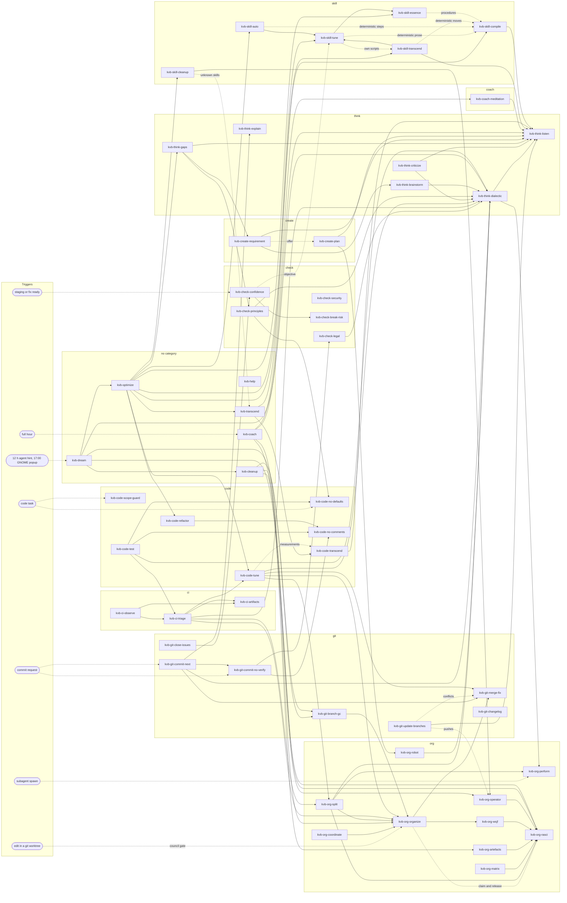

# skills 🧠

[](https://github.com/sponsors/kevinveenbirkenbach) [](https://www.patreon.com/c/kevinveenbirkenbach) [](https://buymeacoffee.com/kevinveenbirkenbach) [](https://s.veen.world/paypaldonate)

The agent skill collection of Kevin Veen-Birkenbach.
Every skill is pinned in `skills-lock.json` for reproducible installs.
First-party skills live under `skills/` and are layered on top of the locked ones at install time.
Compatible with Claude Code, Codex, Gemini CLI, Cursor, Copilot, Windsurf, Cline, and other agents.

## Naming 🏷️

Every first-party skill is named `kvb-<category>-<name>` with one of these categories: `think`, `create`, `code`, `ci`, `git`, `check`, `org`, `skill`, `coach`. Only `kvb-cleanup`, `kvb-coach`, `kvb-help` and the collectors `kvb-dream`, `kvb-optimize` and `kvb-transcend` stand without a category. Names use `a-z`, `0-9` and single hyphens, at most 64 characters, and equal their directory name. `tests/test_naming.py` enforces all of it, including that the organigram below lists every skill under its category.

## Organigram 🏛️

Every first-party skill under its category.

```mermaid
flowchart LR
  kvb((kvb))
  kvb --> think[think]
  kvb --> create[create]
  kvb --> code[code]
  kvb --> ci[ci]
  kvb --> git[git]
  kvb --> check[check]
  kvb --> org[org]
  kvb --> skill[skill]
  kvb --> coach[coach]
  kvb --> none[no category]
  think --> think_listen[kvb-think-listen]
  think --> think_explain[kvb-think-explain]
  think --> think_dialectic[kvb-think-dialectic]
  think --> think_criticize[kvb-think-criticize]
  think --> think_brainstorm[kvb-think-brainstorm]
  think --> think_gaps[kvb-think-gaps]
  create --> create_plan[kvb-create-plan]
  create --> create_requirement[kvb-create-requirement]
  code --> code_scope_guard[kvb-code-scope-guard]
  code --> code_no_defaults[kvb-code-no-defaults]
  code --> code_no_comments[kvb-code-no-comments]
  code --> code_refactor[kvb-code-refactor]
  code --> code_test[kvb-code-test]
  code --> code_tune[kvb-code-tune]
  code --> code_transcend[kvb-code-transcend]
  ci --> ci_triage[kvb-ci-triage]
  ci --> ci_artifacts[kvb-ci-artifacts]
  ci --> ci_observe[kvb-ci-observe]
  git --> git_commit_next[kvb-git-commit-next]
  git --> git_commit_no_verify[kvb-git-commit-no-verify]
  git --> git_merge_fix[kvb-git-merge-fix]
  git --> git_close_issues[kvb-git-close-issues]
  git --> git_update_branches[kvb-git-update-branches]
  git --> git_branch_gc[kvb-git-branch-gc]
  git --> git_changelog[kvb-git-changelog]
  check --> check_legal[kvb-check-legal]
  check --> check_security[kvb-check-security]
  check --> check_principles[kvb-check-principles]
  check --> check_confidence[kvb-check-confidence]
  check --> check_break_risk[kvb-check-break-risk]
  org --> org_organize[kvb-org-organize]
  org --> org_split[kvb-org-split]
  org --> org_coordinate[kvb-org-coordinate]
  org --> org_perform[kvb-org-perform]
  org --> org_matrix[kvb-org-matrix]
  org --> org_rasci[kvb-org-rasci]
  org --> org_artefacts[kvb-org-artefacts]
  org --> org_wsjf[kvb-org-wsjf]
  org --> org_robot[kvb-org-robot]
  org --> org_operator[kvb-org-operator]
  skill --> skill_tune[kvb-skill-tune]
  skill --> skill_auto[kvb-skill-auto]
  skill --> skill_essence[kvb-skill-essence]
  skill --> skill_transcend[kvb-skill-transcend]
  skill --> skill_compile[kvb-skill-compile]
  skill --> skill_cleanup[kvb-skill-cleanup]
  none --> cleanup[kvb-cleanup]
  none --> help[kvb-help]
  none --> transcend_all[kvb-transcend]
  none --> dream_all[kvb-dream]
  none --> optimize_all[kvb-optimize]
  none --> coach_all[kvb-coach]
  coach --> coach_meditation[kvb-coach-meditation]
```



## Skill map 🗺️

How the first-party skills work together. A solid arrow means the skill invokes or relies on the other one; a dotted arrow means it fires automatically. Every skill that reports a result closes with the `kvb-check-confidence` block; those arrows are left out. The locked third-party skills (caveman, ponytail, archify) are not drawn.



## Requirements 📦

- Node.js (provides `npx skills`).
- `jq` (only required for `make update`).

## Installation 🚀

Install the skills globally into your home (`~/.agents/skills` and `~/.claude/skills`):

```bash
make install
```

Copy the skills into a specific project (`<repo>/.agents/skills` and `<repo>/.claude/skills`):

```bash
make project TARGET=/path/to/repo
```

Both commands also patch the target's `.claude/settings.local.json` — the machine-local, untracked file, so a project's reviewed `.claude/settings.json` is never rewritten by an install: the caveman and ponytail plugins are enabled so their modes auto-activate on session start, and two reminder hooks are registered — `kvb-dream` points each agent at `/kvb-dream` at most once every twelve hours (stamped per session in `~/.claude/.dream-stamps/`), and `kvb-coach` runs its short form at the first prompt of every full hour, once across all agents (stamped in `~/.claude/.coach-hours/`); the global install also enables the `kvb-dream-notify.timer` systemd user timer, which recommends `/kvb-dream` in a GNOME notification daily at 17:00 local time and catches up once after a missed run. A PreToolUse gate from the `kvb-org-organize` skill blocks edits to files in a git worktree until the session holds a claim (`skills/kvb-org-organize/scripts/council.py`), and its resource watch (`skills/kvb-org-organize/scripts/watch.py`) measures disk, Docker and caches, cleans up low-risk data and blocks new heavy jobs before the disk runs out; it stays inactive until `~/.config/agents-council/config.json` exists. Two hooks of the `kvb-org-perform` skill (`skills/kvb-org-perform/scripts/log.py`) log every Agent spawn with its task class, model and effort, and store the quality feedback a sandboxed session prints, in `~/.local/state/agents-council/subagent-model.jsonl`. Existing settings are preserved.

Restart your agent afterwards so it loads the new skills.

## Maintenance 🔧

Refresh every skill to its latest version and rewrite `skills-lock.json`:

```bash
make update
```

Validate `skills-lock.json` and shellcheck the scripts (also run by CI on every push and after every update):

```bash
make test
```

## Related Tools 🧰

This collection is part of a wider toolset for managing IT and infrastructure:

- [alias](https://github.com/kevinveenbirkenbach/alias) — shell aliases for common commands.
- [package-manager](https://github.com/kevinveenbirkenbach/package-manager) — `pkgmgr`, a single command to install and manage these repositories.
- [infinito-nexus](https://github.com/kevinveenbirkenbach/infinito-nexus) — automation platform for self-hosted infrastructure.

## License 📜

MIT License, Copyright (c) 2026 Kevin Veen-Birkenbach.

## Author 👤

Kevin Veen-Birkenbach [kevin@veen.world](mailto:kevin@veen.world)

## Thanks 🙏

Thanks to the [#ai:infinito.nexus](https://matrix.to/#/%23ai:infinito.nexus) community, and especially to [Paulinhx](https://github.com/Paulinhx) for the inspiration.

## Donation ❤️

If these tools help you, consider supporting their development:

- [GitHub Sponsors](https://github.com/sponsors/kevinveenbirkenbach)
- [Patreon](https://www.patreon.com/c/kevinveenbirkenbach)
- [Buy Me a Coffee](https://buymeacoffee.com/kevinveenbirkenbach)
- [PayPal](https://s.veen.world/paypaldonate)
- Bitcoin: [bc1qle7j8m9kvny2h2q3jzsnc64s4f5zme5re23pzc2lc2d7hhasc4dqachflp](bitcoin:bc1qle7j8m9kvny2h2q3jzsnc64s4f5zme5re23pzc2lc2d7hhasc4dqachflp?message=%E2%9D%A4%EF%B8%8F%20Help%20Build%20the%20Future%20-%20Donation%20to%20Kevin%20Veen-Birkenbach.)
