# 001 - Agent Orchestrator

## User Story

As the operator of many parallel agents, I want one simple Agent Orchestrator
surface and a radio that only interrupts for urgent calls, so that agents
spend few tokens on talk, urgent news reaches them at once, and I can drill
from three views down to any agent, branch or artefact.

## Decisions (operator-confirmed 2026-11-06; do not re-litigate)

1. **One document**: radio model, surface, pkgmgr branch tree and views live in
   this one requirement as phases. Rejected: one document per feature (the
   operator wants the whole picture in one place).
2. **Location**: `docs/requirements/NNN-slug.md`, numbered per repository.
   Rejected: a file next to the code (no index, no numbering).
3. **Radio classes**: `post`, `call`, `newsletter`, `broadcast`, `mayday`,
   `pan-pan`, `security`. Rejected: `broadcast` only as the umbrella of the
   three alarms (the operator wants an immediate call to all without alarm).
4. **Mailbox**: `post` (one agent) and `newsletter` (all agents) are
   delivered only when the agent ends its turn and goes idle, batched; an
   agent already idle is not woken and sees its mailbox at the end of its next
   turn. Rejected: next prompt, next tool step (interrupts work), batched
   wake-ups (one turn per wake).
5. **Immediate classes**: `call`, `broadcast`, `pan-pan`, `mayday` and
   `security` reach the agent at its next tool step and wake an idle agent.
6. **Call receipt**: the caller gets a delivered/read receipt and does not
   wait; an answer is a call of its own. Rejected: the caller blocks until
   the answer (costs the caller), delivery without feedback.
7. **Mayday pause**: while a mayday holds, a PreToolUse hook blocks every
   writing action until `radio.py clear`; reading, the radio and teardown
   stay allowed. The sender and every agent that joins with `radio.py
   assist` to help keep working. Rejected: an instruction only (not
   enforced), heavy jobs only (today's behaviour, too weak), a full blockade
   that also stops the helpers.
8. **Radio and post**: two channels. `radio.py send` is the radio and always
   immediate (`call`, `broadcast`, `pan-pan`, `mayday`, `security`);
   `radio.py post` is mail and always delayed (`post` with `--to`,
   `newsletter` without). `send direct` stays as an alias so running peers
   keep working: with `--wake` it becomes `call`, without it `post`. Rows
   stored before the change carry no version mark and are read as before:
   `direct` as `post`, `broadcast` as `newsletter`. Rejected: `send
   broadcast` as an alias of `newsletter` (makes the immediate broadcast
   unreachable).
9. **Name**: kvb-hub is renamed in full, with a one-time migration: visible
   "Agent Orchestrator", technical `kvb-orchestrator` / `kvb_orchestrator`
   (directory, module, container, systemd unit, MCP server, environment
   `KVB_ORCHESTRATOR_*`, make targets). Rejected: visible name only (two names
   for one thing).
10. **Navigation**: Stream (sub-items Inbox and Regeln) · Agents (ex Graph) ·
    Artifacts (ex Tree). Agents and Artifacts each offer Orbit, Chord,
    Swimlane, Tree and 3D.
11. **Header**: title · ⌘K · ⚙ only. The status pills become navigation
    badges (Inbox: waiting items, Agents: active agents, Artifacts: runner
    jobs); Mayday shows only as a red banner with "aufheben" while active; the
    background shows day and night. Rejected: one status dot with a popover
    (an extra click), a status block in a side bar, a "Lage" screen (effort),
    no header at all.
12. **Tools**: Steuerung (Funk an alle, Mayday aufheben, Priorität, Tag/Nacht)
    moves to the Agents toolbar, Regeln under Inbox, Himmel, Musik,
    Leitstand and Benachrichtigungen to ⚙ "Ambiente"; ⌘K reaches every one.
    Rejected: one ⋯ menu (hides instead of ordering).
13. **Stream**: four category chips Für dich · Funk · Arbeit · Transkripte;
    one search line with `agent:`, `art:`, `seit:`; sub-filters, saved views
    and a custom range under "Filter ▾"; the time bar becomes "24 h ▾" with
    the replay inside; transcripts are off by default. Rejected: a
    self-grouping stream, a Kibana-like query language (effort), preset
    chips only.
14. **3D**: `3d-force-graph` 1.80.1 on `three` 0.186.1, vendored as in
    meta.infinito.nexus; the Canvas depth axes Zeit and Spawn-Tiefe become 3D
    options. Rejected: keeping the Orbit-only Canvas depth.
15. **Artifacts scope**: git (repositories → branches → worktrees with their
    agents and reviews) plus the kvb-org-rasci register artefacts (images,
    volumes, logs) as leaves of the task or worktree that owns them.
    Rejected: git only.
16. **Artifacts views**: Orbit: repository sun, branch planets (size = commits
    ahead), worktree moons, agent satellites. Chord: branch overlap (same
    files touched, merges) as conflict risk. Swimlane: one lane per branch
    with commits, reviews, gates and pushes. Tree: the pkgmgr branch tree.
17. **Tree data**: the scan moves from `hub/kvb_hub/tree.py` into pkgmgr as
    `pkgmgr branch tree --format json|yaml --output FILE`, rewritten by a
    systemd user timer every minute and after every pkgmgr branch action; the
    orchestrator only reads the file, no git runs in its container. Rejected:
    the hub keeps scanning (pkgmgr is not the single source, git runs in the
    container), a live websocket daemon (effort). Hardened through
    kvb-think-dialectic before it is built.
18. **Order**: 1 radio → 2 surface and rename → 3 pkgmgr branch tree → 4 views
    and 3D; one bundle per phase, each change set through kvb-code-refactor.
19. **Icons over text**: every HTML surface a skill renders (the
    orchestrator, the review pages, the meditation page) shows Bootstrap
    Icons instead of text labels wherever an icon carries the meaning, each
    with a tooltip and an `aria-label`; terminal output and `SKILL.md` keep
    emoji. Rejected: Font Awesome Free (icons under CC BY 4.0, core loads it
    from a kit CDN), emoji in HTML (look differs per platform).
20. **Branch state**: `pkgmgr branch tree` covers every repository pkgmgr
    manages and gives each branch and worktree the classification of
    `pkgmgr branch gc` (one implementation, no second copy): merged and by
    what, clean or uncommitted changes, unpushed commits, gone upstream,
    locked, stale, protected and the gc skip reason. The Artifacts Tree shows
    it as icons. Phase 3 builds the data, phase 4 the icons.
21. **Delete from the tree**: merged, orphaned branches are deleted by click
    in the Artifacts Tree (phase 4), per item and as "Alle gemergten
    löschen":
    - **Credentials**: only while the Secret Service hands pkgmgr the GitHub
      token, which proves the merge and the missing open pull request; no
      secret passes the orchestrator container. Rejected: the master password
      typed into the dialog (secret crosses container and browser), the SSH
      key through the KeePassXC agent (a local delete pushes nothing;
      operator 2026-11-06).
    - **Scope**: local only (operator 2026-11-06): the worktree, the local
      branch, the compose stack without its volumes and its images of a
      `merged-clean` item, never a remote branch; a gc skip reason locks the
      button, and the dry run lists ignored files, any beyond known caches
      (`__pycache__`, `node_modules`, `.venv`) locking it too. Rejected: what
      `pkgmgr branch gc --apply` deletes today (remote branch and
      `compose down -v`).
    - **Confirmation**: the click shows the gc dry-run lines of the chosen
      items, and "Löschen" needs the operator signature (`/api/sign`).
      Rejected: a second click without signature, one click without preview.
    - **Execution**: the orchestrator writes a signed job into a host
      directory; a systemd user path unit runs `pkgmgr branch gc --apply` for
      exactly those items and writes the result back. Rejected: an
      `operator.py` row (not direct).
22. **Organisation update**: a new skill `kvb-org-update` tells every agent
    and client which skills changed and how to use them, as one
    `newsletter` per update; phase 1 announces the radio change through it.

## Approach

```mermaid
flowchart TD
    subgraph P["🧭 0 · Preparation"]
        P1["📋 Write requirement"] --> P2{"✅ Operator approves?"}
        P2 -- "✏️ corrections" --> P1
    end
    P2 -- "🤖 yes" --> R1
    subgraph R["📻 1 · Radio model"]
        R1["🔴 Red tests: classes, mailbox, receipt, mayday block"] --> R2["🛠️ radio.py, Stop mailbox hook, PreToolUse mayday hook, SKILL.md"]
        R2 --> R3{"🧪 Tests and make test green?"}
        R3 -- "🔴 no: fix" --> R2
        R3 -- "🟢 yes" --> R4["🧹 kvb-code-refactor"]
        R4 --> RF{"💬 Operator feedback?"}
        RF -- "✏️ changes" --> R2
    end
    RF -- "👍 commit word" --> S0
    subgraph S["🧭 2 · Surface and rename"]
        S0["🔀 Rebase feature/kvb-hub onto origin/master"] --> S1["🔴 Red tests: nav, header, badges, stream, migration"]
        S1 --> S2["🛠️ Nav, header, badges, banner, stream, inbox, tools, rename + migration"]
        S2 --> S3{"🧪 Tests green?"}
        S3 -- "🔴 no: fix" --> S2
        S3 -- "🟢 yes" --> S4["📸 Screenshots 1920 / 1366 / 390 px"]
        S4 --> SF{"💬 Operator feedback?"}
        SF -- "✏️ changes" --> S2
    end
    SF -- "👍 commit word" --> T0
    subgraph T["🌳 3 · pkgmgr branch tree"]
        T0["⚖️ kvb-think-dialectic on the data path"] --> T1["🔴 Red tests on fixture repositories"]
        T1 --> T2["🛠️ pkgmgr branch tree with gc states, timer, orchestrator reads the file"]
        T2 --> T3{"🧪 Tests green, no git in the container?"}
        T3 -- "🔴 no: fix" --> T2
        T3 -- "🟢 yes" --> TF{"💬 Operator feedback?"}
        TF -- "✏️ changes" --> T2
    end
    TF -- "👍 commit word" --> V1
    subgraph V["🪐 4 · Agents and Artifacts views"]
        V1["🔴 Red tests: five views per tab, artefact leaves, delete job"] --> V2["🛠️ Orbit, Chord, Swimlane, Tree with state icons and delete, 3D (3d-force-graph), host gc unit"]
        V2 --> V3{"🧪 Tests green?"}
        V3 -- "🔴 no: fix" --> V2
        V3 -- "🟢 yes" --> V4["📸 Screenshots of every view"]
        V4 --> VF{"💬 Operator feedback?"}
        VF -- "✏️ changes" --> V2
    end
    VF -- "👍 fits" --> D1["🏁 Full gate, commit with operator OK, push hand-over"]
```

## Acceptance Criteria

### Radio model

- [ ] `radio.py send` accepts exactly `call`, `broadcast`, `pan-pan`,
      `mayday`, `security` and the alias `direct`; `post`, `newsletter` and
      any other class exit 2.
- [ ] `radio.py post --to X` stores `post`; `radio.py post` without `--to`
      stores `newsletter`.
- [ ] `call` and `send direct` require `--to`; `broadcast`, `pan-pan`,
      `mayday` and `security` exit 2 with `--to`.
- [ ] `send direct --wake` is stored as `call`, `send direct` as `post`.
- [ ] New rows carry a version mark; rows without it are read as before:
      `direct` as `post` (as `call` when it woke), `broadcast` as
      `newsletter`.
- [ ] The UserPromptSubmit hook (`radio.py hook`) and the PostToolBatch hook
      (`radio.py tool`) never print a `post` or `newsletter` row.
- [ ] A new Stop hook `radio.py mailbox`, registered in
      `scripts/enable-plugins.js`, prints the unseen `post` and `newsletter`
      rows of the session at most 10 at a time with a "N more" line, marks
      them seen and exits 2; with nothing unseen it exits 0 and prints
      nothing.
- [ ] `radio.py listen` wakes an idle session only for `call`, `broadcast`,
      `pan-pan`, `mayday` and `security`, never for `post` or `newsletter`.
- [ ] `radio.py tool` delivers `call` (to its addressee), `broadcast`,
      `pan-pan`, `mayday` and `security` at the next tool step.
- [ ] When a call reaches the callee's context, a receipt row (callee, call
      time, read time) is stored; the caller's mailbox shows
      "CALL <to> read <time>". The receipt never wakes the caller.
- [ ] While `radio-silence.json` holds an active mayday, a PreToolUse hook
      (matcher `Edit|Write|MultiEdit|NotebookEdit|Bash`) exits 2 for Edit,
      Write, MultiEdit and NotebookEdit and for every Bash command that
      matches neither the config's `never_block` nor its new `mayday_allow`
      regexes nor a plain call of `radio.py`.
- [ ] The mayday's sender passes; `radio.py assist` adds the caller to the
      mayday's helpers, who pass too, and the mayday line names them.
- [ ] After `radio.py clear` the same calls pass again.
- [ ] `skills/kvb-org-radio/SKILL.md` separates the radio (`send`,
      immediate) and the post (`post`, delayed), each class with when to use
      it and how it is delivered; post is the default; markdownlint stays
      green.

### Organisation update

- [ ] A skill `kvb-org-update` with `scripts/update.py` exists.
- [ ] `update.py --repo <skills repo> --dry-run` prints every skill whose
      files changed between the last announced revision (kept in the council
      directory) and `HEAD`, with the subjects of the commits that touched it.
- [ ] Without `--dry-run` it sends one `newsletter` through `radio.py post`
      that names each changed skill and tells every agent to re-read its
      `SKILL.md` before the next use, then records `HEAD` as announced; a
      second run without new commits sends nothing.
- [ ] The radio change of phase 1 is announced through it.

### Orchestrator surface and rename

- [ ] The page title and heading read "Agent Orchestrator".
- [ ] `grep -rnE 'kvb-hub|kvb_hub|KVB_HUB'` over the repository finds only the
      migration code and its tests.
- [ ] The install migrates `~/.local/share/kvb-hub`, `~/.config/kvb-hub`,
      `~/.local/state/kvb-hub-approvals`, the `kvb-hub` MCP registration, the
      settings hook entries, the systemd unit and the container to the
      `kvb-orchestrator` names. A second run changes nothing (scratch-HOME
      test).
- [ ] The navigation has exactly three top-level entries Stream, Agents and
      Artifacts; Stream has the sub-items Inbox and Regeln.
- [ ] Every agent appears once under its current name: a register worker
      such as "Stage (this session)" or "infinito-nexus-core-c8 (Production)"
      maps to the agent named before the bracket.
- [ ] The keys 1 to 3 switch the top-level entries.
- [ ] The hashes `#stream`, `#stream/inbox`, `#stream/rules`,
      `#agents/<view>` and `#artifacts/<view>` route; `#graph…` and `#tree`
      redirect to their successors.
- [ ] Agents and Artifacts show a switch with Orbit, Chord, Swimlane, Tree and
      3D in this order, and each view has its own hash.
- [ ] The header holds exactly the title, the ⌘K button and the ⚙ button.
- [ ] Badges:
  - [ ] Inbox shows the waiting items that are not snoozed.
  - [ ] Agents shows the agents with a heartbeat in the last 900 s.
  - [ ] Artifacts shows the runner jobs that are queued or running.
  - [ ] A badge at 0 is hidden.
- [ ] A red Mayday banner with "aufheben" exists if and only if a mayday is
      active; "aufheben" runs `radio.py clear`.
- [ ] The Agents toolbar holds:
  - [ ] Funk an alle, with the class choice Newsletter, Broadcast, Pan-Pan,
        Security, Mayday and Newsletter preselected.
  - [ ] Mayday aufheben, Priorität and Tag/Nacht.
- [ ] The agent panel sends with the choice Post (preselected) or Call.
- [ ] ⚙ "Ambiente" holds Himmel, Musik, Leitstand and Benachrichtigungen;
      ⌘K lists every former header tool.
- [ ] The Stream shows exactly four category chips Für dich, Funk, Arbeit and
      Transkripte, and one search line that filters by `agent:`, `art:` and
      `seit:`.
- [ ] "Filter ▾" holds the kind sub-filters, the transcript parts, the saved
      views and the custom range.
- [ ] The time control reads "24 h ▾" and holds the replay.
- [ ] Transcripts are off by default.
- [ ] The Inbox renders in the main area under `#stream/inbox`; the right
      rail `#rail` no longer exists, at any width.
- [ ] The read-aloud class choice lists exactly the seven classes of
      decision 3; Mayday stays checked and locked.

### pkgmgr branch tree

- [ ] The kvb-think-dialectic result on the data path is recorded in the
      phase 3 commit body before any code of phase 3 is written.
- [ ] `pkgmgr branch tree --format json` prints, for every repository pkgmgr
      knows and every worktree under `<repo>/.worktrees` and
      `~/.local/share/worktrees`, these fields:
  - [ ] the repository's path, remote and default branch;
  - [ ] per branch: upstream, ahead, behind and gone;
  - [ ] per worktree: path, HEAD and its state, one of `clean`, `changed` or
        `missing`;
  - [ ] detached worktrees, and `generated_at`.
- [ ] It lists every repository `pkgmgr list` names, also one without extra
      branches or worktrees.
- [ ] Per branch and worktree it carries the gc state (`merged-clean`,
      `unmerged`, `dirty`, `protected`, `stale`), what merged it (ancestor,
      `pr#N`, `line:X`), the counts of staged, unstaged and untracked files,
      ahead, behind, gone, locked and the gc skip reason.
- [ ] Tree and gc share one classification function; on a fixture
      `pkgmgr branch tree --format json` and `pkgmgr branch gc --json` agree
      on every item's state.
- [ ] Forge facts (open and merged pull requests) are fetched at most once
      per 10 min per repository, only with a token from the Secret Service;
      without one the file says `forge: unavailable` and "merged by" falls
      back to ancestor and line.
- [ ] `delete_ready` is true only while the token resolves through the
      Secret Service, which the scan never unlocks; otherwise it is false
      with the reason.
- [ ] `--format yaml` prints the same data.
- [ ] `--output FILE` writes it atomically.
- [ ] The scan starts no hook, filter, fsmonitor, pager or external diff of a
      scanned repository and never lazy-fetches (fixture test with a planted
      `core.fsmonitor`).
- [ ] `pkgmgr branch open|close|drop|gc` rewrite the file when it exists.
- [ ] The orchestrator install enables a systemd user timer that writes it
      every 60 s while the page polled within the last 5 min, with pkgmgr
      built from the newest signed tag.
- [ ] The orchestrator mounts the file read-only and reads only it.
- [ ] `orchestrator/kvb_orchestrator/tree.py`'s git scan is gone and no
      module of the orchestrator starts `git`.

### Agents and Artifacts views

- [ ] Artifacts:
  - [ ] Orbit, Chord, Swimlane and Tree draw what decision 16 names, from the
        pkgmgr tree file.
  - [ ] Register artefacts (images, volumes, logs) appear as leaves of their
        task or worktree.
- [ ] Agents:
  - [ ] Orbit, Chord and Swimlane keep today's content.
  - [ ] Tree shows the operator → chair → sessions → subagents spawn tree
        with running and finished states.
- [ ] 3D in both tabs runs on the vendored `3d-force-graph` 1.80.1 and
      `three` 0.186.1, with their MIT licence texts beside them and no CDN
      request (CSP unchanged).
- [ ] 3D offers the layouts Kraft, Zeit and Spawn-Tiefe.
- [ ] A click on a 3D node opens the same panel as in 2D.
- [ ] 3D respects `prefers-reduced-motion`.

### Delete merged branches

- [ ] The Artifacts Tree marks every branch and worktree with icons for
      merged (with what merged it), clean, uncommitted changes (with counts),
      unpushed commits, gone upstream, locked, stale and protected.
- [ ] A `merged-clean` item without a gc skip reason shows a delete button,
      and the Tree header shows "Alle gemergten löschen"; both are disabled,
      with the reason as tooltip, while `delete_ready` is false.
- [ ] A click shows the gc dry-run lines of exactly the chosen items;
      "Löschen" requires the operator signature through `/api/sign`.
- [ ] The orchestrator writes the signed job (repository, branch, worktree
      and tip sha per item, no command) into a host-mounted job directory and
      holds no git, token or key.
- [ ] A systemd user path unit verifies the signature on the host and runs
      `pkgmgr branch gc --apply --local` for exactly the signed items, matched
      exactly, never as a pattern; `--local` removes the worktree, the local
      branch, the compose stack without `-v` and its images, never a remote
      branch, and needs no SSH key.
- [ ] The unit refuses, and changes nothing for, an item whose tip or state
      differs from the signed one, an unknown repository, a non-`merged-clean`
      item and a job with a bad or missing signature, and reports why.
- [ ] The unit writes each item's result back and rewrites the tree file; the
      Tree shows the result.

### Icons

- [ ] Bootstrap Icons 1.13.1 is vendored once as an SVG sprite with its MIT
      licence text beside it; no page loads it from a CDN.
- [ ] The navigation, the header, the view switches, the toolbars, the
      Stream chips and the Inbox actions of the orchestrator show icons
      instead of text labels.
- [ ] The review pages and the meditation page show icons instead of text
      labels on their buttons.
- [ ] Every icon element has a `title` and an `aria-label` that carry the
      former text (DOM test over every page).

### Tests

- **Unit**
  - [ ] Radio: class mapping, `--to` rules, the mailbox Stop hook, the
        receipt and the mayday block hook, each red before and green after.
  - [ ] Organisation update on a fixture repository: changed skills with
        their subjects, nothing new sends nothing.
  - [ ] pkgmgr branch tree on fixture repositories: ahead, behind, gone,
        detached and missing worktree, JSON and YAML, the planted fsmonitor,
        staged, unstaged and untracked counts, tree and gc states agreeing.
  - [ ] Delete job: a bad signature, a changed tip, a non-`merged-clean`
        item and a branch name with pattern characters are each refused.
  - [ ] Orchestrator: the scratch-HOME migration, routing including old
        hashes, badge counts.
- **Integration**
  - [ ] Two scratch sessions exchange `post` and `call` through the real hook
        entry points (JSON on stdin): the post appears only on the callee's
        Stop and the call at its next tool step with a receipt to the caller.
  - [ ] A mayday blocks an Edit until `clear`.
  - [ ] The orchestrator's `/api/tree` serves a pkgmgr-written file.
  - [ ] On a fixture repository with a file remote and a test token source, a
        signed job through the path unit removes the merged worktree, the
        local and the remote branch, and the rewritten tree no longer lists
        them.
  - [ ] `make test` green on the commit of each phase.
- **E2E**
  - [ ] A headless Chromium and Firefox run opens Stream, Inbox, Regeln and
        every view of Agents and Artifacts at 1920, 1366 and 390 px wide and
        saves the screenshots shown at each operator checkpoint.
  - [ ] It sends a Call from the agent panel and sees its receipt in the
        Stream.
  - [ ] On fixture data it shows the state icons in the Artifacts Tree and
        runs the delete flow: dry-run dialog, signature, result.
