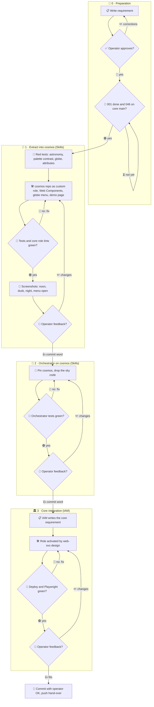

# 002 - Cosmos

## User Story

As the operator and the designer, I want the orchestrator's sky as one
reusable component behind a small live globe, so that the
orchestrator and every Infinito.Nexus web app can show the same calm
background without carrying its code twice.

## Decisions (operator-confirmed 2026-11-06; do not re-litigate)

1. **Scope**: everything of the orchestrator's background moves: the sky (sun,
   moon, stars, twilight stages, day and night palettes with contrast check),
   the generated meditative music and the orbit and 3D scene. The radio
   streams with their schedule stay in the orchestrator. Rejected: the sky
   only.
2. **Repository**: `github.com/kevinveenbirkenbach/cosmos`, not managed by
   pkgmgr, laid out as an Infinito.Nexus custom role `web-app-cst-cosmos` that
   core pulls from its inventory-declared source. Rejected: the infinito-nexus
   organisation, a pkgmgr-managed release.
3. **Form**: Web Components (`<cosmos-ambience>` for sky and music,
   `<cosmos-graph>` for the 3D scene) that also set `--cosmos-*` CSS custom
   properties every design can follow; a "colors only" mode draws nothing.
   Rejected: a plain ES module.
4. **Globe menu**: a small globe logo turns with the Earth's real rotation and
   shows the current Earth with its live day and night line; a click on it
   reveals every control, nothing else is visible while it is closed.
   Rejected: a visibly spinning globe (not the real orientation).
5. **Licence**: MIT, like the skills repository it comes from. Rejected: the
   Infinito.Nexus Community License (non-commercial, limits reuse).
6. **Work split**: Skills extracts the code into cosmos and switches the
   orchestrator to a pinned cosmos version; the IAM agent builds the core
   integration: a role that the design service `web-svc-design` activates.
   Rejected: IAM doing everything.
7. **Timing**: implemented after requirement 001; the core part also needs
   core's custom roles (requirement 046) on core main. Rejected: starting now.
8. **Icons**: the controls use Bootstrap Icons per decision 19 of
   requirement 001.
9. **Scope revision (operator-confirmed 2026-11-12)**: cosmos takes the sky
   only. The orchestrator keeps its generated music and its orbit and 3D
   scene; no `<cosmos-graph>` exists, and the cosmos requirement forbids any
   cosmos file drawing the agent graph. The orchestrator vendors the file
   set the cosmos repository ships (`cosmos.js`, `LICENSE`, `NOTICE.md`).
   This replaces the music, orbit and 3D parts of decisions 1 and 3.
   Rejected: removing the music, moving the 3D views.

## Approach

## Acceptance Criteria

### Repository

- [ ] `github.com/kevinveenbirkenbach/cosmos` holds an MIT `LICENSE`.
- [ ] `pkgmgr list` does not list cosmos.
- [ ] The repository is a role named `web-app-cst-cosmos`: `README.md`,
      `meta/` (main, info, services, license), `tasks/main.yml`, and the
      components under `files/`.
- [ ] An inventory group `web-app-cst-cosmos` with `custom: true` and a
      pinned source makes core's `make roles-pull` place it.
- [ ] Every core role lint passes on the placed role.

### Components

- [ ] `<cosmos-ambience>` takes `latitude`, `longitude` and `mode`
      (`full` or `colors`), and follows `prefers-reduced-motion`.
- [ ] It sets `--cosmos-sky-top`, `--cosmos-sky-bottom`, `--cosmos-stage` and
      `--cosmos-text` and updates them at least once a minute.
- [ ] Text against sky keeps a contrast of at least 4.5:1 at every minute of a
      day at 0° N 0° W and at 52.5° N 13.4° E (unit test).
- [ ] Sun and moon positions match published reference values within 1° for
      at least six fixed dates (unit test).
- [ ] No cosmos file draws the agent graph, plays music or holds radio
      stream code.

### Globe menu

- [ ] A globe of at most 48 px shows a public-domain Earth texture with the
      live day and night line, turned to the Earth's current rotation.
- [ ] A click, Enter or Space opens the control panel and Esc closes it.
- [ ] While the panel is closed only the globe is visible.
- [ ] Every control is a Bootstrap Icon with `title` and `aria-label`.

### Orchestrator

- [ ] The orchestrator vendors a pinned cosmos tag and loads it under its
      nonce CSP.
- [ ] The sky code is gone from the orchestrator; its generated music and
      its radio-stream schedule stay.

### Core (IAM)

- [ ] IAM writes the core requirement for the integration.
- [ ] With `web-svc-design` activating cosmos, a designed web app shows the
      cosmos background behind its content with the globe.
- [ ] With it off, the app loads no cosmos file.

### Tests

- **Unit**
  - [ ] Astronomy against reference values.
  - [ ] Palette contrast over a day.
  - [ ] Attribute parsing.
  - [ ] Globe orientation at fixed times.
- **Integration**
  - [ ] Core's `make roles-pull` places cosmos and its role lints pass.
  - [ ] The orchestrator serves the pinned cosmos under its CSP.
- **E2E**
  - [ ] Headless Chromium and Firefox open the cosmos demo page and the
        orchestrator at noon, dusk and night with the menu closed and open,
        and save the screenshots.
  - [ ] One designed core app is opened with cosmos on and off.
