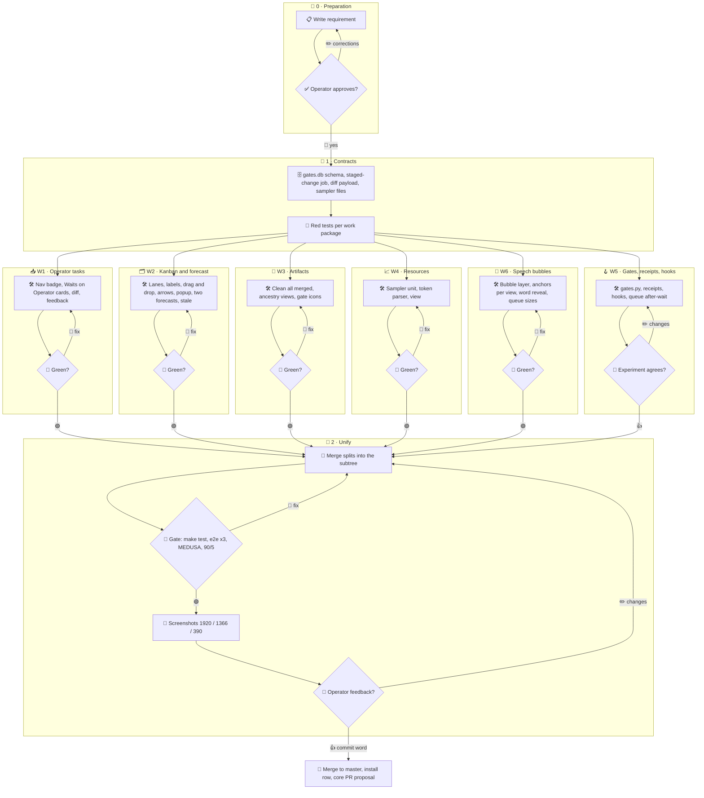

# 003 - Operator Workbench

## User Story

As the operator of many parallel agents, I want to handle every open task,
review, plan, branch gate and resource figure from one simple, interactive
Agent Orchestrator, and agents that commit through fast deterministic hooks
instead of skipping them, so that I steer the work by drag and drop, see what
changed and what it costs, and a gate means something again.

## Decisions (operator-confirmed 2026-11-11; do not re-litigate)

1. **One document**: the whole package lives here as work packages W1 to W6.
   Rejected: one document per feature.
2. **Operator tasks next to Tasks**: the Inbox entry leaves the top navigation
   and the Stream; the Tasks entry carries the count of open operator tasks;
   the Tasks filter "Waits on Operator" shows them as Stream cards with
   checkboxes and the bulk bar. The Stream keeps its operator cards with their
   actions. Rejected: a separate Operator tab, a Stream without operator rows.
3. **Diff preview**: every review card shows its diff expanded; the requesting
   agent's script ships it with the review (the hub reads no git, 001); one
   block per file, a file over 400 changed lines collapsed, 2 MiB cap with the
   rest listed by stat; a file whose old or new content holds an armour
   line or matches a MEDUSA secret rule (every file when no rule loads)
   ships only path, status, mode and counts with the note "content withheld".
   Rejected: the hub reads git.
   Every Ask for a `git commit` shows the staged diff the same way (with
   `-a` or `--all` the diff against HEAD); the permission hook on the host
   attaches it (operator order 2026-11-11).
4. **Inline feedback**: selected lines of a diff or a command go back to the
   agent as one radio `post` with path, line range, quote and text, through
   the right-click menu, the key `f` or a button at the selection.
5. **Kanban**: columns Waiting, Running and Done; Blocked and Stopped become
   labels; `operator/*` rows stay off the board; swimlanes P1, P2, P3, P4+ and
   Unpinned (by WSJF), collapsible; Done older than 24 h hidden by default.
6. **Lines**: solid arrows are `after` dependencies, several into one card; one
   dashed line runs through the cards holding a live queue entry, in queue
   order. Rejected: rank lines per lane, dependencies only.
7. **Drag and drop**: card to column = status, to lane = priority pin, handle
   onto a card = `after`; a click on an arrow removes it; a click on a card
   opens its popup. Moves are staged, shown at once and applied with one
   passkey; each affected agent gets a post. Rejected: a passkey per move, no
   passkey.
8. **Dependencies are enforced**: the queue holds a task until its `after`
   tasks are done, and the rank follows them. Rejected: display only, warning
   only.
9. **Forecast**: two lines in distinct colours, the finish at fixed scope and
   the finish at growing scope (done trend meets scope trend); ∞ when never
   reached. Scope excludes `operator/*`; a task unchanged for 3 days is
   labelled stale and counted apart. Rejected: count everything, only drop
   operator rows.
10. **Clean all merged**: dry run, one passkey, signed job. Local branches
    merged by ancestry and without a remote branch need no token; remote
    branches and squash-merge candidates need the GitHub token, stored through
    an operator row. Rejected: wait for the token, ancestry for remotes.
11. **Ancestry**: Artifacts and Agents get a family tree (generations top down)
    in the slot of today's Tree view. A branch may have several parents;
    parents are recorded at creation (post-checkout hook), older branches are
    derived and marked derived, and the operator corrects them by drag and
    drop. Rejected: derivation only, manual only.
12. **Gates**: a level (none < quick < test < quality-high < e2e) per branch
    and action (commit, merge, push, pr), inherited from all ancestors, the
    strictest wins, an own rule wins over all; kept in the local database
    `~/.local/state/agents-council/gates.db` (the council root lives in the
    tmpfs `/tmp` and loses it at reboot) that agents read through `gates.py`;
    set in every Artifacts view. Rejected: a committed `.gates.yml`, repo plus
    local.
13. **Hooks with receipts**: pre-commit runs only quick checks of the staged
    files (< 30 s); heavy gates run through the queue and on green write a
    receipt (tree sha of the tested content, level, log); commit-msg,
    pre-merge-commit and pre-push only compare the receipt with the resolved
    level (< 1 s). `--no-verify` only on the operator's word for that commit.
    Core's hooks change only in a core PR agreed with Experiment and Main.
    Rejected: heavy gates at pre-push, skills-side checks with `--no-verify`.
14. **Resources**: a host unit samples every 60 s without any LLM call: disks
    per mount, CPU, RAM, swap, load, GPU and VRAM (`nvidia-smi` only while the
    dGPU is awake, else asleep), the queue; tokens per agent and model from
    the transcripts' usage fields. 7 days at 1 min, 90 days at 15 min.
    Replaces 001 S7.
15. **Simplicity**: icons, counts and names instead of text; every action is
    reachable in the GUI.
16. **Delivery**: one subtree `feature/operator-workbench` with split
    worktrees, at most 4 subagents at a time on W1 to W4 and W6, W5 serially
    in the requesting agent with Experiment; one gate (make test, e2e Chromium
    and Firefox at 1920, 1366 and 390 px, MEDUSA, 90/5); master only on the
    operator's word. Rejected: 8 in parallel, serial without subagents.
17. **Speech bubbles**: one toolbar icon switches speech bubbles on in every
    view that shows agents. The agent being read aloud gets the largest
    bubble, its words appear one by one in time with the audio; when it ends
    the bubble fades while the next one grows and is read. Waiting messages
    show a small `…` bubble, the newest smallest, steps in between. Without
    TTS the bubbles run at reading pace. Font: vendored Comic Neue (SIL OFL
    1.1). Rejected: a ticker, the full text with a karaoke mark, bubbles only
    with audio, system fonts only, a switch only in the settings, a caption
    under the speaker only.

## Approach

## Acceptance Criteria

### W1 Operator tasks

- [x] The top navigation has no Inbox entry; the Tasks entry shows the count of
      waiting, unsnoozed operator tasks, hidden at 0.
- [x] The Stream has no inbox button; `#stream/inbox` opens `#tasks/operator`.
- [x] `#tasks/operator` shows each operator task as a Stream card (command,
      directory, reason, run, deny, copy, snooze, pin) with a checkbox; the
      bulk bar acts on the checked cards.
- [x] The Stream keeps its operator cards with their actions.
- [x] The bulk approve counts and approves every checked card, asks, reviews
      and operator commands alike, with one passkey.
- [x] Approving or denying an Ask in the hub also settles the agent's native
      permission dialog where the runtime allows it (the permission hook
      waits for the hub's decision); where it does not, the limit is recorded
      here.
      Limit: Claude Code runs the PermissionRequest hook before it shows its
      own dialog, so a hub decision within the hook's `--timeout` settles the
      ask and no native dialog appears. After the timeout, with the hub down
      or an answer whose signature does not verify, the hook answers nothing
      and Claude Code shows its own dialog, which a later hub decision no
      longer settles. `make orchestrator-hook` installs the hook for Claude
      Code only; other runtimes keep their native prompt and post no ask.
- [x] A review card shows its diff expanded: one unified block per file,
      additions and deletions coloured, a file over 400 changed lines
      collapsed, a binary file named only.
- [x] The review request of `approval.py` (kvb-git-diff) carries
      `git diff --cached` of the exact staged tree; past 2 MiB the rest is
      listed per file with its stat.
- [x] An Ask for a `git commit` carries the staged diff of its working
      directory (with `-a` or `--all` the diff against HEAD), attached by
      `permission_hook.py`, and shows it like a review, feedback included.
- [x] A file whose content holds an armour line or matches MEDUSA's secret
      rules, and every file when no rule loads, is shown by stat with the
      note "content withheld".
- [x] An allow of a commit Ask is bound to the staged tree `git write-tree`
      prints (with `-a` also the working tree); a different tree at approval
      turns it into a deny "staged tree changed since the preview".
- [ ] Selecting lines in a diff or a command and choosing Feedback (right-click
      menu, key `f`, or the button at the selection) posts one radio `post` to
      the requesting agent with path, line range, quote and text; the feedback
      shows under the card.

### W2 Kanban

- [x] Columns Waiting, Running and Done; no Blocked or Stopped column.
- [x] A blocked task carries a red Blocked label, a stopped one a grey Stopped
      label in Done; `operator/*` rows are not on the board.
- [ ] Swimlanes P1, P2, P3, P4+ and Unpinned, collapsible, Unpinned sorted by
      WSJF rank; Done cards older than 24 h hidden until shown.
- [ ] Each `after` dependency is a solid arrow into the dependent card, several
      per card allowed; the cards holding a live queue entry are joined by one
      dashed line in queue order.
- [ ] Dragging a card to a column stages a status, to a lane a pin (P4+ the
      lowest free pin from 4, Unpinned none), its handle onto a card an
      `after`; a click on an arrow stages its removal; every move is also in
      the card's keyboard menu.
- [ ] Staged moves show at once as pending; "Apply n changes" signs them with
      one passkey; the host executor applies them through `rasci.py`, refuses
      a cycle or a `done` with an open key result, and the card shows why.
- [x] Each affected agent receives one post listing the operator's changes to
      its rows that `rasci.py` applied, once the whole signed batch ended.
- [ ] A click on a card opens its detail popup.

### W2 Forecast

- [ ] The burn chart draws, in distinct colours with a legend, the finish at
      fixed scope and the finish at growing scope, each ending at its date; a
      line never reached shows ∞.
- [x] Scope excludes `operator/*`; a task without a register change for 3 days
      carries a Stale label, is counted apart and can be stopped from the
      board.

### W3 Artifacts

- [x] "Clean all merged" shows the gc dry run of every `merged-clean` item; one
      passkey runs the signed job.
- [ ] Without a GitHub token, local branches merged by ancestry into the
      default branch and without a remote branch can be deleted; the others
      show "token needed", and an operator row stores the token.
- [ ] Artifacts and Agents show Ancestry in the Tree slot: generations top
      down, several parents per node; a derived parent edge is dashed.
- [ ] Dragging a branch onto another stages a parent edge, applied with the
      board's passkey batch.
- [ ] Agents' Ancestry shows operator, chair, sessions and subagents.
- [ ] Every Artifacts view shows each branch's effective gate level per action
      as an icon (inherited ones faint, source in the tooltip) and lets the
      operator set a rule, signed.

### W5 Gates, receipts and hooks

- [x] `gates.py` keeps rules, parents and receipts in
      `~/.local/state/agents-council/gates.db`. Amended by Experiment's
      condition 3 below: rules and operator or derived parents live in
      `gates.db`; receipts and the parents the post-checkout hook records are
      written from the sandbox as rows of `gate-receipts.jsonl` and
      `gate-parents.jsonl` in the council root, which the watch hook of
      `kvb-org-organize` keeps in `~/.local/state/agents-council/` beside
      `gates.db`; reads merge both, and a database row for an edge wins.
- [x] `gates.py resolve --repo R --branch B --action A` prints the level and its
      source: the branch's own rule, else the strictest resolved level of all
      ancestors, else none.
- [x] The post-checkout hook records as parents every local branch whose tip
      equals the new branch's start commit; `gates.py parents derive` adds
      derived parents for the others.
- [x] A green queue gate writes a receipt: repo, tree sha of the tested content
      (tracked, staged, unstaged, untracked, via a temporary index), level,
      log, time. It also carries `INFINITO_TEST_GPU` as `gpu`; above quick only
      `false` counts, and a run that changed the tree writes none.
- [x] `gates.py hooks install --repo R` installs pre-commit (quick checks of the
      staged files, under 30 s on this repository), commit-msg,
      pre-merge-commit, pre-push and post-checkout.
- [x] commit-msg, pre-merge-commit and pre-push pass when a receipt for the
      resulting tree meets the resolved level, else refuse with the
      `queue.py hold` command that produces it; each check stays under 1 s.
      For the level quick the command is `gates.py quick`, which starts
      nothing heavy (Main's condition 3). pre-push also needs the remote
      branch's merge level, so a fast-forward or squash merge, which no merge
      hook sees, cannot leave without its receipt; commit-msg warns on a
      squash commit early; a detached HEAD takes the rebased branch, else the
      default branch; `hooks install` changes no git config.
- [x] `queue.py hold` for a task whose `after` tasks are not all done waits with
      `waits for <task>`; the register rank places a task after its `after`
      tasks.
- ~~The commit skills commit through the hooks; `--no-verify` only on the
  operator's word for that commit.~~ Rejected by the operator 2026-11-12:
  agents keep --no-verify, hooks bind humans and CI (Main condition 2,
  Experiment condition 4).
- [x] Experiment's and Main's answer on core's hooks is recorded here; core's
      `.pre-commit-config.yaml` changes only in a core PR.
  - Main (2026-11-12) agrees for the skills repo, four conditions: (1) the
    receipt binds the exact tree id of the commit plus the resolved level; a
    merge or amend without a fresh green gate on that tree fails it. (2)
    Operator rules stay: commits and handed-over pushes run with
    `--no-verify`, so the hooks are a second line, never the only gate check;
    `kvb-git-push` still verifies quality-high on the exact commit, and an
    explicit per-push waiver from the operator stays possible.
    (3) pre-commit quick checks start nothing heavy: no make test, no Docker,
    nothing that belongs in `queue.py hold`. (4) No oracle tests and GPU off
    in the resolved level.
  - Experiment (2026-11-12) agrees, no veto: (1) every core branch's level is
    quality-high with GPU off; no lower per-branch level without the
    operator's word. (2) A receipt binds the exact tree sha plus level plus
    `INFINITO_TEST_GPU=false`; a run whose docs or autoformat step wrote
    files, or one on another tree, never counts. (3)
    `~/.local/state/agents-council` is outside the sandbox write scope, so
    sandboxed gates write receipts to `/tmp/agents-council` (the council
    root) and the watch hook of `kvb-org-organize` mirrors them to
    `~/.local/state/agents-council`, as it does `security-accepted.jsonl`.
    (4) Agents commit and push with `--no-verify` per operator rule, so the
    hooks bind humans and CI; the push hand-over keeps its own green gate on
    the exact commit.
  - Core's hooks and `.pre-commit-config.yaml` stay untouched here; they
    change only in a core PR agreed with Experiment and Main.

### W4 Resources

- [x] `resources.py sample`, run every 60 s by a user timer that
      `make orchestrator-install` enables, appends one row: used and total per
      mount, CPU, RAM and swap percent, load, GPU utilization and VRAM per
      GPU, waiting and active queue jobs.
- [x] An NVIDIA GPU whose PCI `runtime_status` is not `active` is recorded as
      asleep without running `nvidia-smi`.
- [x] `resources.py tokens` adds input, output, cache-read and cache-write
      tokens per agent and model from transcript usage fields since the last
      byte offset; no sampler or parser calls an LLM.
- [x] Rows older than 7 days fold into 15-minute means; means older than 90
      days are dropped.
- [x] The Resources entry shows on one time axis disks, CPU, RAM, swap, GPU,
      VRAM and stacked tokens per agent; bands mark idle (< 30 %) and
      saturated (> 90 %); a marker flags spans where jobs waited while CPU and
      RAM stayed under 50 %; the view reads only the sampler files.
- [x] 001 S7 points to this section.

### Contracts

The work packages meet only through these interfaces:

- **Gates**: `skills/kvb-check-gate/scripts/gates.py` (its docstring is the
  reference). The hub reads `gates.py show --json`; a GUI change is a signed
  job whose argv is `rule set|drop` or `parents add|drop`
  (`signing.gate_argv`), run by the host runner with `--gates`.
- **Register**: the board's signed task changes (`signing.task_argv`) accept
  `set <task>` with exactly one of `--status <s>`, `--after <t>`,
  `--drop-after <t>`, `--prio <n>` or `--unpin`; every changed row carries
  `updated` (ISO time), which Stale reads.
- **Review diff**: the review request of `approval.py` gains `diff`, a list of
  `{path, status, mode, additions, deletions, patch, note}`: status one of
  A, M, D, R or B (binary), mode the git file mode (`old => new` when it
  changed), patch the unified text (empty for binary files, past the 2 MiB
  cap and for withheld content), note empty or "content withheld". An Ask
  for a `git commit` carries the same `diff` from `permission_hook.py`; a
  body past the hub's limit goes without it.
- **Feedback**: a feedback is a message to the requesting agent through the
  existing signed message flow, text `Feedback on <ref> <path>:<from>-<to>:
  "<quote>" <text>`.
- **Resources**: the host unit writes `samples.jsonl` (`{t, disks: [{mount,
  used, total}], cpu, ram, swap, load, gpus: [{name, util, vram_used,
  vram_total} | {name, asleep: true}], queue: {waiting, active}}`),
  `tokens.jsonl` (`{t, agent, model, input, output, cache_read,
  cache_write}`, t the hour), `offsets.json` and `cpu.json` under
  `~/.local/state/agents-council/resources/`.
- **Mounts**: the hub mounts `~/.local/state/agents-council` read-only and
  opens `gates.db` read-only.

### W6 Speech bubbles

- [ ] A `bi-chat-quote` toolbar icon (`title` and `aria-label` "Speech
      bubbles") switches the bubbles on and off for every view that shows
      agents (Agents graph, 3D, Hierarchy, Radio, Stream); the choice is kept
      in the hub settings and survives a reload.
- [ ] One overlay layer (fixed, `pointer-events: none`) draws all bubbles; a
      DOM view anchors a bubble at the visible `[data-face]` element of its
      agent, the 3D view projects the agent's node through the camera on every
      frame; an agent without an anchor in the active view speaks from a
      caption bar at the bottom.
- [ ] The bubble of `speech.current` is the largest (scale 1) and shows its
      line word by word, word i of n at i/n of `buffer.duration`; text beyond
      6 lines scrolls up inside the bubble. On `ended` it fades out within
      400 ms while the next item grows to scale 1 and starts.
- [ ] Every item of `speech.pending` shows a `…` bubble at its agent, scaled
      by queue position: current 1, then 0.8, 0.65, at least 0.5, so the
      newest is the smallest; an agent with several waiting items shows one
      bubble at the size of its earliest.
- [ ] With speech off, TTS unavailable or muted, the same rows run through the
      same queue timed at 180 words per minute, at least 1.5 s each.
- [x] Bubble text uses Comic Neue as a vendored woff2 with its SIL OFL 1.1
      text in `orchestrator/vendor/`, stack `"Comic Neue", "Comic Sans MS",
      cursive`; no external font request, the CSP stays unchanged.
- [x] Stop speaking clears every bubble at once; switching the bubbles off
      leaves speech playback unchanged; `prefers-reduced-motion` drops the
      scaling and scrolling animation.
- [x] Bubble text is set as text content, never as HTML.

### Simplicity

- [ ] Every new control is a Bootstrap Icon with `title` and `aria-label`; no new
      visible text beyond counts and names. A safety note on a destructive
      confirmation sheet (the cleanup sheet's dry-run note) is allowed visible
      text and not a control label.

### Tests

- Unit:
  - [x] Board staging, lanes and refusals (cycle, open key result); forecast
        fixed, growing and never; stale; scope without `operator/*`.
  - [x] Gates resolve (own rule, strictest of several ancestors, none);
        parents derive; receipt tree sha with unstaged and untracked files;
        hook pass and refuse; queue wait on `after`.
  - [x] Resources sample parsing on fixtures (df, meminfo, nvidia-smi, asleep
        GPU); token offsets; retention fold; diff cap and masking; feedback
        payload.
  - [x] W4 part of the item above: sample parsing on fixtures (df, meminfo,
        CPU ticks between runs, nvidia-smi, asleep and unread GPU); token
        offsets, a message counted once across fork transcripts; retention
        fold.
  - [x] Bubble schedule: scale per queue position, word reveal times from a
        duration, reading-pace duration, one bubble per agent.
- Integration:
  - [x] A scratch repository with installed hooks refuses a commit without a
        receipt and passes it after a queue gate; refuses a merge below the
        parent's level; post-checkout records parents.
  - [x] The host executor applies a signed board batch to a scratch register
        and refuses a forged one; deletes a local merged branch without a
        token and refuses a remote one.
  - [x] The sampler writes rows in a scratch HOME.
- E2E, headless Chromium and Firefox at 1920, 1366 and 390 px:
  - [ ] Tasks badge, no Inbox entry, operator cards with bulk actions, review
        diff expanded, feedback by right-click and `f` reaching the radio
        store.
  - [ ] Kanban lanes, no Blocked or Stopped column, drags to column, lane and
        dependency, Apply with a test passkey, arrows and the dashed queue
        line, card popup; forecast two lines and ∞.
  - [ ] Artifacts clean-all dry run, Ancestry in both tabs, a gate set;
        Resources charts; no page scrollbar.
  - [ ] Bubbles on: two radio rows without TTS show the first agent's bubble
        largest with its words appearing, the second as a smaller `…`; after
        the first ends the second grows; the setting survives a reload; off
        hides the layer.
