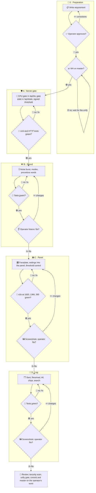

# 004 - Radio Set

## User Story

As the operator of many parallel agents, I want the Agent Orchestrator radio
to work like a minimalist marine VHF set, with every setting at hand, a
filterable log and speech only when the host has CPU to spare, so that I hear
that someone transmits without the speech engine loading a busy host.

## Decisions (operator-confirmed 2026-11-12; do not re-litigate)

1. **CPU gate on the server**: `/api/tts` renders an uncached line only while
   the latest host CPU sample of the W4 resource feed (`samples.jsonl`, at
   most 120 s old) is below the threshold; a cached line is always served;
   otherwise it answers 503 with the reason `busy`, or `unknown` without a
   fresh sample. Rejected: a gate only in the browser (another tab or an old
   page still renders), browser `speechSynthesis` (same host CPU, other
   voices), rendering held-back speech later (stale).
2. **Noise burst**: when no speech plays, the page plays a squelch-tail noise
   burst made by WebAudio in the browser (band-passed white noise, about
   0.6 s, at the tone's volume and squelch); no server request. Rejected: a
   recorded sound file.
3. **Modes**: Auto (speech below the threshold, otherwise the burst), Quiet
   (the burst only, never speech), Silence (no sound except the procedure
   word of decision 4; bubbles and log only). Default Auto.
4. **Procedure words**: for MAYDAY, PAN-PAN and SÉCURITÉ the procedure word,
   spoken three times in the sender's voice, always sounds, in every mode and
   under load; under load or in Quiet the burst replaces the rest of the
   message. The word line is the same text every time, so after its first
   render per voice it is a cache hit.
5. **Settings in the panel**: mode, volume per tone, squelch, read-aloud
   filters (classes, agents) and the internet radio station are radio-set
   buttons and controls in the radio panel; the radio section leaves the
   settings dialog. They live per browser, without a passkey. Rejected: signed
   hub settings (one passkey per button press).
6. **Threshold**: adjustable in the panel, 30 to 90 % in steps of 10, default
   50 %; a signed hub setting `speech.threshold`, since the server enforces
   it. Rejected: a fixed 50 %.
7. **Log**: tabs Sent (from the operator), Received (to the operator or to
   all) and All (every radio row the hub logs); filter chips class, sender,
   recipient and agent plus text search, combined with AND, newest first.
   Rejected: Received as all agent traffic.
8. **Look**: one faceplate inspired by a marine VHF set, functional and
   minimalist: a display line (class, mode, CPU, TX/RX lamp), a row of mode
   buttons, sliders as knobs, a PTT send button; palette tokens, light and
   dark, no textures. Rejected: a full VHF set with dual watch, scan and DSC
   (high effort, no gain).
9. **Order**: builds on W4's resource feed; implementation starts once W4 is
   on master.
10. **Silence scope** (operator-confirmed 2026-11-13): Silence mutes only the
    radio set (speech, bursts, alert beeps); the procedure word of decision 4
    still sounds, and music and the internet station keep playing. Rejected:
    Silence also pauses music and the station (not part of 004's scope);
    Silence also mutes the procedure word (an emergency call could go
    unheard).
11. **Short windows** (operator-picked 2026-11-14): a window too short for
    the two-column radio uses the stacked phone flow instead of a further
    packed tier: `#main` keeps its full height under the header, the radio
    sits in the page flow above it and the page scrolls; "only History
    scrolls" holds only on the two-column side. The two-column side needs,
    measured in all six states in Chromium and Firefox with MAYDAY: 45rem
    (720 px) high from 80rem (1280 px) wide, 46.5rem (744 px) from 61rem
    (976 px) wide and 61rem (976 px) from 48rem (768 px) wide. Rejected: one
    height for every width (61rem would stack a 1366 × 768 laptop, 44rem
    misses the Orbit stage under MAYDAY by up to 20 px), a third packed tier.

## Approach

## Acceptance Criteria

### Server gate

- [x] `POST /api/tts` with an uncached line answers 503 `{"reason": "busy"}`
      while the latest `samples.jsonl` row has `cpu` >= the threshold, and the
      fake Piper records no call.
- [x] Without a sample younger than 120 s it answers 503
      `{"reason": "unknown"}`, and the fake Piper records no call.
- [x] A cached line answers 200 whatever the CPU.
- [x] Below the threshold an uncached line renders as before.
- [x] `GET /api/state` carries `speech.gate` with `threshold`, `cpu` and
      `open`.
- [x] `speech.threshold` accepts only 30 to 90 in steps of 10, default 50,
      and changes only with a valid passkey signature.

### Sound

- [x] Auto below the threshold: the page plays the spoken line; on a 503 it
      plays the burst once and does not retry that row.
- [x] Quiet: the page sends no `/api/tts` request except for procedure-word
      lines, and every row plays the burst.
- [x] Silence: no audio node starts except for a procedure-word line.
- [x] The burst is WebAudio noise of 0.4 to 0.8 s at the tone's volume times
      the squelch, and it sends no network request.
- [x] A MAYDAY, PAN-PAN or SÉCURITÉ row requests its procedure-word line
      first, in every mode; the second such line for the same voice is a
      cache hit with no Piper call.

### Panel

- [x] The display line shows class, mode, CPU % and a TX/RX lamp that is lit
      while sound plays.
- [x] Auto, Quiet and Silence form one button group (`aria-pressed`); a press
      changes the mode without a passkey and survives a reload.
- [x] Volume per tone, squelch, the read-aloud filters for classes and
      agents, and the internet station sit in the panel; the settings dialog
      has no radio section.
- [x] The threshold control asks for the passkey once per change and shows
      the server's value.
- [x] At 1920, 1366 and 390 px the panel has no horizontal scroll, in the
      light and the dark palette.

### Log

- [x] Tabs Sent, Received and All show their counts; Received holds exactly
      the rows addressed to the operator or to all.
- [x] The chips class, sender, recipient and agent and the text search
      combine with AND; one control clears them all.
- [x] Rows run newest first with time, direction, class badge,
      sender → recipient and text; a click opens the full message.
- [x] Tab, chips and search survive a reload in the same browser.

### Layout and history rows (operator 2026-11-14)

- [ ] The radio shows a Device card on the left (display line, Auto, Quiet
      and Silence, the six level sliders one per row with label, slider,
      value and test button, the internet stations folded in a details) and,
      on the right, the Speak card above the History card.
- [ ] Every knob label starts at the same x position (one label column).
- [ ] At 1920, 1366, 960 and 390 px the document's `scrollWidth` is at most
      `innerWidth`, and no element of the radio reaches outside its card.
- [ ] In the Stream view inside the radio only the history row list has
      `scrollHeight` above `clientHeight`, with `overflow-y: auto`,
      `scrollbar-width: thin` and a `scrollbar-color` from the palette;
      `#main` carries a palette `scrollbar-color` as well, so Firefox draws
      no light scrollbar beside a squeezed view.
- [ ] At 390 px the cards stack in the order Device, Speak, History and the
      page scrolls; on the two-column side of decision 11, tablets included,
      the Device card sits left and the Speak card above the History card on
      the right, with the radio bar above Speak.
- [ ] On the two-column side the open radio takes at most 46vh. At
      1280 × 720, 1366 × 768, 1440 × 900, 1536 × 864, 1920 × 1080,
      1024 × 768, 1680 × 1050, 820 × 1180, 768 × 1024 and at the band
      edges 800 × 976, 960 × 976, 976 × 744, 1024 × 744 and 1366 × 720, in
      the two-column layout, in the Stream view and in the Orbit fit view,
      idle, with
      the internet radio fold open on three stations, with a recorded voice
      note attached, while the radio speaks a real reading and under the
      MAYDAY banner with a short and with a 295-character text: `#main` is
      at least
      `0.54 × innerHeight − top of the radio spot` px high (what the old
      46vh spot cap left), the document is no wider and no taller than the
      viewport, the history list is the only scroller inside the radio and
      at least 60 px high with two whole rows, the Device and Speak cards
      show whole, the Orbit stage keeps at least 12 % of the viewport
      height, and the centre of every visible control, the RX/TX lamp, the
      CPU field and the Device title resolves by `elementFromPoint` to
      itself.
- [ ] The internet radio fold opens its stations as a popover anchored to
      the fold toggle and off the layout flow, at most `min(12rem, 28vh)`
      high and scrolling inside itself beyond that. It opens upward over
      the level sliders when the room above holds it and downward
      otherwise, and never grows past the room on its side, so its box
      stays inside the viewport and inside every clipping ancestor, in the
      spot and on the Home tiles at every width, and it shows at least one
      whole station row. The global menu handlers close it like every
      `details.menu`: Escape and a click outside close it. A menu hands the
      focus back to its toggle only when the focus was inside it; a click
      elsewhere never moves the focus, and a History tab or chip keeps the
      focus across the redraw its click causes. The controls the popover
      covers while open are the only ones exempt from the centre check.
- [ ] An attached voice note sits in the composer row: beside the message
      field in the packed layout, beside Record and PTT otherwise; it never
      takes height from the history list. In the packed layout a Play/Pause
      button of at least 24 × 24 px plays it in place of the native player,
      and the Attach checkbox keeps the visible label "Attach".
- [ ] The speaking caption covers no control and no lamp: in the packed
      layout it shows over the class and mode fields of the display, between
      the RX/TX lamp and the CPU field, names the speaker without the word
      "speaking", keeps the spoken line at least 4rem wide with an ellipsis,
      and its Stop speaking button stays clickable at 24 × 24 px.
- [ ] Under the MAYDAY banner the open radio keeps the `#main` floor and the
      12 % Orbit stage: in the packed layout a fit view
      with the open radio pads `#main` by 12 px and the shell bottom by
      16 px instead of 24 px and 32 px. The banner keeps one line at any
      text length: the text ends in an ellipsis, carries the full text in
      its title and in the alert region, and Cancel mayday stays visible.
      The state poll redraws the banner only when the MAYDAY changes: an
      unchanged MAYDAY causes no mutation in the alert region and keeps the
      focus on Cancel mayday, and a changed text replaces the banner
      content once, so it is announced once.
- [ ] On the two-column side up to 66rem (1056 px) high, and below 56rem
      (896 px) wide at any height, the radio packs
      tighter instead of scrolling: the display sits in the Device head row,
      the six level sliders keep one 24 px row each, the Speak card holds
      title, star, channel and recipient in one row (DOM order equals screen
      order) and message, voice note, Record and PTT in the next (the
      channel hint moves into the channel's title), and the History search
      sits in the History head row, each where its card is wide enough; a
      narrower card wraps them into the next rows. The History filter chips
      wrap beside the Clear filters button, never above it.
- [ ] Below 48rem wide and below the heights of decision 11 every view, fit
      or not, gives the view below the stacked radio the full height under
      the header: the page scrolls, the Orbit stage keeps at least 24 % of
      the viewport height, the page never scrolls sideways, the History
      chips never overlap its tabs or search, and every radio control
      resolves to itself once page scroll brings it into view. At 800 × 600,
      1024 × 600, 1280 × 600 and 1366 × 657 this holds in the six states.
- [ ] A closed radio spot takes no box at any width, and closing it in a
      fit view gives the Orbit stage its height back.
- [ ] Every history row has the same height, below two text lines, with
      `white-space: nowrap`; a long text shows an ellipsis (`scrollWidth`
      above `clientWidth`) and every row keeps at least 30 px of text.
- [ ] The reader and acknowledger avatars of a row sit after the text inside
      the row box and overlap each other with at least 10 px of each face in
      view; a History card wider than 34rem shows at most eight faces and
      `+N` for the rest, a narrower one at most three and `+N`.
- [ ] A click on a row opens the hub popup with the full text, sender,
      recipient, class, time and every reader with name, read time ("read
      about" for a sighting, "read, time unknown" without one) and
      acknowledgement, without a stray text node.
- [ ] A redraw of the History card patches it in place: rows keep their
      node by a key unique in the log (the ledger id of a sent row, else
      time, sender and the occurrence index among rows of the same time and
      sender), and tabs and chips keep theirs, so a focused row button or
      tab keeps the focus across new radio rows and the minute tick, Enter
      on it opens its own message even beside a twin of the same time and
      sender, and a redraw that changes no tab fires no `focusin`. When a
      filter, search or time range removes the focused row, the focus moves
      to the nearest remaining row, else to the list.
- [ ] Copy in the popup writes the full message text through
      `navigator.clipboard.writeText`; the button's text and accessible name
      turn to "Copied" or "Not copied", and a polite status region inside the
      popup says the result in words.
- [ ] Reply closes the popup and prefills the Speak card of the same radio:
      channel Post, recipient the sender, focus in the message field. A row
      of a pinned Home tile fills the composer of that tile, else a pinned
      Home Speak or Radio tile, and opens the radio spot only when Home holds
      no composer.
- [ ] Esc and a click outside the popup close it.
- [ ] The whole radio, the Device card, the Speak card and the History card
      each carry a Home star (`radio`, `radio-device`, `radio-speak`,
      `radio-log`) that covers no control.
- [ ] Each pinned part renders on Home as a live instance without ids or
      stars of its own: a new radio row appears in the pinned History and
      Radio tiles without a reload, and a mode pressed in the pinned Device
      tile shows in every radio display.
- [ ] The pinned whole radio carries the Read aloud filters and Cancel
      mayday of the spot; Cancel mayday lifts an active mayday from Home
      after the confirmation and the passkey.
- [ ] A new pin gets its panel's own size: Radio 12 × 7, Device 6 × 6,
      Speak 6 × 5, History 6 × 5 cells. At that size and after a resize to
      12 × 9, 5 × 7, 7 × 6 and 8 × 4 cells, a pinned History or two column
      Radio tile at 1920, 1366, 960 and 390 px has the history list as its
      only scroller, inside the tile and at least two rows high, and a
      Device or Speak tile has none; a Radio tile at 390 px stacks its cards
      and scrolls its tile body as its only scroller, its list unscrolled.
- [ ] Every composer keeps its own draft, recording, voice note and Attach
      box: a new composer starts empty, a send from one never clears
      another's recording, and Record in one composer stops a recording
      running in another, whose transcript and note stay in that other one.

### Tests

- **Unit**: gate busy, unknown, cache hit and open; threshold validation;
  procedure-word lines from `phrasing.py`; every case with a negative
  control.
- **Integration**: hub HTTP tests with a fake Piper and a fake
  `samples.jsonl`: 503 and no Piper call under load, 200 for a cache hit,
  `speech.gate` in `/api/state`.
- **E2E**: Playwright in Chromium and Firefox at 1920, 1366 and 390 px: mode
  buttons, burst through a spy on the AudioContext, procedure word under
  load, the settings dialog without a radio section, the log tabs and
  filters; `tests/e2e/test_radio_layout_e2e.py` measures the layout, the
  popup, Copy, Reply, the Home tiles and the fit view at 1920, 1366, 960
  and 390 px, the open radio in Stream and Orbit at the nine screen sizes,
  the five band-edge sizes and the four short sizes of the layout criteria,
  each against the contract of its side of decision 11, in six
  states on the real code paths (idle, stations open, a recorded voice
  note, a real reading through the mocked synthesizer, MAYDAY banner with a
  short and a long text) after the view transition settles, the station
  popover's placement, whole rows, Escape and outside click in the spot and
  on the Home tiles at 1366, 1280 and 390 px, and where the focus lands
  after mouse presses on a History tab and on blank `#main` with Day/Night
  or the stations open at 1366 and 390 px in both browsers, the focus on
  a keyboard-focused row button and tab across new rows and a forced minute
  tick, focus and Enter on two rows of the same time and sender, the focus
  of a row a filter or the search removes, and the banner's alert region
  across two polls with an unchanged and a changed MAYDAY at 1366 px in
  both browsers, and drives
  two composers, Reply and Cancel mayday from Home copies in Chromium at
  1366 and 390 px.
