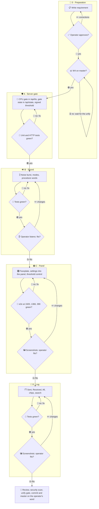

# 004 - Radio Set

## User Story

As the operator of many parallel agents, I want the Agent Orchestrator radio
to work like a minimalist marine VHF set, with every setting at hand, a
filterable log and speech only when the host has CPU to spare, so that I hear
that someone transmits without the speech engine loading a busy host.

## Decisions (operator-confirmed 2026-11-12; do not re-litigate)

1. **CPU gate on the server**: `/api/tts` renders an uncached line only while
   the latest host CPU sample of the W4 resource feed (`samples.jsonl`, at
   most 120 s old) is below the threshold; a cached line is always served;
   otherwise it answers 503 with the reason `busy`, or `unknown` without a
   fresh sample. Rejected: a gate only in the browser (another tab or an old
   page still renders), browser `speechSynthesis` (same host CPU, other
   voices), rendering held-back speech later (stale).
2. **Noise burst**: when no speech plays, the page plays a squelch-tail noise
   burst made by WebAudio in the browser (band-passed white noise, about
   0.6 s, at the tone's volume and squelch); no server request. Rejected: a
   recorded sound file.
3. **Modes**: Auto (speech below the threshold, otherwise the burst), Quiet
   (the burst only, never speech), Silence (no sound; bubbles and log only).
   Default Auto.
4. **Procedure words**: for MAYDAY, PAN-PAN and SÉCURITÉ the procedure word,
   spoken three times in the sender's voice, always sounds, in every mode and
   under load; under load or in Quiet the burst replaces the rest of the
   message. The word line is the same text every time, so after its first
   render per voice it is a cache hit.
5. **Settings in the panel**: mode, volume per tone, squelch, read-aloud
   filters (classes, agents) and the internet radio station are radio-set
   buttons and controls in the radio panel; the radio section leaves the
   settings dialog. They live per browser, without a passkey. Rejected: signed
   hub settings (one passkey per button press).
6. **Threshold**: adjustable in the panel, 30 to 90 % in steps of 10, default
   50 %; a signed hub setting `speech.threshold`, since the server enforces
   it. Rejected: a fixed 50 %.
7. **Log**: tabs Sent (from the operator), Received (to the operator or to
   all) and All (every radio row the hub logs); filter chips class, sender,
   recipient and agent plus text search, combined with AND, newest first.
   Rejected: Received as all agent traffic.
8. **Look**: one faceplate inspired by a marine VHF set, functional and
   minimalist: a display line (class, mode, CPU, TX/RX lamp), a row of mode
   buttons, sliders as knobs, a PTT send button; palette tokens, light and
   dark, no textures. Rejected: a full VHF set with dual watch, scan and DSC
   (high effort, no gain).
9. **Order**: builds on W4's resource feed; implementation starts once W4 is
   on master.

## Approach

## Acceptance Criteria

### Server gate

- [ ] `POST /api/tts` with an uncached line answers 503 `{"reason": "busy"}`
      while the latest `samples.jsonl` row has `cpu` >= the threshold, and the
      fake Piper records no call.
- [ ] Without a sample younger than 120 s it answers 503
      `{"reason": "unknown"}`, and the fake Piper records no call.
- [ ] A cached line answers 200 whatever the CPU.
- [ ] Below the threshold an uncached line renders as before.
- [ ] `GET /api/state` carries `speech.gate` with `threshold`, `cpu` and
      `open`.
- [ ] `speech.threshold` accepts only 30 to 90 in steps of 10, default 50,
      and changes only with a valid passkey signature.

### Sound

- [ ] Auto below the threshold: the page plays the spoken line; on a 503 it
      plays the burst once and does not retry that row.
- [ ] Quiet: the page sends no `/api/tts` request except for procedure-word
      lines, and every row plays the burst.
- [ ] Silence: no audio node starts except for a procedure-word line.
- [ ] The burst is WebAudio noise of 0.4 to 0.8 s at the tone's volume times
      the squelch, and it sends no network request.
- [ ] A MAYDAY, PAN-PAN or SÉCURITÉ row requests its procedure-word line
      first, in every mode; the second such line for the same voice is a
      cache hit with no Piper call.

### Panel

- [ ] The display line shows class, mode, CPU % and a TX/RX lamp that is lit
      while sound plays.
- [ ] Auto, Quiet and Silence form one button group (`aria-pressed`); a press
      changes the mode without a passkey and survives a reload.
- [ ] Volume per tone, squelch, the read-aloud filters for classes and
      agents, and the internet station sit in the panel; the settings dialog
      has no radio section.
- [ ] The threshold control asks for the passkey once per change and shows
      the server's value.
- [ ] At 1920, 1366 and 390 px the panel has no horizontal scroll, in the
      light and the dark palette.

### Log

- [ ] Tabs Sent, Received and All show their counts; Received holds exactly
      the rows addressed to the operator or to all.
- [ ] The chips class, sender, recipient and agent and the text search
      combine with AND; one control clears them all.
- [ ] Rows run newest first with time, direction, class badge,
      sender → recipient and text; a click opens the full message.
- [ ] Tab, chips and search survive a reload in the same browser.

### Tests

- **Unit**: gate busy, unknown, cache hit and open; threshold validation;
  procedure-word lines from `phrasing.py`; every case with a negative
  control.
- **Integration**: hub HTTP tests with a fake Piper and a fake
  `samples.jsonl`: 503 and no Piper call under load, 200 for a cache hit,
  `speech.gate` in `/api/state`.
- **E2E**: Playwright in Chromium and Firefox at 1920, 1366 and 390 px: mode
  buttons, burst through a spy on the AudioContext, procedure word under
  load, the settings dialog without a radio section, the log tabs and
  filters.
