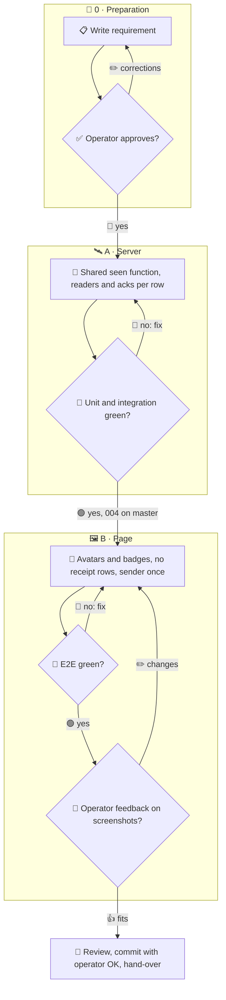

# 005 - Radio Receipts Inline

## User Story

As the operator, I want every radio message to show who read it and who
acknowledged it right under the message, so that I see delivery at a glance
without a second row repeating the same text.

## Decisions (operator-confirmed 2026-11-13; do not re-litigate)

1. **Read for all, ack where it exists**: under every message of every class
   (post, call, newsletter, broadcast, mayday, pan-pan, sécurité, grant) the
   avatars of the agents that read it, from the seen marks `radio.py` keeps
   per session (`radio-seen/<sid>.json`, `news-seen/<sid>`); an avatar gets an
   acknowledged badge when that agent's receipt for the message exists.
   Rejected: an explicit acknowledgement for every class (one radio action
   per agent and message, more tokens); read only (loses the call's
   acknowledgement).
2. **No receipt rows**: receipts no longer show as entries in the Stream, the
   radio log or an agent page; they only feed the badges. Rejected: a
   collapsed receipt row (still a second entry).
3. **One read rule**: the hub decides "read" with the same function
   `radio.py` uses to decide what a session has seen; no second copy in the
   hub.
4. **Sender once**: a message header names its sender exactly once (today
   "Skills Skills → Main").
5. **Order**: the shared seen function and a new hub module for readers and
   acks may start at once; wiring into the hub view and the page starts after
   004 (radio set) is on master, since both change the radio log.

## Approach

## Acceptance Criteria

### Server

- [ ] Each radio row the hub serves carries `readers` (session id, name, read
      time) and `acks` (session ids), computed by the function `radio.py`
      uses for its own seen check; a unit test covers every class.
- [ ] A receipt counts for its call when the call is served, even if the
      receipt row lies outside the served window.
- [ ] A missing, malformed, unreadable or future-dated seen mark counts as
      not read.
- [ ] Receipt rows are absent from the rows served to the Stream, the radio
      log and agent pages; count badges count messages without receipts.

### Page

- [ ] Under each message one avatar per reader, an acknowledged badge on
      readers with a receipt, name and read time in the avatar's title.
- [ ] More than 8 readers collapse into "+N" with the full list on hover.
- [ ] The e2e count of entries with the class pill "Read" is 0 in the
      Stream, the radio log and an agent page.
- [ ] The message header shows the sender name exactly once.
- [ ] Avatars appear on the next poll after a mark advances, without a
      reload.

### Tests

- [ ] Unit: readers and acks per class; malformed marks; receipt to call
      matching by call time; the header renders the sender once.
- [ ] Integration: the hub state endpoint over a council fixture (posts,
      calls, broadcasts, receipts, seen marks) returns readers and acks and
      no receipt rows.
- [ ] E2E: Chromium and Firefox at 1920, 1366 and 390: a call with two
      readers and one receipt shows two avatars, one with the badge, no
      "Read" entry and the sender once; screenshots for the checkpoint.
