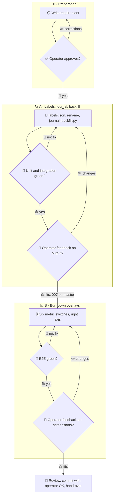

# 006 - Score Metric Overlays

## User Story

As the operator, I want the score of every change (Fix, Break, Tokens,
Velocity, Security, Score) recorded over time and switchable as overlays in
the burndown, so that I see how quality and cost move alongside the work.

## Decisions (operator-confirmed 2026-11-13; do not re-litigate)

1. **Labels**: 💸 Cost becomes 💸 Tokens and ⏱️ Time becomes ⏱️ Velocity in
   every score output (block, line, table header) and in every skill text;
   emojis and meaning stay (Tokens is the token-cost percentage, Velocity the
   speed percentage against the base).
2. **One label file**: `skills/kvb-check-score/labels.json` holds per metric
   key its emoji, current label and every former label (Cost, Time);
   `score.py`, the backfill and the hub read it. Rejected: labels in each
   script (three copies drift apart).
3. **Journal**: `score.py` appends one JSON line per `--message-block` render
   to `<council root>/scores.jsonl` (time, repo remote and path, branch,
   values, digest); display data only, never a gate input. Rejected: a
   journal per repository (the hub would read many places).
4. **Backfill CLI**: a separate deterministic
   `skills/kvb-check-score/scripts/backfill.py --repo <dir>... [--since <rev>]
   [--labels <file>]` parses score blocks from commit messages through
   `git log` with the label file, keyed by (remote, commit sha), idempotent (a
   second run adds nothing), runnable on any host, after a reboot (the journal
   lives in the RAM-backed `/tmp`) or on another PC; no model calls.
   Rejected: an agent reading the history (tokens); parsing at view time in
   the hub (the hub would need every repository).
5. **Overlays**: the burndown gets one switch per metric (six), all off by
   default, kept in the unsigned view store of 007; an overlay draws that
   metric's journal points of the branches of the tasks in the burndown's
   scope on a right axis from 0 to 100 % (higher when a value exceeds 100).
   Rejected: one switch for all metrics.
6. **Order**: label file, rename, journal and backfill first (Python only,
   parallel to 007); the overlay wiring after 007's view store and legend
   chips are on master.

## Approach

## Acceptance Criteria

### Labels

- [ ] `score.py --message-block`, the line and the table print `Tokens` and
      `Velocity`, never `Cost` or `Time`.
- [ ] `grep -rnE "💸 Cost|⏱️ Time" skills/ docs/` finds nothing outside the
      aliases in `labels.json`.
- [ ] A test that changes a label in a temporary `labels.json` sees it in
      `score.py`'s output.

### Journal

- [ ] Each `--message-block` render appends exactly one row with the fields
      of decision 3.
- [ ] A failed append prints one stderr line and keeps the exit code.
- [ ] No gate reads `scores.jsonl` (test).

### Backfill

- [ ] A fixture repository with 3 commits carrying blocks (old and new
      labels) gives 3 rows on the first run and 0 on the second.
- [ ] Two runs from an empty journal give byte-identical journals.
- [ ] An unknown label is reported once per label and skipped.
- [ ] A clone at another path yields the same keys (remote plus sha).

### Overlays

- [ ] The burndown shows six metric chips, all off on first load; a chip
      switched on draws its series on the right axis.
- [ ] The state survives a reload and shows the same in a second browser.
- [ ] Only rows of branches in the burndown's scope are drawn (unit test on
      the series function).

### Tests

- [ ] Unit: label loading; block, line and table output; journal append;
      backfill parsing of old, new and malformed blocks; overlay series
      selection.
- [ ] Integration: backfill over a fixture repository, then the hub serving
      the journal series for a window.
- [ ] E2E: Chromium and Firefox at 1920, 1366 and 390: overlay switches,
      persisted across reload and browsers; screenshots for the checkpoint.
