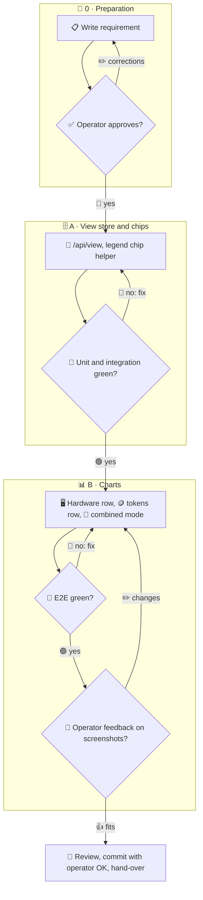

# 007 - Resources View

## User Story

As the operator, I want all hardware load in one chart, the tokens in a
second, every series switchable and a combined view with the burnup, so that
I see in one place how load, token spend and progress relate.

## Decisions (operator-confirmed 2026-11-13; do not re-litigate)

1. **Two rows**: Hardware (disk per mount, CPU, RAM, swap, GPU and VRAM per
   device as lines on one % axis; zones and queue marks stay) and Tokens
   (per-agent stacked bars per interval, with a switch to accumulated:
   per-agent running sums). Rejected: one row per resource as today.
2. **Legend chips**: every series has a chip in its legend that hides or
   shows it, all shown by default; one shared helper serves 006 and 008 too.
3. **Combined mode**: a switch overlays hardware % (left axis), tokens (right
   axis, per interval or accumulated as the tokens switch says) and burnup
   (done and scope, scaled to % of the largest scope in the window, left
   axis) in one chart; every series deselectable, all on by default.
4. **Unsigned view store**: `/api/view` on the hub keeps view state
   server-side (chips, switches, modes, the burndown overlays of 006 and the
   Home pins of 008), the same in every browser, without a passkey because it
   grants nothing; strict schema covering all three requirements, a 64 KiB
   cap, unknown keys refused. Rejected: signed hub settings (a passkey per
   click); per-browser localStorage (no shared layout).
5. **Window**: both rows and the combined chart follow the existing range
   control.

## Approach

## Acceptance Criteria

### View store

- [ ] A GET and a PATCH of `/api/view` round-trip; a PATCH sets only the
      paths it names, each against the value the page last saw there (409
      when another browser changed it meanwhile); a malformed body, an
      unknown key, a body over 129 KiB (both values of a path at the cap
      plus 1 KiB) or a document that would grow past 64 KiB answers 400 and
      stores nothing, while a list at the cap can still shrink. Lists change
      only by a function re-run on the stored value, scalars by replacement.
      A page restored from the back-forward cache fetches the view again; a
      change sent while leaving the page is dropped when it meets a 409.
- [ ] A PATCH needs no passkey and leaves the signed settings file
      byte-identical.
- [ ] The store is written atomically with mode 0600 and survives a hub
      restart.

### Hardware

- [ ] One SVG with a line for every disk mount, CPU, RAM, swap, every GPU and
      its VRAM; normal mode shows exactly 2 charts.
- [ ] Hiding a line's chip removes its path, and the state persists through
      `/api/view`.

### Tokens

- [ ] Per-interval bars as today; the accumulated switch draws per-agent
      running sums that never decrease (unit test on the series function).
- [ ] Agent chips hide and show agents.

### Combined

- [ ] The combined switch replaces both charts with one holding hardware,
      tokens and burnup series, all on by default, each deselectable.
- [ ] Burnup is scaled as decision 3 says (unit test).

### Tests

- [ ] Unit: series builders (hardware merge, accumulation, burnup scaling);
      view store validation.
- [ ] Integration: the hub serves `/api/view` and the resources state;
      persistence across a restart.
- [ ] E2E: Chromium and Firefox at 1920, 1366 and 390: two charts, chips
      toggle and persist, combined mode; screenshots for the checkpoint.
