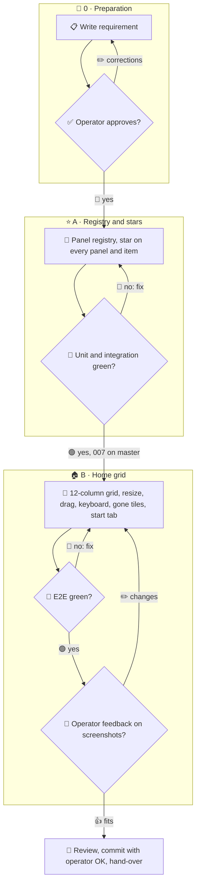

# 008 - Home Dashboard

## User Story

As the operator, I want to star any panel or item of the hub and arrange the
starred ones on a Home tab, so that I get my own overview of what matters to
me.

## Decisions (operator-confirmed 2026-11-13; do not re-litigate)

1. **Home tab**: a new first tab left of Stream (route `#home`); it becomes
   the start tab once at least one pin exists, otherwise Stream stays the
   start; an explicit hash wins.
2. **Star everywhere**: a star button on every panel (each chart, the
   stream, the radio log, kanban, gantt, burndown, task list, RASCI,
   ancestry, 3D, the agents list) and on every single item (message, task,
   artifact, agent card); pressing it again unpins. Rejected: panels only;
   panels and agent cards only.
3. **Panel registry**: every pinnable panel and item kind registers an id, a
   title and a render function that takes the tile size; Home renders tiles
   through it, live with the same data as the source view. Rejected: Home as
   saved route views (views are not built for small cells and share page
   state).
4. **Grid**: a classic 12-column CSS grid; a tile resizes from 1 to 12
   columns wide and 1 to 12 rows high by a handle and reorders by drag and by
   the arrow keys while focused; no layout library. Rejected: gridstack.js (a
   new dependency for what CSS grid does).
5. **Gone items**: a tile whose item no longer exists shows "gone" with an
   unpin button; it is never removed silently.
6. **Persistence**: pins, sizes and order live in the unsigned view store of
   007, capped at 64 pins.
7. **Order**: the registry, stars and grid may start at once against the
   view store contract of 007; persistence and e2e after 007 is on master.

## Approach

## Acceptance Criteria

### Stars

- [ ] The e2e count of registered panels and items without a star is 0
      across all tabs.
- [ ] Starring adds a tile on Home and unstarring removes it; the same
      layout shows in a second browser.
- [ ] A 65th pin is refused with a visible message.

### Grid

- [ ] A tile spans w of 12 columns; the handle changes w from 1 to 12 and h
      from 1 to 12.
- [ ] Drag and keyboard reorder work and persist.
- [ ] At 390 px width every tile spans all 12 columns.

### Tiles

- [ ] A pinned chart updates on the next poll like its source view.
- [ ] A pinned task deleted from the register shows "gone" and an unpin
      button.

### Start tab

- [ ] With no pins the hub opens on Stream, with one or more on Home; an
      explicit hash wins.

### Tests

- [ ] Unit: registry lookup, layout validation, reorder math.
- [ ] Integration: `/api/view` accepts the pins schema and refuses an
      oversize or malformed one.
- [ ] E2E: Chromium and Firefox at 1920, 1366 and 390: star and unstar,
      resize, reorder by drag and keyboard, the gone tile, the start tab;
      screenshots for the checkpoint.
