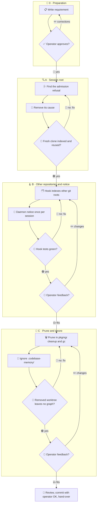

# 009 - Code Graph by Default

## User Story

As the operator running many agent sessions across repositories and
worktrees, I want every repository a session opens to carry a current
codebase-memory-mcp graph without any manual step, so that agents answer
structural questions from the graph instead of reading files and spend fewer
tokens.

## Decisions (operator-confirmed 2026-11-14; do not re-litigate)

1. **Depends on**: nothing. Independent of 010, 011 and quality 003.
2. **Timing**: implementation starts once the running agent lanes are done.
3. **Automatic per repository**: a session that opens a repository without a
   graph indexes it itself, with no `index_repository` by hand and no
   operator step; afterwards the graph stays fresh incrementally through the
   watcher. Mechanism found in codebase-memory-mcp 0.12.1: both, with
   separate jobs. The daemon's `auto_index` indexes and watches the MCP
   session root when a session connects
   (`application_background_initialize_impl` in `src/daemon/application.c`).
   The SessionStart hook (`hook-augment`) only adds context: it never
   indexes and never spawns a daemon (`src/main.c`). Measured 2026-11-14:
   `_config.db` holds `auto_index = true`, so the skills `make install` did
   switch it on (`scripts/install.sh`), yet `cbm-daemon.log` holds 1113
   `daemon.autoindex.skipped` lines for infinito-nexus-core and 8 for the
   `feature-store-i18n` worktree, all `reason=unsafe_or_unavailable_path
   files=-1`, and not one `autoindex.done`. `files=-1` means the bounded
   admission count (5 s deadline, or an entry it cannot observe) failed, not
   the file limit; the last graph was written 2026-11-12 22:24.
4. **Fix the refusal, no workaround**: the root cause of that admission
   refusal is found and removed, in our repositories or upstream through an
   issue. Rejected: raising `auto_index_limit` (the count fails, the limit is
   not reached); an agent calling `index_repository` per session (a manual
   step).
5. **Other repositories (proposed)**: the daemon auto-indexes only the
   session root, so additional working directories and worktrees made during
   a session stay unindexed. A skills `PreToolUse` hook resolves the git root
   of each path a tool call touches; for a root without a graph it starts a
   detached helper that holds one MCP connection, calls `index_repository`
   with `async: true` and stays connected until the job succeeds, once per
   root and session. A permanent daemon (`codebase-memory-mcp daemon start`,
   run by a systemd user unit `kvb-code-graph.service` that `make install`
   enables) keeps the watch after the helper leaves: upstream keeps a watch
   past its last session only under `daemon start`, registers an async index
   only while its session is connected, and a CLI index registers none
   (README, Indexing and Session Coordination Daemon). Rejected: the hook
   telling the agent to call `index_repository` (a manual step that costs a
   turn); `codebase-memory-mcp cli index_repository` (no watch, so the graph
   goes stale).
6. **Missing daemon, once per session**: upstream rate-limits its own notice
   per cache folder to once in 900 s (`MAIN_HOOK_NOTICE_INTERVAL_SECONDS` in
   `src/main.c`), not per session, so a second session within 15 minutes
   hears nothing; `.hook-daemon-absent-notice` was last written 2026-11-14
   12:21. The skills hook checks `codebase-memory-mcp daemon status` at the
   first tool call of a session, after the MCP servers connected, and on a
   missing daemon prints once per session id:
   `codebase-memory-mcp: no daemon; run: systemctl --user enable --now
   kvb-code-graph.service`. The same command becomes one `kvb-org-operator`
   row.
7. **Worktrees get their own graph**: codebase-memory-mcp registers every
   project under its absolute root, so each linked worktree is a separate
   index (`docs/CONFIGURATION.md`, `ignore_worktrees`); one graph cannot
   serve two checkouts. A worktree gets its graph through decision 3 or 5 and
   loses it with decision 8. Rejected: `ignore_worktrees true` (a worktree
   session would get no graph); seeding a worktree from a copied
   `.codebase-memory/graph.db.zst` (README, Bootstrap: possible, but it needs
   `persistence: true` writes into the main checkout after every index and a
   copy step at worktree creation, for a saving not yet measured).
8. **Prune with the worktree**: removing a worktree deletes its graph in the
   same step, inside the existing cleanup. `pkgmgr worktree cleanup` deletes
   the project of each checkout it removes, and `pkgmgr gc`, the single
   deterministic cleanup source picked 2026-11-14, lists every graph whose
   root is gone or is no git repository as a low-risk candidate. Measured: of
   the 10 graphs, 5 belong to removed skills worktrees
   (`chore-requirement-001-audit`, `feature-workbench-w1` to `w4`, 174 MiB
   together) and `/tmp/release-17.0.0` is no git repository. The pkgmgr part
   is a package-manager task in the `kvb-org-rasci` register. Rejected: a
   separate prune timer (a second cleanup source).
9. **Local only**: graphs are never committed; `.codebase-memory/` goes into
   each repository's `.gitignore`, the "not shared" branch of
   `kvb-agent-optimize`. Measured: skills, infinito-nexus-core, gui,
   package-manager and quality ignore it nowhere today.
10. **Graph first, grep after**: skills and AGENTS.md keep sending code
    questions to `search_graph`, `trace_path` and `get_architecture` first.
11. **Sandbox-proof checks (proposed)**: `codebase-memory-mcp config get
    auto_index` fails inside the agent sandbox with "could not load saved
    runtime settings", because `~/.cache/codebase-memory-mcp` lies outside
    `allowWrite`; opening `_config.db` read-only works there. Checks read the
    setting read-only or ask the daemon (`index_status`), never through
    `config get` from the sandbox.

## Approach

## Acceptance Criteria

### Session root

- [ ] The commit that fixes the admission refusal names its root cause, and
      a new session in infinito-nexus-core then writes `autoindex.done` for
      it to `~/.cache/codebase-memory-mcp/logs/cbm-daemon.log`.
- [ ] Fresh clone: a session started in a new `git clone` of skills finds the
      clone in `list_projects` with more than 0 nodes, with no
      `index_repository` call in its transcript and no new operator row.
- [ ] Second session: a second session in the same clone adds no
      `autoindex` line for it to `cbm-daemon.log`, `list_projects` still
      holds exactly one entry for that root, and `index_status` reports
      `watch.watched: true`.
- [ ] Fresh incrementally: after a commit that adds a function to the clone,
      `search_graph` finds the function within one watcher poll, with no
      `index_repository` call.

### Other repositories

- [ ] A session rooted in skills that reads a file of an unindexed
      package-manager clone leaves that root in `list_projects`, and once the
      helper has exited `index_status` reports `watch.watched: true` for it.
- [ ] `make install` enables `kvb-code-graph.service`, and after the last
      agent session closes `codebase-memory-mcp daemon status` still reports
      a running daemon.

### Worktrees and pruning

- [ ] A new linked worktree of skills gets its own entry in `list_projects`
      from the first session or tool call in it.
- [ ] `pkgmgr worktree cleanup --apply --branch <b>` removes that worktree's
      project: `list_projects` no longer lists it and its `.db` file under
      `~/.cache/codebase-memory-mcp/` is gone.
- [ ] `pkgmgr gc --json` lists each graph whose root is missing or no git
      repository as a low-risk candidate; on the state of 2026-11-14 it names
      the 5 removed skills worktrees and `/tmp/release-17.0.0`.

### Daemon notice

- [ ] With no daemon running, the first tool call of a session prints the
      notice with the exact command once, later tool calls of that session
      print nothing, and a second session prints it once again.
- [ ] The command appears as one `kvb-org-operator` row, not one per session.
- [ ] With a daemon running, no notice is printed.

### Local only and instructions

- [ ] `git check-ignore -q .codebase-memory/graph.db.zst` exits 0 in the main
      checkouts of skills, infinito-nexus-core, gui, package-manager and
      quality.
- [ ] `kvb-agent-optimize/SKILL.md` step 2 names the daemon `auto_index` for
      the session root and the hook for every other repository, and no longer
      says `make install` alone indexes every repository a session opens.
- [ ] `agents.py` reports `auto_index` from inside the agent sandbox by
      opening `_config.db` read-only.
- [ ] `AGENTS.md` of skills still sends code questions to the graph first and
      to grep after.

### Tests

- **Unit**
  - [ ] `test_hook_resolves_git_root`: a path in a subfolder, in a linked
        worktree and in a submodule each resolves to its own root.
  - [ ] `test_hook_indexes_once_per_root`: two tool calls on one unindexed
        root start one helper.
  - [ ] `test_hook_skips_indexed_root` and `test_hook_skips_non_git`: an
        indexed root and a path outside git start nothing.
  - [ ] `test_notice_once_per_session` and `test_notice_silent_with_daemon`.
  - [ ] `test_auto_index_read_only`: `agents.py` reads `auto_index` from a
        read-only `_config.db` fixture.
  - [ ] `test_gc_lists_orphan_graphs` (package-manager): a graph of a missing
        root and one of a non-git root are listed, a live root's is not.
- **Integration**
  - [ ] `test_code_graph_fresh_clone`: the real binary, a temporary clone under
        the real cache root (upstream refuses a different `CBM_CACHE_DIR`
        while the live daemon runs): the first MCP session indexes, the second
        reuses; the test deletes its project afterwards.
  - [ ] `test_code_graph_helper_watch`: the hook's helper indexes an
        additional root and the watch outlives the helper under `daemon
        start`.
  - [ ] `test_code_graph_worktree_prune`: a worktree's graph is gone after
        `pkgmgr worktree cleanup --apply`.
- **E2E**
  - [ ] `tests/e2e/test_code_graph_e2e.py`: a headless agent session in a fresh
        clone answers one structural question through `search_graph` with no
        `index_repository` call in its transcript, and a second session adds
        no `autoindex` line for that root.
