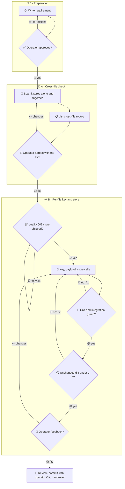

# 010 - Security Scan Cache per File

## User Story

As an agent running `kvb-check-security` on many branches and sessions, I
want the MEDUSA findings of every unchanged file reused under an exact
per-file key, so that one changed file rescans only that file and the same
file is never scanned twice across branches and sessions.

## Decisions (operator-confirmed 2026-11-14; do not re-litigate)

1. **Depends on**: quality 003 (the result store). Independent of 009 and
   011.
2. **Timing**: implementation starts once the running agent lanes are done
   and quality 003 has shipped its store.
3. **Today, measured**: `keyed()` in `scripts/security.py` hashes the script,
   the medusa binary's path, mtime and size, `PATH`, the files not covered,
   every `MEDUSA_*` variable and, per copied file, its tree path, repository
   path, mode and content; one entry per whole diff lives in
   `<council root>/security-cache/` for `CACHE_SECONDS` (24 h), and medusa
   runs with `--no-cache`. One changed file therefore rescans the whole diff,
   and an unchanged file on another branch or in another session is scanned
   again; the ModelAttackScanner needs 71.8 s for one 2949-line file.
4. **Key per file**: the sha256 of the file content, the medusa version
   (2026.7.0 today, from its dist-info), a digest of medusa's rule set (its
   `rules/` tree and the RULES that `security.py` reads from medusa's
   source) and the digest of `security.py`. No time expiry: the key changes
   whenever anything relevant changes. Rejected: the whole-diff key (today's
   behaviour); a 24 h expiry (a key that changes with every input needs
   none).
5. **What selects and runs a scanner joins the key (proposed)**: medusa
   picks scanners by extension, exact name, prefix and parent folder name
   (`ai_context_scanner`, `rag_security_scanner`, `mcp_config_scanner` and
   `agent_memory_scanner` read `file_path.parent.name`), and most scanners
   call external tools found on `PATH` (shellcheck, semgrep, gitleaks, trivy
   and more). The key therefore also holds the scanned tree path, the file
   mode, every `MEDUSA_*` variable and the resolved path, size and mtime of
   each external tool, as today's key holds `PATH`. Without them a moved file
   or a newly installed tool would reuse findings it never produced.
6. **Cross-file check first**: before any per-file entry is written, prove
   that medusa's findings for a file do not depend on other files of the
   scan tree; where a cross-file rule exists, the files it reads stay per
   diff. Found while drafting, medusa 2026.7.0: `trivy_scanner` runs `trivy
   fs` on the file's parent folder, `rust_scanner` walks up to `Cargo.toml`,
   `_find_config_file` in `scanners/base.py` walks up for tool
   configuration past the scratch tree into `/tmp`, and
   `docker_compose_scanner` runs in the file's folder. `medusa scan` has no
   flag that selects scanners, so a file that `FILE_SCANNERS` routes to a
   cross-file scanner stays in a per-diff group, keyed like today minus the
   expiry. The check is an acceptance criterion.
7. **Through the quality store**: entries are written and read with
   `quality store put` and `get` (quality 003) under tool `medusa`;
   `<council root>/security-cache/` goes away. A payload holds per finding
   only `rule`, `line` and `severity`, as quality decision 23 allows. `sha1`
   and `context` are line hashes, which decision 23 keeps out of stored
   data, so `security.py` recomputes them from the file after a hit; the file
   content is part of the key, so they come out identical.
8. **Incomplete scans are never cached**: a run with a non-zero exit, a FAULT
   or SKIP line, a `files_scanned` or `lines_scanned` shortfall, an
   unreadable report or a file never covered writes no entry for any of its
   files, as `scan()` does today.
9. **Accepted findings unchanged**: `security-accepted.jsonl`, `accept`, the
   rule, path, sha1 and context match and the score formula stay as they
   are.
10. **A store failure costs time only**: a missing quality binary or a store
    miss on error runs medusa as today; it never yields a score without a
    scan.
11. **Rejected: radio digest**. The operator rejected it on 2026-11-14:
    every radio message stays in full in the hooks, because each one is sent
    for a reason.

## Approach

## Acceptance Criteria

### Cross-file check

- [ ] `test_findings_file_local`: for a fixture set covering every
      `FILE_SCANNERS` route, each file's findings scanned alone equal its
      findings scanned inside the full fixture tree; every route where they
      differ is listed in `CROSS_FILE` in `security.py`.
- [ ] `CROSS_FILE` holds the routes of `trivy_scanner`, `rust_scanner` and
      `docker_compose_scanner` and the configuration names that
      `_find_config_file` looks up, unless `test_findings_file_local` proves
      one of them file-local.
- [ ] `test_cross_file_group_rescans`: changing a sibling of a file in the
      per-diff group (a `Cargo.toml` next to a `.rs` file) rescans the group.

### Key

- [ ] `test_key_per_file`: with 10 scanned files of which 1 changed, medusa's
      scratch tree holds that 1 file and the other 9 come from the store.
- [ ] `test_key_across_branches`: an unchanged file on a second branch,
      scanned by a second process, hits without running medusa.
- [ ] `test_key_parts`: each of content, medusa version, rule set digest,
      `security.py` digest, tree path, mode, a `MEDUSA_*` variable and an
      external tool's mtime changes the key.
- [ ] `rg -n CACHE_SECONDS scripts/security.py` finds nothing.
- [ ] The medusa command line still carries `--no-cache`.

### Store

- [ ] `test_store_payload_fields`: every stored finding holds exactly `rule`,
      `line` and `severity`.
- [ ] `test_hit_fingerprints_match`: `sha1` and `context` of a hit equal those
      of a fresh scan of the same file.
- [ ] `test_no_legacy_cache_dir`: a scan writes nothing under
      `<council root>/security-cache/`.
- [ ] `test_store_missing_runs_scan`: without the quality binary, or with a
      store that errors, the scan runs and its output equals today's.

### Incomplete scans and accepted findings

- [ ] `test_incomplete_caches_nothing`: a FAULT line, a non-zero exit, a
      `lines_scanned` shortfall, a SKIP line and an unreadable report each
      leave zero store entries for every file of that run.
- [ ] The existing accepted-findings tests in `tests/test_security.py` pass
      unchanged, and `test_hit_accepts_like_scan`: a hit with an accepted
      finding leaves the score as a fresh scan does.
- [ ] `test_hit_output_identical`: output line, `--json` and exit code of a
      hit equal those of a fresh scan of the same diff.

### Speed and scope

- [ ] A second `security.py` run over an unchanged diff holding the
      2949-line file that took 71.8 s finishes in under 2 s (`time`).
- [ ] The implementation's diff touches no file of `kvb-org-radio`.

### Tests

- **Unit**
  - [ ] `test_key_parts`, `test_store_payload_fields` and the `CROSS_FILE`
        routing of `taken()` results.
- **Integration**
  - [ ] Real medusa on fixture trees with a temporary `XDG_CACHE_HOME`:
        `test_findings_file_local`, `test_key_per_file`,
        `test_key_across_branches`, `test_cross_file_group_rescans`,
        `test_incomplete_caches_nothing`, `test_hit_fingerprints_match`.
- **E2E**
  - [ ] `tests/e2e/test_security_cache_e2e.py`: two worktrees of skills on
        branches sharing unchanged files; after the second `security.py` run,
        `quality store stats --tool medusa` counts new rows only for the
        files the second branch changed, and its score equals a run with the
        store removed.
