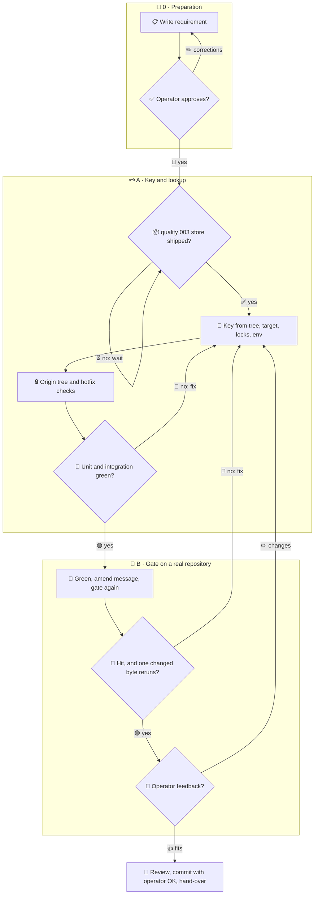

# 011 - Test Result Cache

## User Story

As an agent proving 90/5 with `kvb-check-gate`, I want a target that already
ran green under the exact same inputs to be reused instead of rerun, so that
an identical tree never costs a second full `make test` while a gate still
never passes for a tree it did not run on.

## Decisions (operator-confirmed 2026-11-14; do not re-litigate)

1. **Depends on**: quality 003 (the result store). Independent of 009 and
   010.
2. **Timing**: implementation starts once the running agent lanes are done
   and quality 003 has shipped its store.
3. **Today, measured**: `gate.py` records results per commit sha in
   `kvb-gate.json` in the git common dir. Linked worktrees share that file,
   but a new commit starts from zero even with an identical tree (an amended
   message, a merge commit whose tree equals a gated one), and no clone sees
   another clone's results.
4. **Green only, exact key**: only a GREEN result is reused, under an exact
   key of the git tree hash of `HEAD`, the make target, a digest of the
   lockfiles and toolchain versions and a digest of `custom.env`. A red
   result always reruns and is never stored.
5. **The judge joins the key (proposed)**: the key also holds the digest of
   `gate.py`, the sorted `--fail-regex` patterns, and the path and content
   digest of every untracked, non-ignored file. A green under an older judge
   or fewer fail patterns proves less, and `gate.py run` accepts untracked
   files ("not part of the gate") although a test runner collects them.
6. **Lockfiles and toolchain**: lockfiles are the files named `uv.lock`,
   `poetry.lock`, `Pipfile.lock`, `requirements*.txt`, `package-lock.json`,
   `pnpm-lock.yaml`, `yarn.lock`, `Cargo.lock`, `go.sum`, `flake.lock`,
   `Gemfile.lock` and `composer.lock` anywhere in the worktree, tracked or
   not. The toolchain is the resolved path and first `--version` line of
   `make`, `git`, `python3`, `node` and `docker` on the gate's `PATH`, a
   missing one recorded as absent. Both lists live in one data constant.
   Accepted limit: an image a test pulls by a mutable tag is outside the key;
   such a project pins it in a lockfile or in `custom.env`.
7. **Hit output**: a hit prints `cached green from <run, date>` in the reason
   column of the `run` line, with run = the origin commit's first 8 hex
   digits and its log path, and date = its `finished` time; the entry is
   recorded in `kvb-gate.json` for `HEAD` with `cached_from`, so `gate.py
   status` shows it.
8. **No expiry**. Rejected: a 24 h expiry (an exact key needs none).
9. **Never pass a tree it did not run on**: a hit counts only when the origin
   commit exists in this repository and its tree equals `HEAD`'s tree, the
   tracked tree is clean, and `hotfix.py void` and `pending` decide as for a
   run. A missing quality binary, a store error or a payload that fails
   validation is a miss, never a hit.
10. **Rule text**: the `kvb-check-gate` rule "Only `gate.py run` on this head
    marks a target green" gains one exception: a `gate.py run` on a commit
    with the same exact key. A peer's report, CI and a dirty tree still never
    count.
11. **Payload**: stored through `quality store put` under tool
    `kvb-check-gate`, tool version the `gate.py` digest, rules digest the
    fail-pattern digest and input digest the rest of the key; the payload
    holds only `origin` (`commit`, `finished`, `path`) and an empty
    `findings` list, as quality decision 23 allows.
12. **Accepted limit, measured**: core's `worktree-up` writes per-slot pins
    into each worktree's `custom.env` (`scripts/system/worktree/up.sh`), so
    with a whole-file digest no hit crosses core worktrees; core hits come
    from identical trees in the same worktree.

## Approach

## Acceptance Criteria

### Hit and miss

- [ ] `test_cache_hit_same_tree`: target green on commit A, then commit B
      with A's tree and another message: `gate.py run` does not start make,
      prints `cached green from <sha8> <log>, <finished>`, and `status` shows
      the target green with `cached_from`.
- [ ] `test_cache_red_never_stored`: a red run stores nothing, and the next
      run starts make.
- [ ] `test_cache_key_parts`: each of the tree, the target, one lockfile byte,
      one toolchain version line, one `custom.env` byte, the `gate.py`
      digest, the fail-pattern set and an untracked file changes the key and
      misses.
- [ ] `test_cache_no_expiry`: an entry whose `finished` lies 400 days back
      hits.

### Safety

- [ ] `test_cache_origin_tree_check`: a payload whose origin commit is
      missing locally, or whose tree differs from `HEAD`'s, is a miss.
- [ ] `test_cache_dirty_tree_exits_2`: dirty tracked files exit 2 before any
      lookup, as today.
- [ ] `test_cache_hotfix_void`: with a voiding hotfix, `run` exits 3 and
      records no hit.
- [ ] `test_cache_store_error_runs`: without the quality binary, or with a
      store that errors, `run` starts make as today.
- [ ] `test_cache_never_cross_tree`: over 50 generated commit pairs with
      distinct trees, no lookup hits.

### Skill and script text

- [ ] `kvb-check-gate/SKILL.md` names the exact-key hit as the only other way
      to green, and keeps "a peer's report, CI, a dirty tree never".
- [ ] The `gate.py` docstring documents the key parts and the `cached green
      from` reason.

### Speed

- [ ] On skills, after a green `make test`, `git commit --amend -m <new>`
      followed by `gate.py run --target test` finishes in under 5 s.

### Tests

- **Unit**
  - [ ] `test_cache_key_parts`, the lockfile finder and the toolchain probe
        with a missing tool.
- **Integration**
  - [ ] Temporary git repositories with a stub Makefile and a temporary
        `XDG_CACHE_HOME`: `test_cache_hit_same_tree`,
        `test_cache_red_never_stored`, `test_cache_origin_tree_check`,
        `test_cache_hotfix_void`, `test_cache_store_error_runs`,
        `test_cache_never_cross_tree`.
- **E2E**
  - [ ] `tests/e2e/test_gate_cache_e2e.py`: on a skills worktree, `make test`
        green, an amended message hits, and a one-byte change reruns make.
