# 012 - Match Review

## User Story

As the operator, I want every waiting commit and operator command as a card
in one stack under Tasks, decide each with a swipe and release all decisions
with one passkey at the end, so that I review agent work fast without
terminal prompts.

## Decisions (operator-confirmed 2026-11-14; do not re-litigate)

1. **Cards**: staged commits (diff, score, gate) and operator commands with
   their payload: the command, its directory, its reason and the content of
   every file the command reads (an issue body, a script, a list file).
   Rejected: staged commits only; decision rows as cards (they keep their own
   pick view). Amended by the operator 2026-11-19: every entry under Waits on
   Operator is a card, so the card count equals the Tasks badge: asks,
   choices, decision rows and rule requests join commits and commands. A
   decision card shows its options with the recommended one marked; a pick is
   that card's decision and goes out with the same single passkey, the hub
   posting the answer to the row's agent. A choice cannot be rejected. A rule
   card can be rejected with feedback; accepting opens its row, because the
   passkey signs the rule itself.
2. **Place**: a Match view under the Tasks tab; the Tasks tab badge counts
   every waiting entry as 001 defines it, the cards included (operator
   2026-11-17: asks and decisions stay visible in the badge). Rejected: a
   badge of the cards alone.
3. **Card layout**: on top the agent's face, below it the agent's name and
   its age in days (since its first session), then repository, branch and
   worktree; below them the affected files, each collapsed, opening one
   after another while the card scrolls down and showing the diff (commits)
   or the file content (command payloads) with line numbers.
4. **Marks**: a right-click on a code line (a long press on touch) opens a
   short comment field; the mark stays on the card.
5. **Decide**: the green check at the bottom right, a swipe right or the
   right arrow key accepts; the red cross at the bottom left, a swipe left or
   the left arrow key rejects and opens a feedback popup prefilled with the
   card's marks (file, line, comment), editable; a swipe up or the up arrow
   key moves the card to the back of the stack. Nothing runs while the
   operator swipes.
6. **Release**: after the last card, a list overview shows every decision
   with a way to change it; one passkey signature over the list of card id,
   tree or payload hash and decision releases them all. Accepted commits:
   the agent checks the signature with `approval.py verify` against the
   signed hash and commits. Accepted commands: the hub runs them as it runs
   operator rows today. Rejections: a radio call with the feedback text goes
   to the card's agent. Rejected: a passkey per card; a release button
   without a passkey.
7. **Source**: the existing hub review queue (`approval.py`) and the operator
   rows stay the source of truth. A thin `kvb-match` skill (`match.py add`,
   `list`, `show`) lets an agent add a finished stage as a patch snapshot
   (staged diff, tree hash, score) and shows the cards in a terminal.
   Rejected: a second queue next to the reviews; a UI over the reviews only.
8. **Snapshot binding**: a card shows the patch or payload as it was when it
   was added; when the agent's staged tree or a payload file changes
   afterwards, the card shows `stale` and cannot be accepted until it is
   added again.
9. **Gone rows**: a card whose review or operator row the server no longer
   has leaves the stack on the next refresh; it never shows a 404.
10. **Responsive**: the view works at 390 px and on desktop, with touch
    swipe and mouse drag. Reaching the hub from a phone is a separate
    requirement.
11. **Score labels** (operator 2026-11-19): every card shows the scores its
    text carries as labels, 💰 value included: a commit card from its score
    line, every other card from its command, question or reason, where only
    an emoji-led score counts, so "fix 2 tests" is no score.

## Approach

```mermaid
flowchart TD
    subgraph P["🧭 0 · Preparation"]
        P1["📋 Write requirement"] --> P2{"✅ Operator approves?"}
        P2 -- "✏️ corrections" --> P1
    end
    P2 -- "🤖 yes" --> Q1
    subgraph Q["🗂️ A · Queue and skill"]
        Q1["🧩 match.py add, list, show over the review queue"] --> Q2["📦 Operator rows as cards with payload files"]
        Q2 --> Q3["🔒 Snapshot hash, stale and gone detection"]
        Q3 --> QT{"🧪 Unit tests green?"}
        QT -- "🔴 no: fix" --> Q1
    end
    QT -- "🟢 yes" --> C1
    subgraph C["🃏 B · Card"]
        C1["🙂 Face, name, age, repository, branch, worktree"] --> C2["📜 Files open on scroll, diff with line numbers"]
        C2 --> C3["🖱️ Right-click and long-press marks"]
        C3 --> CT{"🧪 E2E at 1920, 1366, 390 green?"}
        CT -- "🔴 no: fix" --> C1
        CT -- "🟢 yes" --> CF{"💬 Operator feedback on screenshots?"}
        CF -- "✏️ changes" --> C1
    end
    CF -- "👍 fits" --> D1
    subgraph D["👉 C · Decide and release"]
        D1["↔️ Swipe, buttons, arrow keys, later"] --> D2["📝 Feedback popup prefilled from marks"]
        D2 --> D3["📋 List overview of all decisions"]
        D3 --> D4["🔑 One passkey signature over ids, hashes, decisions"]
        D4 --> D5["🚀 Commits verified and committed, commands run, calls sent"]
        D5 --> DT{"🧪 Release and negative control green?"}
        DT -- "🔴 no: fix" --> D1
        DT -- "🟢 yes" --> DF{"💬 Operator feedback?"}
        DF -- "✏️ changes" --> D1
    end
    DF -- "👍 fits" --> E1["🏁 Review, commit with operator OK, hand-over"]
```

## Acceptance Criteria

### Queue and skill

- [ ] `match.py add --repo <worktree>` in a worktree with staged changes adds
      one card whose patch equals `git diff --cached` and whose hash equals
      `git write-tree`; `match.py list` shows it and `match.py show <id>`
      prints its patch.
- [ ] Every open operator row appears as a card with its command, directory,
      reason and the content of each regular file its command names; a
      symlink or a file over the size limit is shown as refused, not read.
- [ ] A card whose staged tree or payload file changed after it was added
      shows `stale` and its accept is disabled.
- [ ] A card whose review or operator row the server no longer returns is
      gone from the stack after the next refresh, without a page reload.

### Card

- [ ] A card shows the agent's face, name, age in days, repository, branch
      and worktree, and the file list.
- [ ] Scrolling down a card opens its files one after another; each shows
      its diff or content with line numbers.
- [ ] A right-click or a long press on a code line adds a mark with a
      comment; the mark is shown at its line.

### Decide and release

- [ ] Swipe right, the check button and the right arrow record accept; swipe
      left, the cross button and the left arrow open the feedback popup
      prefilled with every mark of the card; swipe up and the up arrow move
      the card to the back; no commit and no command runs before the
      release.
- [ ] The list overview shows every decision and lets each be changed
      before the release.
- [ ] The server refuses a release whose passkey signature does not cover
      exactly the listed card ids, hashes and decisions, and refuses a
      replayed signature.
- [ ] After a release, `approval.py verify` accepts an accepted commit only
      at its signed tree hash; a changed index is refused.
- [ ] After a release, each accepted command runs once and its result is
      shown; each rejected card's agent receives a radio call whose text
      contains the feedback.
- [ ] The Tasks tab badge equals the number of waiting inbox entries, every
      waiting card among them.
- [ ] Every ask, choice, decision row and rule request under Waits on
      Operator is a card of its kind; a decision row answered through Match
      leaves the stack until its question changes, and its agent receives the
      pick as a post.
- [ ] A decision card's option buttons record the pick; a choice's reject is
      refused; a rule card's accept opens its row and its reject carries the
      feedback.
- [ ] Every card shows the score labels its text carries, 💰 value included.

### Tests

- [ ] Unit: `match.py add`, `list`, `show`; the snapshot hash; stale and gone
      detection; release signature verification for a valid, a tampered and
      a replayed list; the feedback prefill from marks.
- [ ] Integration: `approval.py verify` against a released list; payload
      extraction from operator rows, including a symlink and an oversized
      file that are refused.
- [ ] E2E: Chromium and Firefox at 1920, 1366 and 390 px swipe through three
      cards (a commit, a command, a stale card), mark a line, reject with
      feedback, open the list overview and release through a virtual WebAuthn
      authenticator; negative control: a decision changed after signing is
      refused.
- [ ] E2E: Chromium at 1920, 1366 and 390 px decides an ask, a choice, a
      decision row and a rule request and releases them with one signature
      (`tests/e2e/test_match_waiting_e2e.py`).
