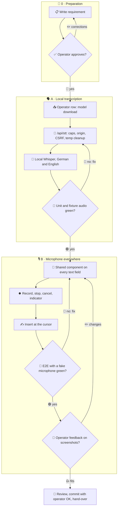

# 013 - Voice Input

## User Story

As the operator, I want a microphone on every text field of the hub that
turns my speech into text on this machine, so that I can work without a
keyboard on a desktop and on a small screen.

## Decisions (operator-confirmed 2026-11-14; do not re-litigate)

1. **Everywhere**: one shared microphone component sits on every `textarea`
   and text input of the hub (composer, radio, feedback popup, marks,
   filters, settings), present by default. Rejected: an opt-in per field.
2. **Local Whisper**: the browser records with MediaRecorder and sends the
   audio to the hub on this machine, which transcribes it with a local
   Whisper model; the audio never leaves the machine and is deleted right
   after the transcription. Rejected: the browser's speech recognition
   (Chrome sends audio to Google, Firefox has none); a browser fallback.
3. **Insert**: the text lands at the cursor; German and English are detected
   automatically; a second tap stops the recording, Escape cancels it, and a
   visible indicator shows while it records.
4. **Model**: the one-time model download is an operator row; without a
   model the button is disabled and its tooltip names that row.
5. **Limits**: a recording is capped at 60 s and 5 MB; the transcription
   endpoint accepts requests only from the hub page, with the same origin
   and CSRF checks as every other POST of the hub.
6. **Responsive**: touch targets of at least 44 px at 390 px; the component
   works with mouse, touch and keyboard.
7. **Order**: built in parallel with 012 in its own sidetree; 012's
   feedback popup and marks get the microphone through the shared component.
8. **German fixture (operator-confirmed 2026-11-17)**: the local small model
   detects a two-word "hallo welt" clip as English, recorded and spoken by
   espeak-ng alike, while it detects a German sentence as German; the
   German fixture is the espeak-ng sentence "Hallo Welt, heute teste ich die
   Spracheingabe." and its criterion checks the language and the start of
   the transcript. Rejected: a recording by the operator, keeping the
   two-word fixture with an open criterion.

## Approach

## Acceptance Criteria

### Transcription

- [ ] A POST of the German fixture WAV, the sentence "Hallo Welt, heute
      teste ich die Spracheingabe." spoken by espeak-ng, to `/api/stt`
      returns language `de` and a transcript starting with "hallo welt"; the
      English fixture returns language `en` and "hello world".
- [ ] The transcription's temp directory is empty after each request,
      including a failed one.
- [ ] A request from another origin, without the CSRF token, over 60 s or
      over 5 MB is refused with 4xx and is not transcribed.
- [ ] Without an installed model, `/api/stt` answers with the operator row
      that installs it, and the button is disabled with that row in its
      tooltip.

### Microphone

- [ ] A DOM scan of every hub view finds no `textarea` or text input without
      the microphone button.
- [ ] Pressing the button records, a second press stops and the transcript
      appears at the cursor; Escape cancels without inserting text; an
      indicator shows while it records.
- [ ] At 390 px the button's touch target is at least 44 by 44 px.

### Tests

- [ ] Unit: the endpoint caps, the origin and CSRF checks, the temp cleanup
      and the language selection.
- [ ] Integration: the real model transcribes both fixture files, run
      through `queue.py hold`.
- [ ] E2E: Chromium and Firefox with a fake microphone stream fed from a
      WAV file, at 1920 and 390 px; the transcript appears in the composer;
      negative control: with the model missing the button is disabled.
