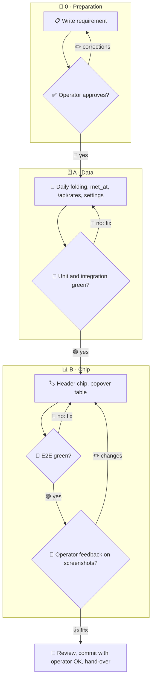

# 014 - Header Rates

## User Story

As the operator, I want a chip in the hub's header that shows how much work
gets done, how many tokens it costs and how loaded the host is per minute,
hour, day, week, month, year or in total, so that I see the pace of the agents
at a glance on every screen.

## Decisions (operator-confirmed 2026-11-14; do not re-litigate)

1. **Rates per period**: the operator picks minute, hour, day, week, month,
   year or total. Per period the chip shows the work items as three separate
   kinds (register tasks done, commits, key results met), the tokens, and
   the average CPU %, RAM %, VRAM (used and %), swap % and disk usage over
   that period. Total means since records begin: totals for counts,
   all-time averages for gauges.
2. **Exact windows on the server**: `/api/rates` returns one small JSON for
   all periods, each window ending now. Sources: the sampler's
   `samples.jsonl` and `tokens.jsonl`, the register's `rasci.json` (a task's
   `end` once done) and the score journal `scores.jsonl` (a row with a sha is
   a commit, counted once per remote and sha); the hub's existing readers
   read them, no second parser.
3. **Daily buckets kept forever**: the sampler's retention folds rows older
   than 90 days into one row per day, kept forever, with `mean_row` and the
   bucket folding; a folded row carries `span`, the seconds its rows sampled,
   and `width`, its bucket's seconds; the gauges weight every row by its span
   (a raw row 60 s) and a row whose bucket straddles a window start by the
   share inside. Token rows of a day that ended more than 90 days ago fold
   into one row per day, agent and model with `width`, kept forever; a window
   reaching back before the first token row is an estimate (≈, source total)
   scaled from the token rows there are.
4. **KR met timestamp**: `rasci.py kr <task> met <n>` records `met_at` with
   `stamp()` when the key result turns met, `open <n>` drops it. A key result
   met without `met_at` stays so when met again, never counts in a window,
   but counts in total. The commit table after a commit (`score.py
   --commit-table <repo> --commit <sha>`) appends a journal row with the full
   sha and the commit time unless one for that remote and sha exists, so the
   commits count.
5. **Extrapolation from the next longer window**: a period without an event
   of a kind takes the shortest longer window (hour, day, week, ..., total)
   that holds some and scales it to the period; the chip shows it with ≈ and
   names the source window in a tooltip, the API with
   `approx: true, source: "<period>"`. Token rows are hourly, so the minute
   always takes a longer window. Gauges never extrapolate; a gauge without a
   sample shows n/a.
6. **Chip and popover**: the chip shows the period picker and 2 to 3 chosen
   metrics; a click opens a table of every metric and every period. Period
   and chip metrics persist in the hub settings (`rates`), which need no
   passkey. The chip fetches `/api/rates` on the page's refresh tick at most
   every 60 s.

## Approach

## Acceptance Criteria

### Data

- [ ] Each period counts the events inside its window; total counts every
      event, also those without a time.
- [ ] A token row counts in a window by the share of its hour inside it.
- [ ] Gauges average every window across raw rows, 15-minute means and daily
      means, each weighted by its span.
- [ ] An empty minute takes the hour, an empty hour the day, marked approx
      with the source; a gauge without a sample is null.
- [ ] Retention folds days older than 90 days into one row each, idempotent,
      and keeps them forever.
- [ ] `met_at` is set when a key result turns met, kept on a second met,
      never added to one met before it existed, and dropped on open.

### Chip

- [ ] The chip sits right of the Live chip, shows the chosen period and
      metrics and never widens the header at 1920, 1366 or 390.
- [ ] A period change and a metric swap persist over a reload.
- [ ] The popover opens on click and closes on Escape, a second click and a
      click outside.

### Tests

- [ ] Unit: window sums and averages per period and row tier,
      extrapolation, daily folding, `met_at`, the settings round trip.
- [ ] Integration: the hub serves `/api/rates` from fixture files.
- [ ] E2E: Chromium and Firefox at 1920, 1366 and 390: chip, persisted
      period, popover open and close; screenshots for the checkpoint.

## Known Limits

- Tokens before the first token row are unknown; the windows reaching back
  before it show a scaled estimate.
- A cold `/api/rates` call decodes every sample row; on a year of samples the
  JSON decoding alone takes about 180 ms.
