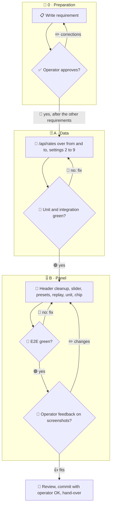

# 015 - Time Range in the Rates Panel

## User Story

As the operator, I want to pick any window of the hub's history and the rate
unit in the one Rates per period panel, and read every rate over exactly that
window, so that I see how the agents worked in any past stretch with one
control instead of three.

## Decisions (operator-confirmed 2026-11-17; do not re-litigate)

1. **One panel**: the time range menu (`1 h ▾`) and the rate period select
   leave the header; time range, replay and rate unit live in the Rates per
   period panel the rates chip opens. The header keeps the Live line and the
   chip. Rejected: keeping the header menus as shortcuts (two controls for
   one value).
2. **Two-thumb slider over the whole history**: one slider spans the first
   record to now with a From and a To thumb; the window moves and stretches
   freely, the thumbs never cross. Presets 1 h, 6 h, 24 h, 7 d and all set
   both thumbs with the end at now; arrow keys step a thumb; the exact From
   and To inputs stay below the slider. The window drives the whole page as
   the time range does today. Rejected: a length and an end slider (two
   controls for one window), a brush on a mini timeline (most effort).
3. **Replay and Live**: Replay slides the window at its length from where it
   stands to now in 48 steps of 500 ms; a click pauses. Live puts the To
   thumb on now and keeps the length. A window ending at now is live.
4. **Rates over the chosen window**: a count is the sum inside the window, a
   gauge its average over the window. Every unit column converts that one
   window: per minute, hour, day, week, month (30 days) and year (365 days);
   `all` is the sum inside the window (a gauge: its average). Example: last
   7 days and unit day give the mean daily tokens of those 7 days. A window
   reaching back before the first record of a kind divides by the covered
   part and shows ≈, the covered span in the tooltip. Rejected: each column
   its own trailing window and the scaling from the next longer window
   (014 decisions 2 and 5), one value column only.
5. **Chip**: shows window and unit (`7 d · /d`) and the chosen metrics, 2 to
   9 of the nine; the default stays tasks done, tokens, CPU. Where the header
   lacks room the chip shows as many as fit and `+n`. Rejected: a limit of 3
   or 5.
6. **Persistence**: unit and chip metrics persist in the hub settings
   `rates` without a passkey, as today; the window stays page state, 1 h
   live on load, as today.
7. **Timing**: implemented after every other open skills requirement.

## Approach

## Acceptance Criteria

### Data

- [ ] `/api/rates?from=<s>&to=<s>` returns per unit and metric the window's
      sum converted to the unit, or the gauge's average; `all` holds the sum.
- [ ] A 7-day window holding 7,000,000 tokens gives `day` 1,000,000, `week`
      7,000,000 and `all` 7,000,000.
- [ ] A window starting before the first record of a kind divides by the
      covered seconds and returns `approx: true` with `covered` seconds.
- [ ] A gauge without a sample in the window returns null.
- [ ] `rates.metrics` accepts 2 to 9 distinct metrics; 1 or a duplicate is
      refused with a 400.

### Panel

- [ ] The header holds no time range menu and no rate period select; the
      Live line and the chip stay.
- [ ] The panel shows the presets, the two-thumb slider, Replay, Live, the
      From and To inputs, the unit picker and the table.
- [ ] Dragging From to 9 days ago and To to 2 days ago reloads the stream,
      the charts and the rates for that window, and the label names both
      ends.
- [ ] Each preset sets both thumbs with the end at now.
- [ ] ArrowLeft and ArrowRight move the focused thumb one step; From never
      passes To.
- [ ] Replay slides the window to now and ends live; a click pauses it.
- [ ] With 7 d and unit d the chip's tokens equal the table's `d` cell and
      the window's token sum divided by 7.
- [ ] With 9 metrics chosen the chip shows every one at 1920 and `+n` at
      390, and the header never grows wider than the viewport.
- [ ] Unit and metrics survive a reload; the window returns to 1 h live.

### Tests

- [ ] Unit: window sums per unit, the covered part and approx, gauge
      averages over the window, the settings round trip with 2 and 9 metrics.
- [ ] Integration: the hub serves `/api/rates?from&to` from fixture files.
- [ ] E2E: Chromium and Firefox at 1920, 1366 and 390: header without the
      old controls, slider by mouse and keys, presets, replay to live, unit
      change, the 9-metric chip; screenshots for the checkpoint.
