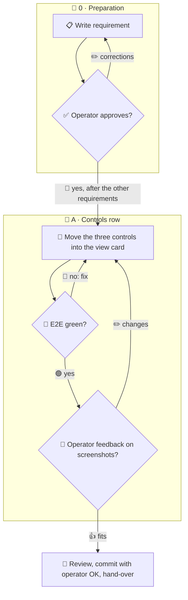

# 016 - Agents Controls in the View Row

## User Story

As the operator, I want the Priority, Day/Night and Status controls of the
agents screen in the row of its view switcher, so that the screen spends one
row on controls and the graph gets the room.

## Decisions (operator-confirmed 2026-11-17; do not re-litigate)

1. **One row**: the controls card holds on the left the view switcher
   (Orbit, Chord, Swimlane, Tree, 3D, Hierarchy) and the 3D layout tools, on
   the right Priority, Day/Night and Status; the toolbar row above it goes.
   Rejected: keeping the separate toolbar row.
2. **Same controls**: the three keep their menus, labels and behaviour; only
   their place changes.
3. **Narrow screens**: without room for one row the right group wraps under
   the switcher, aligned right, with no horizontal scroll.
4. **Timing**: implemented after every other open skills requirement.

## Approach

## Acceptance Criteria

### Layout

- [ ] On every agents view the `.graph` holds no `.toolbar` before
      `.card.controls`.
- [ ] `.card.controls` holds the View group first and Priority, Day/Night
      and Status last; at 1920 and 1366 the Status menu's right edge lies
      within 16 px of the card's content edge.
- [ ] At 390 the document's `scrollWidth` is at most `innerWidth` and the
      three controls sit below the switcher.

### Behaviour

- [ ] Priority opens the agent order, Day/Night shows the night mode and its
      actions, Status hides and shows agent states, each as before.

### Tests

- [ ] Unit: n/a: a layout change without logic.
- [ ] Integration: n/a: no server change.
- [ ] E2E: Chromium and Firefox at 1920, 1366 and 390 on Orbit, Chord,
      Swimlane, Tree, 3D and Hierarchy: the row, the wrap, the three menus
      open; screenshots for the checkpoint.
