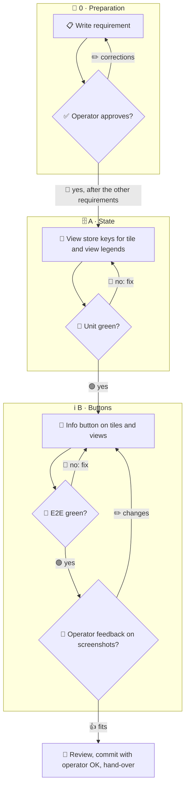

# 017 - Legend Toggle

## User Story

As the operator, I want to hide and show a chart's legend on its Home tile
and in its view, so that a small tile shows the chart instead of its legend.

## Decisions (operator-confirmed 2026-11-17; do not re-litigate)

1. **Info button**: a button with the info icon (`bi-info-circle`) and
   `aria-pressed` shows or hides the legend; on a Home tile it sits left of
   the Open button, in a view next to the star. Only panels whose content
   holds a legend get it, among them Tasks burndown and burnup, Tokens and
   Hardware resources.
2. **Per tile and per view, in the hub store**: each Home pin and each view
   keeps its own state in the hub view store, shared by every browser; the
   default is shown. Rejected: one global switch, a per-browser state.
3. **The chart takes the room**: a hidden legend frees its space for the
   chart; series switched off in legend chips stay off while the chips are
   hidden.
4. **Timing**: implemented after every other open skills requirement.

## Approach

## Acceptance Criteria

### Button

- [ ] A DOM scan of Home and every view finds the info button exactly on
      the tiles and views whose content holds a `.legend`.
- [ ] On a tile it is the head button left of Open; in a view it sits next
      to the star.
- [ ] A click hides the legend and the chart's height grows; a second click
      shows it again.

### State

- [ ] The state survives a reload and shows in a second browser.
- [ ] Hiding the legend on the Tokens tile leaves the Tokens view's legend
      shown, and the reverse.
- [ ] With the IAM series switched off and the Tokens legend hidden, the
      chart still leaves IAM out.
- [ ] The view store refuses an unknown panel key and a non-boolean value
      with a 400.

### Tests

- [ ] Unit: view store validation and defaults of the legend keys.
- [ ] Integration: the hub keeps the legend state across a restart from its
      view file.
- [ ] E2E: Chromium and Firefox at 1920, 1366 and 390: the scan, hide and
      show on a tile and in a view, persistence across a reload and a second
      browser; screenshots for the checkpoint.
