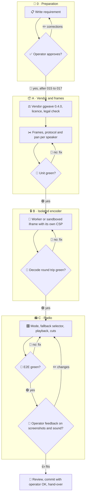

# 018 - Gibberlink

## User Story

As the operator, I want the radio to send agent messages as real ggwave data
sound, as a mode of its own and as the fallback where speech cannot play, so
that a machine can decode every message and its sender from the audio while I
hear which agent transmits.

## Decisions (operator-confirmed 2026-11-17; do not re-litigate)

1. **Real ggwave**: ggwave 0.4.0 from npm (MIT, the only JavaScript build,
   2022-07-05), vendored under `orchestrator/vendor/ggwave/` with its sha256
   pinned, the MIT text of the upstream repository at v0.4.0 beside it (the
   npm tarball ships none) and a `kvb-check-legal` pass (order 2026-11-14).
   Rejected: a sound imitation (not decodable), the Python package (source
   only, a C++ toolchain at install), a rebuild from source with emscripten
   (toolchain cost; revisit when a newer protocol is needed).
2. **Isolated encoder**: ggwave.js needs `new Function` (embind) and
   WebAssembly, so it runs in a worker or a sandboxed iframe with its own CSP
   (`'unsafe-eval' 'wasm-unsafe-eval'`, no network, no DOM); the page posts
   protocol and text and plays the samples it gets back. The hub page CSP
   gains only the encoder's source, never `'unsafe-eval'`. The e2e in
   Chromium and Firefox decided (2026-11-17): a sandboxed iframe whose
   response also sets `sandbox allow-scripts`, so the server keeps it in an
   opaque origin however it loads. Rejected: `'unsafe-eval'`
   on the hub page, which signs with the passkey; encoding in a node
   subprocess of the hub (node becomes a hub runtime dependency).
3. **Mode**: Gibberlink joins Auto, Quiet, Silence and Morse. Every message
   sends whole as frames; MAYDAY, PAN-PAN and Sécurité speak their procedure
   word first, as in Quiet and Silence. Stop cuts at once, a mode change cuts
   and replans, and a row of a higher class cuts a running row, which sends
   again whole after it (as Morse, 004 decision 1). Rejected: frames only,
   like Morse (a MAYDAY would sound like any other chirp).
4. **Frames**: ggwave carries at most 140 bytes per transmission, so a
   message splits into self-identifying frames like packet radio: frame 1 is
   the sender's full session key, `1/m` and text, frames 2 to m its first 8
   characters, `n/m` and text, each at most 140 UTF-8 bytes and never split
   inside a character. The session key is the row's `source`, the key the
   hub resolves for the sender; the text leaves out the hub's message mark.
5. **One sound per agent**: from the speaker slot that already gives voice
   and Morse pitch, each agent gets one of the four audible protocols the
   vendored ggwave decodes (Normal, Fast, Fastest, DT Fastest) and one of
   five stereo positions, 20 distinct sounds; they repeat beyond that. No
   pitch shift, as ggwave decoders listen on fixed bands. Ultrasound and
   custom protocols stay out. Amended 2026-11-17 on evidence: DT Normal and
   DT Fast of ggwave 0.4.0 fail to decode at most lengths from 5 bytes up,
   even on a perfect digital channel, while the four decode at every length
   from 1 to 140. Rejected: all six audible protocols (two undecodable); a
   rebuild from current upstream (decision 1); the MT protocols of the order
   (not in 0.4.0).
6. **Fallback**: where the burst plays today (Auto with the CPU gate closed,
   Quiet), a selector in the radio gear picks what plays for the rest of the
   message: Gibberlink frames (default), Morse keying or the hiss, today's
   burst. The pick is kept per browser in the radio set beside mode and
   squelch. Rejected: a hub setting for every browser.
7. **Volume**: frames play at the row's tone volume times the squelch, as
   burst and Morse do.
8. **Timing**: implemented after 015 to 017 are committed.

## Approach

## Acceptance Criteria

### Vendor and Licence

- [ ] `orchestrator/vendor/ggwave/ggwave.js` equals the file of the npm
      tarball `ggwave-0.4.0.tgz` (integrity
      `sha512-+sKq0aIEVJ7zHj4Vw+Sj/RPa91xp76ihaG5gsOKZ8ojM5+uUu3NFzAspozwBx/zeaThxP5VeIkA2bbsfWpUd2g==`),
      its sha256 pinned in `tests/test_hub_artifacts.py`.
- [ ] `orchestrator/vendor/ggwave/LICENSE` holds the MIT text of the upstream
      repository at v0.4.0, the README names ggwave 0.4.0 beside the other
      vendored libraries, and `kvb-check-legal` reports no blocker.

### Encoder

- [ ] The hub page's `Content-Security-Policy` holds no `'unsafe-eval'`; the
      encoder's own response carries `'unsafe-eval' 'wasm-unsafe-eval'` and
      `connect-src 'none'`.
- [ ] For each of the four protocols, samples from the encoder decode back
      to the frame text with the same vendored ggwave.js.

### Frames and Sound

- [ ] A 300-byte message from a 36-character session key splits into frames
      of at most 140 UTF-8 bytes; frame 1 starts with the full key and
      ` 1/m `, every later frame with the first 8 characters and ` n/m `; the
      frame texts joined give the message without the hub's mark.
- [ ] A message with "ä", "€" and an emoji at a frame edge splits between
      characters, never inside one.
- [ ] Every speaker gets one stable protocol of the four and one stable
      stereo position from its speaker slot; four speakers in four distinct
      protocol slots get four distinct protocols.

### Radio

- [ ] The mode row offers Gibberlink beside Auto, Quiet, Silence and Morse;
      in Gibberlink `RadioSet.plan` gives MAYDAY, PAN-PAN and Sécurité their
      procedure word, then the frames of the whole message, and every other
      class the frames only.
- [ ] In Auto with the gate closed and in Quiet, `plan` gives the fallback
      after the word: Gibberlink frames by default, Morse keying or the burst
      when picked; the pick survives a reload in this browser and never
      appears in the hub settings.
- [ ] Stop ends the frames at once; a MAYDAY arriving during a post's frames
      cuts them, and the post sends again whole after the MAYDAY.
- [ ] Frames play at the row's tone volume times the squelch; squelch 0
      plays none.

### Tests

- [ ] Unit: frames (byte budget, headers, characters, joined text), protocol
      and pan per speaker slot, `plan` per mode and fallback, radio set
      validation of the fallback pick.
- [ ] Integration: node decodes the encoder's samples for all four protocols
      back to the frame text; the hub serves the encoder files with their own
      CSP and the page CSP without `'unsafe-eval'`.
- [ ] E2E: Chromium and Firefox at 1920, 1366 and 390: the Gibberlink mode
      button, the fallback selector in the gear, a posted message whose
      captured frames decode to the message, no CSP violation on the hub
      page; screenshots for the checkpoint.
