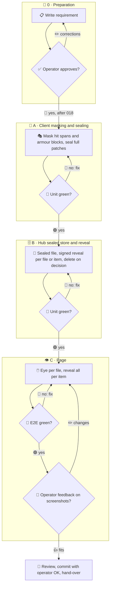

# 019 - Reveal withheld diff content

## User Story

As the operator, I want a diff file that hits a secret rule to show with only
the hits masked, and the hits shown after a passkey approval per file or per
item, so that I can review every change while no secret reaches the hub page
unasked.

## Decisions (operator-confirmed 2026-11-17; do not re-litigate)

1. **Mask, not withhold**: the client masks only each match of a MEDUSA
   secret rule with `••••`, and every PEM armour block from its BEGIN to its
   END line; the rest of the patch shows. A file for which no secret rule
   loads stays withheld whole (fail closed), but revealable. Rejected:
   withholding the whole file by default (hid `tests/test_hub_view.py` over
   `tokens = {...}`).
2. **Passkey approval, two scopes**: an eye button per masked file reveals
   that file; one button per item reveals every masked file of the review or
   ask. The passkey signs `reveal`, kind, id and the paths. Rejected: a plain
   confirm click (anyone with page access could reveal).
3. **Sealed store**: the client sends the full patches of the masked files
   with the request, kept in a sealed file per item
   (`<id>.<kind>-sealed.json`, mode 0600), never in the snapshot, the stream
   or `/api/diffs`; the hub deletes it once the item is decided or expires.
   Rejected: keeping it with the review (the secret stays on disk longer);
   the hub reading git (the hub runs no git by design).
4. **Both kinds**: review diffs (`approval.py`, `tree_diff`) and ask diffs
   (`permission_hook.py`, `bound_diff`).
5. **Audit**: every reveal logs an approval-stream event with kind, id and
   paths, never the content.
6. **Page memory only**: revealed text stays in page memory until the item
   leaves Waits on Operator; never in `localStorage` or the view store.
7. **Timing**: implemented with the other open requirements before the one
   final suite plus all e2e on master (operator order 2026-11-17); per
   bundle only the MEDUSA scan runs. Rejected: waiting for the 018 commit
   (it waits for that same final run).

## Approach

## Acceptance Criteria

### Client

- [ ] On a file holding `tokens = {"chart": "tokens"}` and an unrelated line,
      `tree_diff` and `bound_diff` give a patch where only the match reads
      `••••`, note `masked`, and the unrelated line is unchanged.
- [ ] A PEM block masks every line from BEGIN to END; without loadable rules
      every text file keeps the note `content withheld` and an empty patch.
- [ ] The request carries the full patches of the masked or withheld files
      apart from `diff`; `diff` itself never holds a masked span in clear.

### Hub

- [ ] The sealed file exists with mode 0600 next to the item, is absent from
      `/api/diffs/<kind>/<id>`, the snapshot and the stream, and is deleted
      after the grant, the denial or the expiry.
- [ ] `POST /api/diffs/<kind>/<id>/reveal` answers the patches only for a
      pinned passkey's unexpired, unreplayed signature over `reveal`, kind,
      id and exactly the requested paths; a wrong path, a replay, a missing
      proof or a decided item answers 4xx without content.
- [ ] Every reveal adds one approval event with kind, id and paths and no
      patch text.

### Page

- [ ] A masked file shows its patch with the `••••` spans and an eye button;
      an item with 2 or more masked files shows one reveal button; after the
      passkey the clear patch replaces the masked one.
- [ ] Revealed text is never written to `localStorage` or the view store and
      is gone once the item leaves Waits on Operator.

### Tests

- [ ] Unit: span masking (rule match, armour block, no rules), sealing apart
      from `diff`, sealed file mode and deletion per decision path, reveal
      signature (per file, per item, wrong path, replay, decided item), audit
      event without content.
- [ ] Integration: `approval.py` and the permission hook send masked `diff`
      plus the sealed patches to a test hub; a signed reveal returns the
      clear patch.
- [ ] E2E: Chromium and Firefox at 1920, 1366 and 390: the masked file with
      its eye button, the per-item reveal, the clear patch after the virtual
      passkey, no CSP violation; screenshots for the checkpoint.
