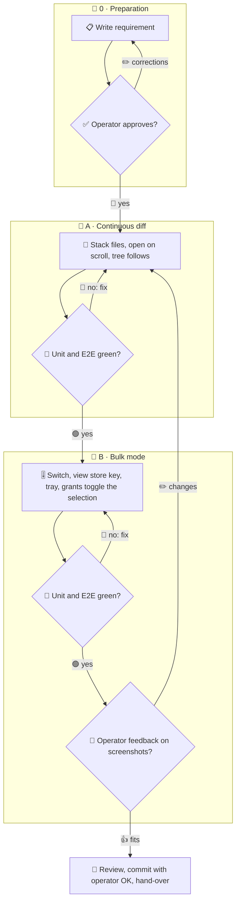

# 020 - Bulk grant mode and continuous diff

## User Story

As the operator, I want one switch at the top right that turns every grant
button of the hub into "add to selection", with one tray that grants the
selection under one passkey signature, and a review diff that runs on into
the next file as I scroll, so that I can review and grant many items in one
pass.

## Decisions (operator-confirmed 2026-11-17; do not re-litigate)

1. **Continuous diff**: the review sheet stacks every file in one scroll; a
   file opens when the end of the file before it comes into view (as
   `openOnScroll` does in the Match deck); the tree marks the file in view
   and a click in the tree scrolls to that file. Rejected: overscroll
   advance (trackpad inertia skips files), a "Next file" button (not
   automatic).
2. **Mode switch**: a segmented control "Direct | Select" in the header
   tools at the top right; Direct keeps today's behaviour. Rejected: a
   switch per view.
3. **What collects** (operator 2026-11-20): in Select, every grant button
   and every option pick toggles its item into one shared selection
   (pressed state): inbox rows, Home, stream rows, the review sheet and the
   key `a`. A decision or decision row keeps the option picked for it;
   picking the same option again takes it out. Grant n first asks one
   signature per rule request and per red-gate review, one after the
   other, since the server accepts neither inside a batch, then signs
   every batchable item under one passkey signature. A commit row brings
   the pending reviews its `approval.py verify` steps check along, and
   the server settles it after them, so it runs only once they are
   approved (operator 2026-11-20: approve-and-run). Deny always
   acts at once with its reason; the Match deck and the palette keep their
   own confirmed release. Rejected: a unified tray where denials collect
   too; rules, red-gate reviews and option picks acting directly in Select
   (operator 2026-11-20: Select applies to every item).
4. **Tray**: in Select, beside the switch: `n selected` with Grant n,
   Deny n, Grant all green and Clear. Grant and Deny open the existing
   selection sheet that lists every entry and full command; one passkey
   signs, then 3 s remain to undo. The selection is the inbox selection
   (`ui.selected`), kept in page memory until granted, denied or cleared.
5. **Memory**: the mode lives in the hub view store (`approval.mode`,
   `direct` or `select`, default `direct`), like the legend toggles.
   Rejected: per browser only.
6. **Trust unchanged**: nothing is granted without the passkey signature
   over exactly the listed items; server and signing path stay as they are.
   Rejected: a trust window of direct grants without a prompt.
7. **Timing**: after 018, reject-with-reason and the score chips.

## Approach

## Acceptance Criteria

### Continuous diff

- [ ] A review of 3 files shows file 1 open, files 2 and 3 closed; scrolling
      the diff pane to the end of file 1 opens file 2 without a click, and
      the tree marks the file in view.
- [ ] A click on file 3 in the tree scrolls file 3 to the top of the pane
      and opens it.

### Bulk mode

- [ ] The header tools hold a "Direct | Select" switch; its state is stored
      as `approval.mode` in the view store, survives a reload, and the store
      refuses any value but `direct` or `select`.
- [ ] In Select, the grant button of a green review, an ask and a runnable
      operator row (inbox, Home, stream, review sheet, key `a`) sends nothing
      to `/api/sign` and adds the item to the selection; a second press
      removes it; the tray counts it.
- [ ] Tray "Grant n" opens the selection sheet with exactly the selected
      entries; one passkey signature covers them all, and after the undo time
      each is granted.
- [ ] In Select, an option pick on a decision or decision row, the grant of
      a red-gate review and Accept on a rule request add the item to the
      selection; Grant n posts the batchable items under one signature, then
      each rule and red-gate review under its own; Deny acts at once in both
      modes.
- [ ] A grant, option pick or checkbox in Waits on Operator never scrolls
      the page; only `j` and `k` move the view to the cursor.
- [ ] In Direct, every grant button acts as today and the tray is hidden.

### Tests

- [ ] Unit: view store validation of `approval.mode`; page vm: a grant in
      Select toggles `ui.selected` without a post, a grant in Direct posts,
      an option pick collects with its label, a rule and a red-gate review
      collect and get their own signature before the batch, a commit row
      grants the reviews it verifies first, the tray counts.
- [ ] Integration: n/a: the server and the signing path stay unchanged
      (decision 6).
- [ ] E2E: Chromium and Firefox at 1920, 1366 and 390: the continuous diff
      opens file 2 on scroll and jumps to file 3 from the tree; the switch
      persists over a reload; three grants in Select give a tray of 3;
      Grant 3 makes one signed post listing 3 items; Direct posts at once; no
      horizontal scroll; screenshots for the checkpoint.
