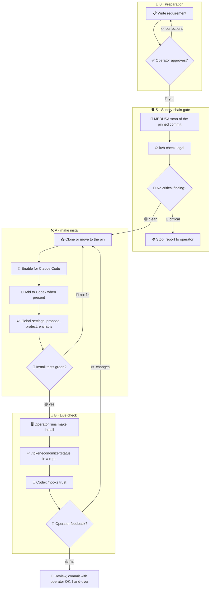

# 021 - TokenEconomizer by Default

## User Story

As the operator running many agent sessions across repositories, I want
microsoft/TokenEconomizer installed and on by default for Claude Code and
Codex in every repository through the skills `make install`, so that sessions
stop paying for failing loops and rediscovered repository facts, without any
tool silently disappearing from an agent.

## Decisions (operator-confirmed 2026-11-17; do not re-litigate)

1. **Source and pin**: microsoft/TokenEconomizer (MIT), pinned to commit
   `b57d03f81585a18b936a0eaecbd1eb51cdcecf71`. The pin is one constant in
   the skills repository; raising it is a reviewed change. Rejected: tracking
   `main` (unreviewed hook code would run in every session outside the
   sandbox).
2. **Supply-chain gate**: a MEDUSA scan of the pinned commit and a
   kvb-check-legal pass come before the first install; a critical finding
   stops the rollout. The README badge says Apache 2.0, the LICENSE file says
   MIT; the LICENSE file governs.
3. **Install path**: the skills `make install` (TARGET = HOME) clones it to
   `~/Repositories/github.com/microsoft/TokenEconomizer` (pkgmgr layout) at
   the pin, enables it for Claude Code in `~/.claude/settings.local.json`
   (the caveman/ponytail mechanism of `scripts/enable-plugins.js`) and, when
   `codex` is on PATH, adds it to Codex (`codex plugin marketplace add`,
   `codex plugin add`). Rejected: one-off operator rows (not reproducible on
   another machine).
4. **Tool pruning: propose + protect**: `toolprune=propose` globally; deny
   lists are only proposed, the operator applies one per repository with
   `/tokeneconomizer:toolprune apply`. `toolprune_protect` names the tools
   that are rare but critical here: `AskUserQuestion`, `Artifact`, `Skill`,
   `Agent`, `ToolSearch`, `mcp__kvb-orchestrator__*`,
   `mcp__codebase-memory-mcp__*`, `mcp__plugin_codebase-memory_*`. Rejected:
   `auto` (writes deny rules into `.claude/settings.local.json` after 60 idle
   minutes and could silently drop the hub approval tools), `off`.
5. **Micro-skills: envfacts**: facts only from failures that repeat across
   sessions, no model calls. Rejected: `on` (paid proposer every 3 sessions
   per repository), `off`.
6. **Loop guard: plugin default (on)**: the judge runs through the agent only
   when a turn shows loop signs; it redirects once and never stops a turn.
7. **Global settings** are written with the clone's own launcher
   (`plugin/scripts/te config set ... --global`), idempotent on every
   install.
8. **Codex hook approval stays manual**: Codex asks once per hook change
   (`/hooks`, Trust all); the install prints that step in one line.
   Rejected: editing Codex's trust store by script.
9. **Local security patch until upstream fixes it** (operator pick
   2026-11-17 "1 und 2", after the review in decision 2): the pin carries
   two holes. `context.py` starts `python -m tokeneconomizer.plugin.cli`
   with the repository as cwd, so a `json.py` or `tokeneconomizer/`
   planted there runs outside the sandbox; `write_json` and `_write_text`
   in `denylist.py` follow a symlink planted at the `.te.tmp` name.
   `patches/tokeneconomizer.patch` is the diff of upstream PR #261
   (microsoft/TokenEconomizer, fixes issue #260; operator 2026-11-17 chose
   the public issue and PR over the private channel): the child starts as
   `python -E -s -X utf8 -c` with the plugin directory first on
   `sys.path`, the aider probe runs in an empty directory, and temporary
   and settings files open with `O_NOFOLLOW` (the temporary one also
   `O_CREAT|O_EXCL`). The install applies it on top of the pin, and a
   clone that differs from pin plus patch is refused, left as found; the
   patch is dropped once a fixed upstream commit is pinned. Rejected:
   parking the rollout until upstream fixes it; installing unpatched;
   `PYTHONSAFEPATH=1`, which an empty `PYTHONPATH` element bypasses.

## Approach

## Acceptance Criteria

### Supply chain

- [ ] A MEDUSA scan of the pinned commit is saved under
  `.state/evidence/tokeneconomizer/` and reports no critical finding, or the
  rollout stopped with the finding reported.
- [ ] kvb-check-legal names the MIT licence of the pinned commit.
- [ ] The regression tests of PR #261 (`tests/test_live_safety.py`) pass on
  pin plus patch and fail on the bare pin: planted `json.py`, `runpy.py`,
  `sitecustomize.py` and `tokeneconomizer/` with no, an empty and a `.`
  `PYTHONPATH` element, a planted `aider/`, and symlinked temporary and
  settings files.
- [ ] Issue #260 and PR #261 are open on microsoft/TokenEconomizer.

### Install

- [ ] `make install` with an empty clone path leaves
  `~/Repositories/github.com/microsoft/TokenEconomizer` with `HEAD` equal to
  the pin.
- [ ] A clone at another commit is moved to the pin and patched; a clone
  with changes beyond the patch is left as found, patch included, with a
  warning and a non-zero install status.
- [ ] `~/.claude/settings.local.json` holds
  `enabledPlugins["tokeneconomizer@tokeneconomizer"] = true` and the
  `tokeneconomizer` marketplace pointing at the clone; a second install
  changes nothing.
- [ ] With `codex` on PATH, `codex plugin list` shows tokeneconomizer
  enabled; without `codex`, the install skips it with one line.
- [ ] `te config show --global` (or its equivalent) reports
  `toolprune=propose`, `microskills=envfacts` and the protect list of
  decision 4.
- [ ] The install prints the Codex `/hooks` approval in one line.

### Live

- [ ] `/tokeneconomizer:status` in a fresh Claude Code session in this
  repository reports the plugin active with the settings above.
- [ ] After 10 prompts no file `.claude/settings.local.json` in any
  repository gained a deny rule written by the plugin.

### Tests

- Unit: `tests/test_install.py` covers the settings merge (marketplace,
  enabled plugin, idempotence) and the pin logic (fresh, moved, dirty)
  against a local bare repository standing in for GitHub.
- Integration: `make install` into a temporary HOME with a fake `codex` and
  a local clone source asserts the settings file, the clone pin and the
  global TokenEconomizer settings.
- E2E: n/a: needs a signed-in agent; covered by the operator's live check.
