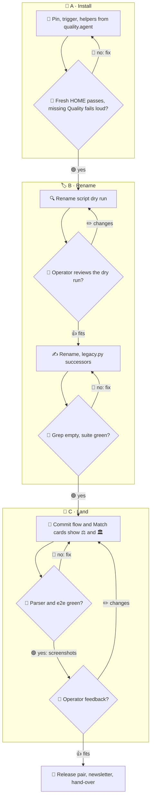

# 022 - Analysis Skills from Quality

## User Story

As the operator, I want the skills `make install` to install Quality's
`kvb-quality-*` analysis skills at a pinned version and every skill here to
call them by their new names, so that analysis lives once in Quality and
this repository only orchestrates.

## Decisions (operator-confirmed 2026-11-18; do not re-litigate)

1. **Trigger**: `scripts/install.sh` clones or updates
   `~/Repositories/github.com/infinito-nexus/quality` at the pin and runs
   its `make install`, as `scripts/tokeneconomizer.sh` does for
   TokenEconomizer. A failed Quality install fails `make install` and names
   Quality, because radio, queue, rasci and other skills import Quality's
   helpers (decision 9). Rejected: copying Quality's files here; redirect
   skills under the old names; warning and going on (those skills would
   break at their first run).
2. **Pin**: one Quality tag in `plugins-lock.json`; raising it is a reviewed
   change.
3. **Old names leave**: the eight skills of Quality 003 decision 1 leave
   `skills/`; the skill-token half of `kvb-check-efficiency` stays as
   `kvb-skill-tokens`; `kvb-check-gate` stays here as `kvb-org-gate`
   (operator 2026-11-18: it orchestrates queue, register and hotfix runs).
   One script renames every reference (611 files today); its dry run is
   reviewed before it writes.
4. **Installed leftovers**: `kvb-skill-cleanup`'s `legacy.py` reports each
   old folder as `legacy` with its successor, and `make install` removes it.
5. **Newsletter**: `kvb-org-update` names each rename once, so running
   agents re-read the new skills.
6. **Release pair**: Quality's release first, then this repository's release
   raising the pin; neither alone.
7. **First contracts**: `.quality/architecture.yml` here declares contracts
   for Quality 005 decision 3 only after an import-graph read confirms them;
   an existing violation becomes a decision for the operator.
8. **Hub reads every block**: the hub's score parser in `orchestrator/`
   reads the Quality 006 block and every older form (one line joined with
   `·`, lines without `Metrics:`); Match cards show eight metric chips
   (🎯 💥 💸 ⏱️ 🛡️ ⚖️ 🏛️ 🏆) and the gate. Moved here from Quality 006:
   the hub lives in this repository.
9. **Helpers from Quality's package** (operator 2026-11-18: skills depends
   on Quality, never the reverse, nothing twice): `kvb-org-organize`'s
   `nofollow.py` leaves for `quality.agent.nofollow`; `councilroot.py`
   keeps its migration and settings logic but takes the root rule from
   `quality.agent.state`; `kvb-code-clean`'s `defaults.py` leaves once
   Quality's `clean.default-value` reaches recall 1.0 on core (Quality
   003), and `kvb-code-clean` then reads that rule from `quality check
   --staged --json`; until then `defaults.py` takes its diff parser from
   `quality.agent.diff`. `kvb-code-clean` step 3 runs
   `kvb-quality-architecture`, whose limits live in Quality's
   `rules/clean.yml` (Quality 005 retires `principles.py` for `quality
   --staged --json`), instead of naming its own.
   Every script that uses
   a helper imports `quality.agent` and starts with
   `#!/usr/bin/env kvb-quality-python` (Quality 003 decision 8); this
   repository's tests run under that interpreter. Hook commands in
   settings files that call such a script with `python3` change too, as
   operator rows.

## Approach

## Acceptance Criteria

### Install

- [ ] On a fresh `HOME`, `make install` leaves
  `~/.claude/skills/kvb-quality-score/SKILL.md` and no
  `~/.claude/skills/kvb-check-score`.
- [ ] With the Quality clone unreachable, `make install` exits non-zero and
  its last line names Quality.

### Helpers

- [ ] `git ls-files skills/kvb-org-organize/scripts/nofollow.py
  skills/kvb-code-clean/scripts/defaults.py` prints nothing.
- [ ] `git grep -n 'def open_below' -- 'skills/**/*.py'` finds no safe-IO
  definition, and `git grep -n
  'AGENTS_COUNCIL_ROOT' -- 'skills/**/*.py'` finds no second root rule,
  and `git grep -n 'def added_lines' -- 'skills/**/*.py'` no second diff
  parser.
- [ ] `git grep -n -- '--ccn' -- skills/kvb-code-clean` prints nothing.
- [ ] `git grep -l 'quality.agent' -- skills` lists only files whose first
  line is `#!/usr/bin/env kvb-quality-python`.

### Rename

- [ ] `git grep -nE 'kvb-check-(security|legal|principles|score|confidence|break-risk|gate|speed|efficiency)' -- ':!docs/requirements' ':!CHANGELOG.md'`
  prints nothing.
- [ ] `kvb-git-commit-no-verify`, `kvb-git-commit-next`, `kvb-org-swarm`,
  `kvb-dream` and `kvb-optimize` name `kvb-quality-*`.
- [ ] `legacy.py` lists `kvb-check-score` as `legacy` with successor
  `kvb-quality-score`, and `kvb-check-gate` with successor `kvb-org-gate`.
- [ ] `skills/kvb-org-gate/SKILL.md` carries the frontmatter name
  `kvb-org-gate`, and `queue.py` and `hotfix.py` load its scripts.

### Commit flow

- [ ] A staged fixture commit through `kvb-git-commit-no-verify` prints the
  block of Quality 006 with ⚖️ and 🏛️.

### Hub

- [ ] Match cards show the eight metric chips and the gate, both from a
  Quality 006 block and from a commit message written before 2026-11-18.

### Tests

- **Unit**: rename script tests with a negative control (a left-over
  reference fails the grep criterion); `legacy.py` successor test; hub
  parser tests per block form, negative control: a block without
  `Metrics:` and without `·` yields no chips.
- **Integration**: install into a temporary `HOME` from a local Quality
  clone at a test tag; a `score.py --message-block` output reads back
  through the hub parser to the same values.
- **E2E**: one commit in a scratch repository through the commit skill
  shows ⚖️ and 🏛️, and a fixture legal blocker stops it with exit 4; the
  Match card e2e shows the ⚖️ and 🏛️ chips at 1920, 1366 and 390.
