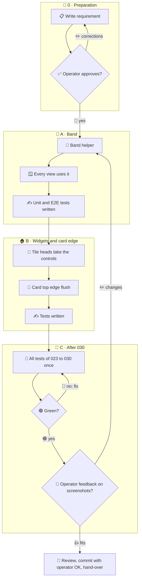

# 023 - Box Heads

## User Story

As the operator, I want every view's controls in one head band right under
its box's top border, the way Home widget title bars sit today, so that
controls never float as a separate card and a widget shows one head.

## Decisions (operator-confirmed 2026-11-23; do not re-litigate)

1. **Head band**: every view whose controls sit in a `.card.controls` box
   today (Match, Tasks, Resources, Agents, Artifacts, Kanban, Controls)
   gets a `.box-head` band instead: first child of the view's box, flush
   with its top and side borders, one line below it, height, padding and
   button size of `.home-head`. Rejected: title and controls on one line
   without a band (operator: a separate section like the widgets); a sticky
   bar inside the box (two bars in widget mode).
2. **Widget mode**: on a Home tile the band's controls move into the tile's
   `.home-head`, as Match does today, so a tile has one head; a control
   that does not fit stays reachable through the tile's context menu.
3. **Card top edge**: the Match card's gradient bar and head pattern reach
   the card's top edge and both rounded corners, with no plain strip.
4. **One helper**: one function builds the band for every view (SPOT).
5. **Timing**: 023 to 031 are implemented serially in number order; tests
   are written per requirement and run once after 031 (operator
   2026-11-23).

## Approach

## Acceptance Criteria

### Band

- [ ] A DOM scan of Match, Tasks, Resources, Agents, Artifacts, Kanban and
      Controls finds one `.box-head` per view as the first child of its box
      and no `.card.controls`.
- [ ] Per view the band's top, left and right edges equal the box's inner
      edges (0 px apart) at 1920, 1366 and 390.
- [ ] At 1920 a one-row band's height and its button size equal
      `.home-head`'s within 1 px; at narrower widths the band wraps into
      rows of that height.

### Widget mode

- [ ] Each of these views pinned to Home has no `.box-head` inside
      `.home-body`; its controls sit in `.home-head` or its context menu.

### Card edge

- [ ] A computed-style probe of the front Match card finds, for all five
      patterns, a 0 px top border, the 6 px bar as the card's own first
      background layer, the head flush with the card top and the hatch
      mask starting at 6 px.

### Tests

- [ ] Unit: the band helper renders title, count and controls in order.
- [ ] Integration: n/a: client layout only, no server change.
- [ ] E2E: Chromium and Firefox at 1920, 1366 and 390: the scans and the
      probe; screenshots per view and tile.
