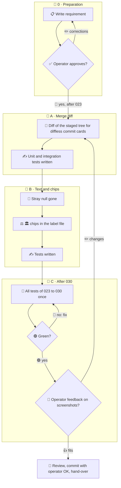

# 024 - Match Card Content

## User Story

As the operator, I want every Match card to show what it changes and no
stray text, so that I can decide a merge from its card.

## Decisions (operator-confirmed 2026-11-23; do not re-litigate)

1. **Merge diff**: a commit card whose stage shipped no diff gets the diff
   of its staged tree against its worktree's HEAD (for a merge: the change
   onto the first parent), computed by the hub the way the command card's
   merge preview is, bound to the card's tree; "No diff shipped with this
   stage." stays only when the tree cannot be read, with the reason.
   Rejected: making agents ship merge diffs (old cards stay empty).
2. **No stray text**: the "null" under the Match buttons goes; no text of
   the Match view or its Home tile reads "null" or "undefined"; a reason
   that is empty or `-` shows no reason line.
3. **Legal and architecture chips**: the score labels gain ⚖️ Legal and
   🏛️ Architecture (022 decision 8); a card shows them when its score text
   carries them, in the order 🎯 💥 💸 ⏱️ 🛡️ ⚖️ 🏛️ 🏆. The values come from
   022 with Quality 004 to 006. Rejected: the hub computing them (operator:
   022 owns them).
4. **One count**: the Tasks tab badge and the page title count exactly
   the open cards Match shows, from the same server list, and follow every
   state poll; today the badge counts unsettled inbox items (operator rows
   included) and showed 3 while Match said "0 cards wait" (operator
   2026-11-23).
5. **Timing**: 023 decision 5.

## Approach

## Acceptance Criteria

### Merge diff

- [ ] A review of a fixture merge commit with a tree and no diff yields a
      card whose files hold the merge's changed files with their hunks.
- [ ] The card turns stale when HEAD moves after it was added.
- [ ] A review whose tree is missing shows "No diff shipped with this
      stage." plus the read error.

### Stray text

- [ ] A DOM scan of the Match view and its Home tile over fixture cards of
      every kind finds no text node equal to "null" or "undefined".
- [ ] A command card with reason `-` or empty has no `.match-reason`.

### Chips

- [ ] A score text with ⚖️ and 🏛️ values yields eight chips in decision 3's
      order; one without them yields no empty ⚖️ or 🏛️ chip.

### Count

- [ ] With fixture state holding three operator rows that are no Match card
      and one ask, the badge reads 1 and Match "1 card waits".
- [ ] Answering that ask drops the badge to hidden and the title count away
      within one state poll, without a reload.

### Tests

- [ ] Unit: merge diff on a fixture repo (merge, plain commit, missing
      tree), chip order, the badge equals the open card count.
- [ ] Integration: `/api/match` serves the merge card with its files and
      marks it stale after a HEAD move.
- [ ] E2E: a merge card shows its diff; the text scan; screenshots.
