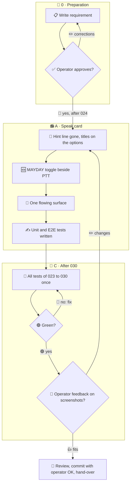

# 025 - Radio Speak Card

## User Story

As the operator, I want a calm, rounded Speak card with MAYDAY next to PTT,
so that I write without fine print and raise or lift a mayday where I send.

## Decisions (operator-confirmed 2026-11-23; do not re-litigate)

1. **No hint line**: "Post arrives at the end of the turn. Your passkey
   signs every message." goes; each channel's meaning moves to its option's
   title, the signature note to PTT's tooltip.
2. **MAYDAY toggle**: one button right of the PTT split button. Without an
   active mayday it reads MAYDAY, asks in an in-page confirm and sends the
   typed text as mayday to all; with one active it is pressed, reads
   "Cancel mayday" and lifts it (`clear-mayday`). Mayday leaves the channel
   select; the separate cancel button goes. Rejected: Mayday in the select
   (two ways to one alarm).
3. **Flowing shape**: one surface without inner boxes: Channel and To as one
   joined pill row, the textarea below, footer Record, mic, MAYDAY and PTT
   in one row; card radius 14 px, fields 10 px; usable at 390.
4. **Timing**: 023 decision 5.

## Approach

## Acceptance Criteria

- [ ] The Speak card holds neither hint sentence.
- [ ] The channel select has no mayday option; every option has a title.
- [ ] MAYDAY is the next sibling of the PTT split button.
- [ ] MAYDAY opens the in-page confirm; Confirm sends one mayday row with
      the typed text, Cancel sends nothing.
- [ ] With an active mayday the button has `aria-pressed="true"` and reads
      "Cancel mayday"; confirming clears it and it reads MAYDAY again.
- [ ] `grep -n 'window.confirm' orchestrator/templates/page-composer.js`
      finds nothing.
- [ ] The card has no descendant `.card`; its radius is 14 px, its fields'
      10 px.
- [ ] At 390 the footer fits the card width without horizontal scroll.

### Tests

- [ ] Unit: toggle state from `state.silence`; the select without mayday.
- [ ] Integration: n/a: the server's mayday and clear paths are unchanged.
- [ ] E2E: raise and cancel a mayday, the layout probes at 1920, 1366 and
      390; screenshots.
