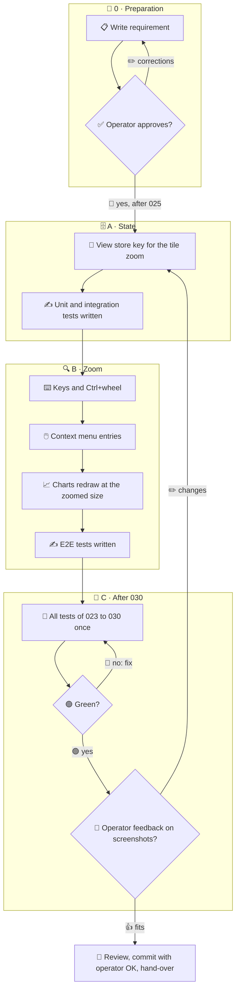

# 026 - Widget Zoom

## User Story

As the operator, I want to zoom a widget's content in and out, so that a
small tile shows more and a large one stays readable.

## Decisions (operator-confirmed 2026-11-23; do not re-litigate)

1. **Per tile**: each Home pin keeps a zoom of 50 to 200 % in 10 % steps,
   default 100 %, in the hub view store (like 017's legend state); it scales
   the tile body, never the head. Rejected: browser zoom (whole page); tile
   size (the resize handle exists).
2. **Keys**: with a tile focused outside a text field, `+` zooms in, `-`
   out, `0` resets; Ctrl+wheel over the body zooms; `?` lists them.
   Rejected: Ctrl+plus (browser zoom).
3. **Right-click**: the tile's context menu gets Zoom in, Zoom out and
   Reset zoom with the current percent.
4. **Redraw**: charts redraw at the zoomed size; above 100 % the body
   scrolls.
5. **Timing**: 023 decision 5.

## Approach

## Acceptance Criteria

- [ ] Three `+` on a focused tile set its body zoom to 130 %; the head keeps
      its size.
- [ ] `0` resets to 100 %; `-` stops at 50 %, `+` at 200 %.
- [ ] Ctrl+wheel up zooms in one step per notch; the plain wheel scrolls.
- [ ] The context menu lists Zoom in, Zoom out and "Reset zoom (130 %)",
      each acting as its key.
- [ ] The zoom survives a reload and shows in a second browser; the view
      store refuses values outside 50 to 200 or off the 10 % grid with 400.
- [ ] A zoomed chart's SVG width equals the body width divided by the zoom.
- [ ] The `?` help lists the zoom keys.

### Tests

- [ ] Unit: view store validation of the zoom key; key handling.
- [ ] Integration: the zoom persists across a hub restart.
- [ ] E2E: keys, wheel, menu and persistence at 1920, 1366 and 390;
      screenshots.
