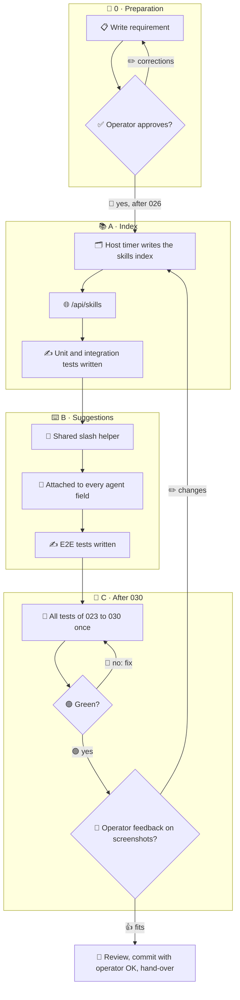

# 027 - Slash Skill Suggestions

## User Story

As the operator, I want skill suggestions when I type "/" in any message to
agents, so that I call a skill by its exact name without looking it up.

## Decisions (operator-confirmed 2026-11-23; do not re-litigate)

1. **Source**: a host timer writes a skills index (name, description,
   source) next to `branch-tree.json`, from `~/.claude/skills`,
   `~/.agents/skills` and every repository of the pkgmgr tree
   (`.claude/skills`, `.agents/skills`); the hub serves it at `/api/skills`
   with name, description and source only. In a field tied to an agent or
   card, the skills of its repository rank first. Rejected: mounting every
   repository into the hub.
2. **Fields**: every field whose text reaches an agent: radio composer,
   agent message, Match feedback and line comments, choice "Other" answers,
   reject feedback, rule request replies, diff feedback; one shared helper
   attaches to each.
3. **Trigger**: "/" at the field's start or after whitespace opens a list
   filtered by the typed prefix (name matches first); ↑/↓ move, Enter or Tab
   inserts `/<name>` and a space, Esc closes; "/" inside a word or path
   opens nothing;
   the global "/" search key keeps working outside text fields.
4. **No send**: picking only inserts text.
5. **Timing**: 023 decision 5.

## Approach

## Acceptance Criteria

### Index

- [ ] The index lists fixture skills of all three sources with their
      source; a name in two sources shows once per source.
- [ ] `/api/skills` serves name, description and source only, sorted by
      name; no path and no body.
- [ ] A new skill folder shows in `/api/skills` after the next timer run,
      without a hub restart.

### Suggestions

- [ ] In each field of decision 2, "/kvb-org-r" lists kvb-org-radio first;
      Enter inserts "/kvb-org-radio " at the caret.
- [ ] In a field tied to a core card, a core project skill ranks above a
      global one with the same prefix.
- [ ] "a/b" opens no list; Esc closes the list and keeps the text.
- [ ] A test enumerates decision 2's fields and finds the helper on each.

### Tests

- [ ] Unit: frontmatter parser (missing description, no `SKILL.md`), filter
      and rank order.
- [ ] Integration: the timer's index over fixture dirs, `/api/skills`,
      refresh.
- [ ] E2E: every field of decision 2; screenshots.
