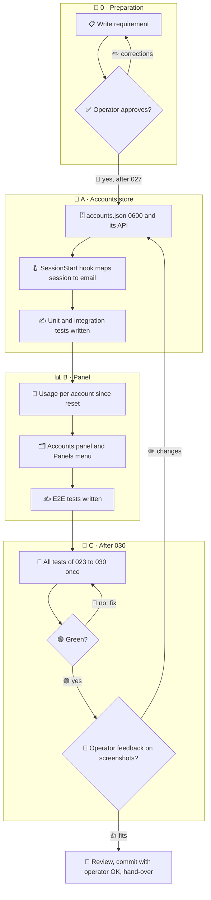

# 028 - Resources Accounts

## User Story

As the operator, I want Resources to show my provider accounts with renewal,
weekly reset and usage, and to pick its panels, so that I see which account
to work on and when the next one resets.

## Decisions (operator-confirmed 2026-11-23; do not re-litigate)

1. **Host only**: accounts are entered in the hub (add, edit, remove) and
   stored as `accounts.json` with mode 0600 in the hub's state dir; never in
   git, the view store, the radio or a commit; fixtures use example.org.
2. **Fields**: provider, email, renewal (weekday, time), weekly reset
   (weekday, time), resubscribe date, autorenew, optional weekly token
   limit, optional note; local time.
3. **Active account**: a SessionStart hook writes the session id and
   `oauthAccount.emailAddress` from `~/.claude.json` (that field only) into
   the council; the hub maps each session's token rows to its account.
   Rejected: mounting `~/.claude.json` into the hub (it holds more than the
   email); a provider usage API (subscriptions have none).
4. **Usage**: per account: since the last weekly reset, today, total;
   remaining = limit minus used since reset, only with a limit; unmapped
   sessions count as "unassigned".
5. **Panel picker**: a Panels menu in the Resources head (023) with
   checkboxes Hardware, Tokens, Combined and Accounts; one stays on; stored
   in the view store.
6. **Order**: rows sort by next weekly reset; the active account is marked.
7. **Timing**: 023 decision 5.

## Approach

## Acceptance Criteria

### Store

- [ ] Adding an account writes `accounts.json` with mode 0600; the skills
      repo stays clean; the radio and view store files hold no account
      email (grep).
- [ ] The API refuses a bad email, weekday, time or a negative limit with
      400.

### Mapping and usage

- [ ] The hook on a fixture `~/.claude.json` writes one mapping line with
      session and email and no other field.
- [ ] Fixture token rows of two mapped sessions give each account's used
      since reset, today and total equal to the fixture sums; remaining is
      limit minus used; without a limit it shows "—"; unmapped rows count
      as "unassigned".
- [ ] Rows sort by next reset; the active account carries a marker.

### Panel picker

- [ ] The Panels menu hides and shows each panel; the last checked box
      cannot be unchecked; the choice survives a reload.

### Tests

- [ ] Unit: validation, next-reset arithmetic across a DST change, usage
      aggregation, hook extraction.
- [ ] Integration: accounts API and file mode; hook to mapping to usage.
- [ ] E2E: add, edit and remove an account, the panel picker at 1920, 1366
      and 390; screenshots.
