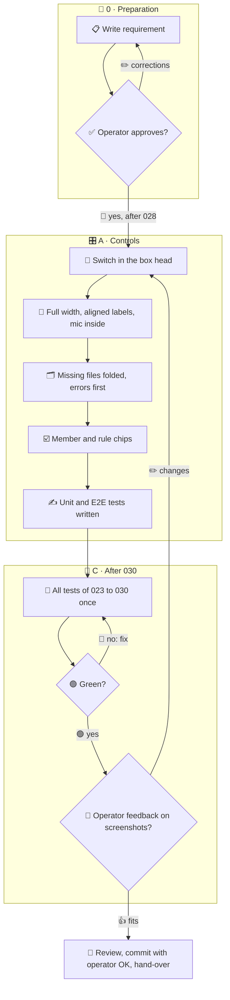

# 029 - Controls Layout

## User Story

As the operator, I want the Controls tabs (Tools, Rules, Groups) laid out
like the other views, so that I find their forms at once and the settings
list shows what matters.

## Decisions (operator-confirmed 2026-11-23; do not re-litigate)

1. **Head**: Controls with its Tools, Rules and Groups switch sits in the
   023 box head, not floating beside the content.
2. **Width and alignment**: the Groups and Rule sets cards span the content
   width; form labels share one baseline; the mic button sits inside its
   field's end, as 031 builds it.
3. **Settings list**: files whose folder does not exist hide behind a "show
   N missing" toggle; rows with an error chip come first, then by path.
4. **Chips**: group members and set rules are checkbox chips (members with
   faces) instead of multi-select boxes; an empty rule list says how to
   create a rule.
5. **Timing**: 023 decision 5.

## Approach

## Acceptance Criteria

- [ ] On every Controls tab the switch sits in `.box-head` at the box's top
      edge.
- [ ] The Groups and Rule sets cards are as wide as the Rules card (within
      1 px).
- [ ] Per form all labels share one top offset (within 1 px); each mic
      button lies inside its field.
- [ ] With 40 fixture paths of which 30 lack their folder, the list shows
      10 rows and "show 30 missing", which reveals them; error rows first.
- [ ] Checking two member chips and saving signs a group of those two.
- [ ] `grep -n 'multiple' orchestrator/templates/page-rules.js` finds no
      multi-select.

### Tests

- [ ] Unit: settings list filter and order.
- [ ] Integration: n/a: the signed group and rule set APIs are unchanged.
- [ ] E2E: the layout probes and a group creation at 1920, 1366 and 390;
      screenshots.
