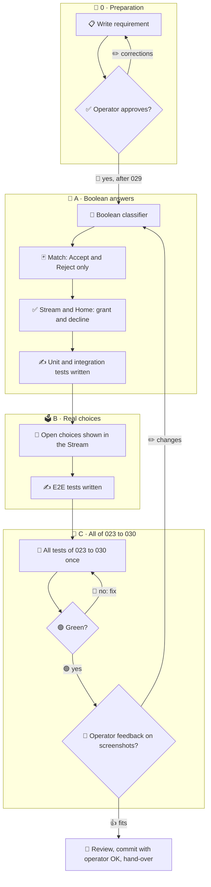

# 030 - Yes/No Answers as Buttons

## User Story

As the operator, I want to answer a plain yes/no question with the Accept
and Reject buttons I already have, and to see every real choice in the
Stream, so that I do not read a numbered form for a single decision and no
decision hides from me.

## Decisions (operator-confirmed 2026-11-23; do not re-litigate)

1. **Boolean cards**: permission asks (allow, deny) and choices whose only
   options are Yes and No. Choices with named options or multi-select keep
   the full numbered form with its Other answer. Rejected: every
   two-option card (named options are real choices).
2. **Match**: a boolean card shows no form; Accept answers Yes, Reject
   answers No through the existing feedback dialog, whose optional text
   reaches the agent as what to do instead.
3. **Stream, Waits on Operator, Home**: a boolean item shows the existing
   green grant button with bulk selection (020) and a decline button with
   an optional comment; no numbered form.
4. **Real choices in the Stream**: every open choice with named options or
   multi-select (decision rows and `decision_request` cards) shows in the
   Stream with its full numbered form, not only in Match and Waits on
   Operator (operator 2026-11-23: the tasks must not hide there).
5. **Answered and running in the Stream**: the Stream also keeps granted,
   declined and answered items, each with its outcome pill, and an operator
   command the hub runner executes shows its live output box there, as in
   Waits on Operator (operator 2026-11-23).
6. **Same answers**: the signed answers stay as today; only the controls
   change.
7. **Timing**: 023 decision 5.
8. **Nothing hides** (operator 2026-11-23, after Match dropped every row
   with an open hub job): every open item `operator.py list` shows, and
   every review, ask and decision, appears in Match, the Tasks views
   (list, board, Waits on Operator), the Stream and on Home tiles of those.
   Where an area cannot act on it (a hub runner job queued or running for
   it, no command or no absolute directory, a view that only shows), the
   item stays visible, greyed out, its buttons disabled, and a tooltip on
   it names the reason (for a queued job: how long, and which job the
   runner runs meanwhile). Rejected: hiding such items; a separate list
   of hidden items.

## Approach

## Acceptance Criteria

### Boolean answers

- [ ] A boolean ask card in Match has no numbered form; Accept sends allow,
      Reject sends deny, with its feedback text when one is typed.
- [ ] A Stream ask shows grant and decline and no numbered form; three
      selected asks are granted at once through the 020 bulk path.
- [ ] Decline with a comment delivers it to the agent; without one, a plain
      deny.
- [ ] A Yes/No choice renders as boolean; a choice with "Commit B11" and
      "Don't commit" and a multi-select choice keep the form with Other.

### Real choices

- [ ] An open fixture decision row with four named options shows in the
      Stream with its numbered form and Other answer; picking one there
      settles it in Match and Waits on Operator too.

### Answered and running

- [ ] A granted ask stays in the Stream with a "granted" pill, a declined
      one with "declined" and its comment, an answered choice with its pick.
- [ ] While the hub runner executes an operator row, its Stream entry shows
      the live output box, and its lines grow with each state poll, as in
      Waits on Operator.

### Same answers

- [ ] The signed records for allow, deny and deny with text equal today's
      (fixture comparison).

### Nothing hides

- [ ] For a fixture register of open operator rows (free, one with a
      queued hub job, one with a running job, one without an absolute
      directory, one decision row), the set of row ids in Match, Tasks
      list, Waits on Operator and the Stream each equals the set
      `operator.py list --json` prints.
- [ ] The rows with a job or without an absolute directory render greyed
      (`data-blocked`), Accept and Reject disabled, and their tooltip names
      the reason; keyboard and swipe refuse them with the same reason.
- [ ] The queued row's reason names its minutes in the queue and the job
      the runner runs meanwhile.
- [ ] The Match badge counts only cards that can act.

### Tests

- [ ] Unit: the boolean classifier (asks, Yes/No, named options,
      multi-select); the blocked reason of a queued, a running and a free
      row.
- [ ] Integration: allow, deny and deny with text through the API give
      today's signed records; a Stream pick settles the decision row; the
      row sets of the nothing-hides fixture per area.
- [ ] E2E: Match and Stream at 1920, 1366 and 390, including the greyed
      cards and their tooltips; screenshots.
