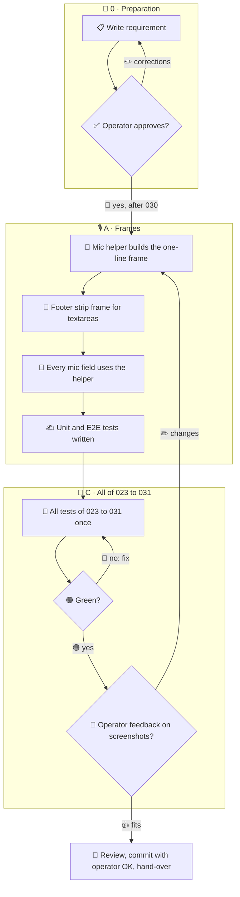

# 031 - Mic in Fields

## User Story

As the operator, I want the microphone joined into every text field it
serves, so that field and mic read as one control instead of a loose button
beside or below it.

## Decisions (operator-confirmed 2026-11-23; do not re-litigate)

1. **One-line fields**: the mic is a segment at the right end inside the
   field's frame, the field's height, divided from the text by a 1 px line;
   field and segment share one border and radius. Applies to every one-line
   field with a mic, among them the Stream search, the command line, rule
   and group forms and choice "Other" answers.
2. **Textareas: footer strip** (operator pick 2026-11-23): the textarea and
   a slim footer row share one frame, divided by a 1 px line; the mic sits
   at the footer's right end; the footer's left side holds what belongs to
   the field (Record in the radio composer, a character count where a limit
   exists). Rejected: a floating corner button (covers text next to the
   resize handle); a top-right corner button (collides with the first
   line); the mic in the label line (no longer joined); a full-height side
   segment (clunky when tall).
3. **One helper**: the shared mic component (`page-mic.js`) builds both
   frames for every field it serves, the automatic sweep included; no
   field places its mic by hand. 025's composer footer and 029's forms use
   it.
4. **States**: the segment and the footer button keep the mic's idle,
   recording and transcribing looks; the frame's focus ring covers field
   and mic together.
5. **Timing**: implemented after 030, before the one test run of 023 to
   031.

## Approach

## Acceptance Criteria

### One-line fields

- [ ] A DOM scan finds every mic of a one-line field inside the same frame
      element as its field, as its last child.
- [ ] Per one-line field the mic segment's top and bottom equal the field
      frame's inner edges (within 1 px), its right edge the frame's inner
      right edge, and a 1 px divider sits between text and mic.
- [ ] Typed text never runs under the mic segment (text box right edge
      left of the divider).

### Textareas

- [ ] Every textarea with a mic sits in a frame with a footer row below it,
      divided by a 1 px line; the mic is the footer's last child.
- [ ] The radio composer's footer holds Record on the left and the mic on
      the right (025).
- [ ] Resizing the textarea by its handle keeps the footer attached and the
      mic visible.

### States

- [ ] Recording shows the recording look on the segment or footer button;
      focus in the field draws one ring around the whole frame.
- [ ] `grep -nE "micButton\(" orchestrator/templates/*.js` finds no caller
      outside `page-mic.js` that inserts the button itself.

### Tests

- [ ] Unit: the helper builds the one-line frame and the footer frame and
      keeps the button state.
- [ ] Integration: n/a: no server change.
- [ ] E2E: the scans and geometry probes on Stream, Match, radio, agent
      page, Controls and the command line at 1920, 1366 and 390;
      screenshots.
