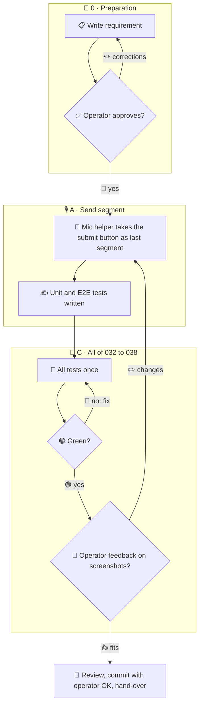

# 032 - Send in the Field

## User Story

As the operator, I want a one-line answer field, its microphone and its Send
button to read as one field, so that answering is one control instead of a
field with buttons beside it.

## Decisions (operator-confirmed 2026-11-25; do not re-litigate)

1. **Order and look**: field, then mic, then Send, all inside one frame with
   one border and one radius; the parts are separated only by 1 px vertical
   lines. This extends 031's one-line frame by a last segment.
2. **Scope**: every one-line field with a mic whose form has its own submit
   button, among them the choice "Other" answers. A one-line field without a
   submit button keeps 031's frame unchanged.
3. **One helper**: the mic component (`page-mic.js`) moves the form's submit
   button into the frame as the segment after the mic; no form places it by
   hand.
4. **Timing**: 032 to 038 are implemented in order; tests are written per
   requirement and run once after 038, then screenshots go to the operator.

## Approach

## Acceptance Criteria

### Frame

- [ ] A DOM scan finds, in every form that holds a one-line mic field and a
      submit button, the field, the mic and the submit button as the
      frame's children in this order.
- [ ] The mic and Send segments span the frame's inner height (within 1 px),
      and a 1 px divider sits before each of them.
- [ ] The Send segment draws no border or radius of its own; the frame's
      right corners round it.

### Behaviour

- [ ] Enter in the field and a click on Send submit the same answer as
      before (choice "Other" answer reaches its agent once).
- [ ] A redraw of the stream keeps the typed text, focus and caret (026).

### Tests

- [ ] Unit: the helper moves the submit button behind the mic and keeps a
      single copy across repeated sweeps.
- [ ] Integration: n/a: no server change.
- [ ] E2E: the "Other" field of a decision in the stream at 1366 and 390:
      order and geometry probes; screenshots.
