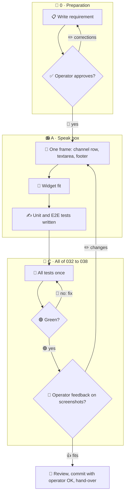

# 033 - Coherent Speak Box

## User Story

As the operator, I want the radio speak box to be one coherent control, so
that writing, recording and sending read as one piece in the Radio view and
as a Home widget.

## Decisions (operator-confirmed 2026-11-25; do not re-litigate)

1. **One frame** (operator pick 2026-11-25): Channel and To on top as one
   segmented row, the message textarea, and a footer row with Record on the
   left and the mic, the PTT split and the MAYDAY toggle on the right, all
   in one border and separated only by 1 px lines. Rejected: a messenger
   composer with recipient chips, a rounded pill and a round send button,
   which adds a second visual language beside the frames of 031 and 032.
2. **No extra labels**: no inner "Speak" heading where a box or widget title
   already names the box; no channel hint as a tooltip on the Channel select
   or the textarea (025's "no hint text" covers tooltips too).
3. **Fit**: in widget mode the box fills the widget body; the textarea takes
   the free height and the footer with PTT and MAYDAY stays fully visible at
   every widget size the Home grid allows.
4. **Behaviour unchanged**: hold-to-talk, the PTT test menu and the inline
   MAYDAY confirmation keep working as today.
5. **Timing**: as 032.

## Approach

## Acceptance Criteria

### Frame

- [ ] One frame element holds the channel row, the textarea and the footer;
      the footer's children are Record, a spacer, the mic, the PTT split and
      the MAYDAY toggle in this order.
- [ ] Inside the frame the parts are divided by 1 px lines and draw no
      borders of their own.

### Labels

- [ ] No visible "Speak" text in the box apart from the box or widget title.
- [ ] No text of `CHANNEL_HINTS` (page-composer.js) reaches a `title`
      attribute inside the composer.

### Fit

- [ ] As a Home widget at every height from 3 to 8 rows and every width
      from 4 to 12 columns, the PTT split and the MAYDAY toggle lie fully
      inside the widget body.

### Behaviour

- [ ] Hold-to-talk, the test menu and the MAYDAY confirmation pass the
      existing composer tests.

### Tests

- [ ] Unit: the composer's DOM order and the absence of hint titles.
- [ ] Integration: n/a: no server change.
- [ ] E2E: Radio view and Home widget at 1920, 1366 and 390; geometry
      probes; screenshots.
