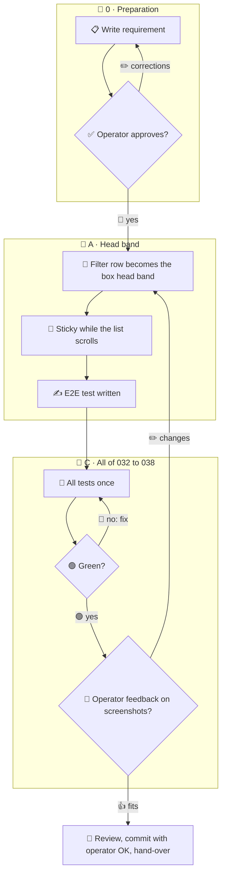

# 034 - Stream Head Band

## User Story

As the operator, I want the stream's view buttons, search and filters in one
head band separated from the list, so that I see where the controls end and
the entries start.

## Decisions (operator-confirmed 2026-11-25; do not re-litigate)

1. **Head band** (operator pick 2026-11-25): the stream's top row (view
   buttons, search, filter menu, entry count) is the box head band of 023:
   flush under the box's top border, tinted like the other box heads, with a
   1 px line below it. Rejected: a plain 1 px line, which scrolls away and
   differs from the other box heads.
2. **Sticky**: the band stays at the top of the stream box while the list
   scrolls.
3. **Timing**: as 032.

## Approach

## Acceptance Criteria

### Band

- [ ] The band is the first child of the stream box; its top edge equals the
      box's inner top edge (within 1 px).
- [ ] The band has a 1 px bottom border in `var(--line)` and the background
      of a Home widget, under which its title bar sits, so the list never
      shows through it.

### Sticky

- [ ] After the list scrolls by 600 px the band's top edge is unchanged
      (within 1 px).

### Tests

- [ ] Unit: n/a: layout only.
- [ ] Integration: n/a: no server change.
- [ ] E2E: band geometry and the scroll probe at 1920, 1366 and 390;
      screenshots.
