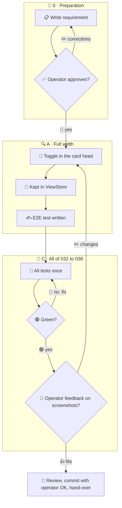

# 035 - Match Full Width

## User Story

As the operator, I want to enlarge a Match card to the full width, so that I
can read long diffs and commands without scrolling sideways.

## Decisions (operator-confirmed 2026-11-25; do not re-litigate)

1. **Toggle**: a ⤢ button in the card head switches the card between its
   normal width (at most 960 px) and the full width of the Match area; ⤡
   switches back.
2. **Kept**: the choice is stored per browser, like the Next cards toggle,
   and applies to the following cards too.
3. **Widget**: in a Home widget the full width is the widget's width.
4. **No gain, no button**: where the Match area is at most 960 px wide the
   button is hidden.
5. **Timing**: as 032.

## Approach

## Acceptance Criteria

### Toggle

- [ ] After a click on ⤢ the card's width equals the Match area's inner
      width (within 2 px); after a click on ⤡ it is at most 960 px.
- [ ] After a reload the chosen width is kept.
- [ ] → ← ↑ and swiping work unchanged at both widths.
- [ ] At 390 px viewport width the button is absent.

### Tests

- [ ] Unit: n/a: layout and a stored flag.
- [ ] Integration: n/a: no server change.
- [ ] E2E: toggle, reload and keys at 1920 and 1366, button absence at 390;
      screenshots.
