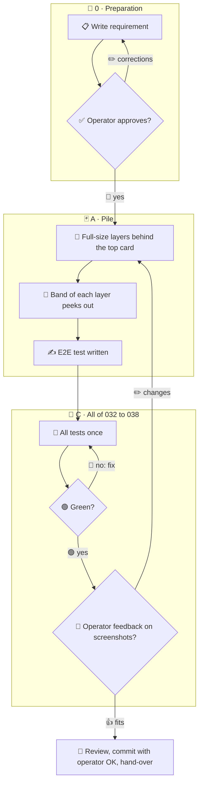

# 036 - Match Pile

## User Story

As the operator, I want the waiting Match cards to lie behind the top card
like a pile of playing cards, so that I see at a glance that more cards
wait.

## Decisions (operator-confirmed 2026-11-25; do not re-litigate)

1. **Pile** (operator pick 2026-11-25): the next two waiting cards lie
   behind the top card at full card size, lifted by 8 and 16 px and drawn
   2 % and 4 % smaller, tilted by −1.5° and +1°, dimmed; their colour band
   (the gradient top bar) peeks out above the top card. Rejected: a fan like a hand of
   cards, which needs room at the sides and covers neighbouring panels in
   widget mode.
2. **Inert**: the layers behind show nothing beyond their band, take no
   focus and no clicks.
3. **Count**: as many layers as further waiting cards, at most two; none
   behind the last card.
4. **Replaces** the 40 px slivers (`.match-behind`) of today.
5. **Reduced motion**: no animation when the pile reorders.
6. **Timing**: as 032.

## Approach

## Acceptance Criteria

### Layers

- [ ] With three or more waiting cards, two layers lie behind the top card,
      each the top card's size (within 2 px) with a lower z-index.
- [ ] Each layer's band starts above the top card's top edge.
- [ ] The layers have `pointer-events: none` and `aria-hidden="true"`.
- [ ] With two waiting cards one layer shows; with one card none.

### Tests

- [ ] Unit: n/a: layout only.
- [ ] Integration: n/a: no server change.
- [ ] E2E: layer count, size and band position for 3, 2 and 1 waiting
      cards at 1920, 1366 and 390; screenshots.
