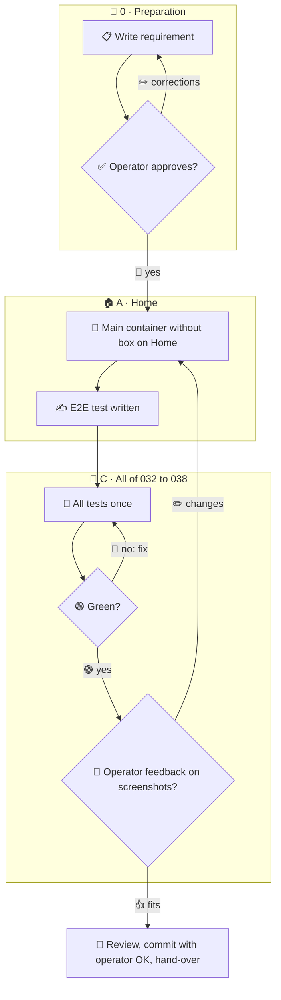

# 037 - Home without Box

## User Story

As the operator, I want the Home widgets to stand directly on the sky, so
that the page shows the widgets and no box around them.

## Decisions (operator-confirmed 2026-11-25; do not re-litigate)

1. **No outer box**: on Home the main container draws no background, border,
   shadow or frame padding; the widgets sit on the page background with the
   grid's gap between them.
2. **Other screens keep their box.**
3. **Empty state**: "Nothing pinned yet" stays readable as a card of its
   own.
4. **Timing**: as 032.

## Approach

## Acceptance Criteria

### Home

- [ ] On Home the main container's computed background is transparent and
      it has no border and no box-shadow.
- [ ] The widgets' left edge lines up with the navigation bar's left content
      edge (within 2 px).
- [ ] With no pins the empty state shows on its own card.

### Other screens

- [ ] The stream screen's box keeps its background, border and shadow.

### Tests

- [ ] Unit: n/a: layout only.
- [ ] Integration: n/a: no server change.
- [ ] E2E: Home with pins, Home empty and the stream at 1920, 1366 and 390;
      screenshots.
