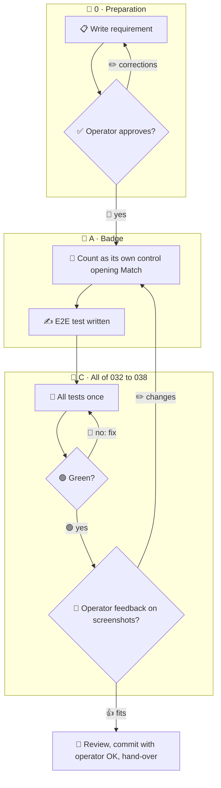

# 038 - Badge to Match

## User Story

As the operator, I want a click on the blue count of open operator tasks to
take me straight to the Match view, so that I start deciding with one click.

## Decisions (operator-confirmed 2026-11-25; do not re-litigate)

1. **Target**: a click on the count on the Tasks navigation button opens the
   Match screen; a click on the rest of the button keeps opening Tasks.
2. **Own control**: the count becomes a focusable control of its own next to
   the Tasks icon, not a button nested in the Tasks button, named "N open
   operator tasks: open Match".
3. **Hidden at zero**: as today, no count shows when nothing waits.
4. **Timing**: as 032.

## Approach

## Acceptance Criteria

### Navigation

- [ ] A click on the count sets the location hash to `#tasks/match`; a
      click on the Tasks icon opens the Tasks screen.
- [ ] Enter on the focused count opens Match.
- [ ] The count's `aria-label` names the number and Match.
- [ ] The count and the Tasks icon keep their positions (within 1 px).

### Tests

- [ ] Unit: n/a: one navigation handler.
- [ ] Integration: n/a: no server change.
- [ ] E2E: click and keyboard on the count and the icon at 1366 and 390.
