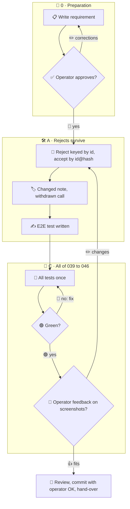

# 039 - Match Rejects Survive

## User Story

As the operator, I want a reject I swiped to stay until the release even
when the agent changes or withdraws the card, so that my feedback always
reaches the agent.

## Decisions (operator-confirmed 2026-11-25; do not re-litigate)

1. **Key**: a reject is kept by card id, not by `id@hash`; an accept stays
   bound to the exact hash, because it signs that tree. Rejected: dropping
   the reject visibly with a toast, which loses the feedback.
2. **Changed card**: the release card shows such a reject with the note
   "card changed since your reject"; the feedback goes out unchanged.
3. **Withdrawn card**: a reject whose card is gone is still sent at the
   release, by radio call to the card's agent with title and feedback; the
   card data needed for that is kept when the reject is made.
4. **Accept on a changed card**: dropped as today, but a toast names the
   card ("changed since your accept: decide it again").

## Approach

## Acceptance Criteria

### Rejects

- [ ] Reject card X, then serve X with a new hash: the release card still
      lists X as rejected with the note "card changed since your reject".
- [ ] Reject card X, then serve a list without X: the release sends exactly
      one radio call to X's agent containing X's title and the feedback.
- [ ] Accept card X, then serve X with a new hash: the decision is gone and
      one toast names X.

### Tests

- [ ] Unit: n/a: the decision logic lives in page JS without a unit harness;
      E2E covers it.
- [ ] Integration: n/a: no server change.
- [ ] E2E: the three cases above against a mocked `/api/match`, the radio
      call captured on `/api/radio`.
