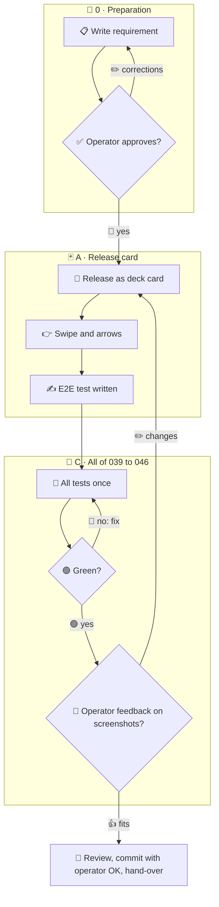

# 040 - Release Card

## User Story

As the operator, I want the release to arrive as the front card of the
Match deck once I have decided everything, so that I release the same way
I decide.

## Decisions (operator-confirmed 2026-11-25; do not re-litigate)

1. **When**: once every card that can be decided now is decided, the release
   card is the front card; greyed cards (stale or blocked) do not hold it
   back.
2. **Content**: the list of today's overview (each decision changeable or
   back to the stack), the release-block note and the Release button.
3. **Gestures** (operator: "1 und 2"): swiping right or the right arrow
   starts the passkey release exactly like the button; swiping left or the
   left arrow returns to the stack.
4. **Behind it**: cards that arrive meanwhile and the greyed cards lie behind
   the release card as the pile layers of 036; they never jump in front.
5. **Early**: the Decisions button (tally) still opens the release card
   before everything is decided.
6. **Replaces** the overview section that takes the deck's place today.

## Approach

## Acceptance Criteria

### Card

- [ ] With all decidable cards decided, `.match-deck .match-card.front` is
      the release card and contains `.match-release`.
- [ ] Swiping the release card right or the right arrow runs the same
      release as the button: exactly one submit with every decision.
- [ ] Swiping it left or the left arrow shows the open stack again.
- [ ] A card arriving while the release card is front lies in
      `.match-layer`; the release card stays front.
- [ ] A stale or blocked open card does not prevent the release card and
      lies behind it as a layer.

### Tests

- [ ] Unit: n/a: page JS.
- [ ] Integration: n/a: no server change.
- [ ] E2E: the five checks above at 1920 and 390; screenshots.
