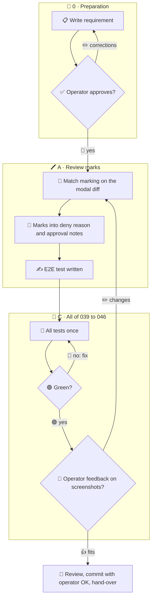

# 041 - Code Marks in the Review Modal

## User Story

As the operator, I want to mark code lines in the review modal's diff as I
can in Match, so that I point the agent at exact lines when I deny or
approve.

## Decisions (operator-confirmed 2026-11-25; do not re-litigate)

1. **Scope**: the review modal only. Rejected: every diff view, more surface
   than asked for.
2. **Mechanism**: Match's marking is reused, not rebuilt: select or click
   lines, attach a comment.
3. **Flow**: Deny prefills its reason with the marks as `path:line` plus
   comment; Approve sends them to the agent as notes by radio post, as
   Match does after a release.
4. **Persistence**: marks are kept per review id until the review is
   decided, like Match's marks.

## Approach

## Acceptance Criteria

### Marks

- [ ] In the review modal, marking a diff line and adding the comment "c"
      shows the mark in the modal.
- [ ] Deny opens with a reason containing `<path>:<line>` and "c".
- [ ] Approve sends one radio post to the agent containing `<path>:<line>`
      and "c".
- [ ] Closing and reopening the modal for the same review keeps the mark.

### Tests

- [ ] Unit: n/a: page JS.
- [ ] Integration: n/a: no server change.
- [ ] E2E: the four checks above; screenshot.
