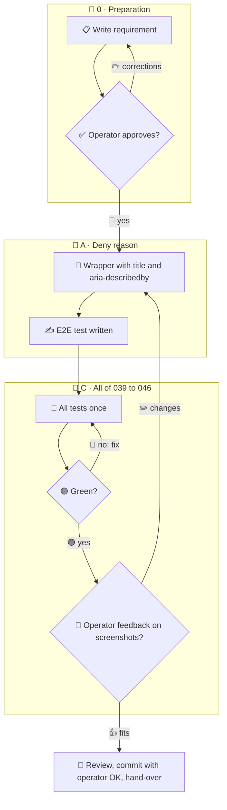

# 042 - Why Deny Is Off

## User Story

As the operator, I want a disabled Deny button to tell me on hover why it
is off, so that I do not guess what is missing.

## Decisions (operator-confirmed 2026-11-25; do not re-litigate)

1. **Hover and focus**: a wrapper around the button carries the reason as
   tooltip, because a disabled button fires no hover in Chrome; the button's
   `aria-describedby` gives keyboard users the same text.
2. **Reasons**: "Pick the agent to tell: a post or call needs a recipient"
   (deny sheet) and "No agent to tell: the item names no recipient" (the
   split Deny button, `page-deny.js` `denySplit`).
3. **Enabled again**: once the reason is gone the tooltip names the action.

## Approach

## Acceptance Criteria

### Tooltip

- [ ] In the deny sheet with channel Call and no recipient, the wrapper of
      the disabled Deny button has a `title` naming the missing recipient.
- [ ] The button's `aria-describedby` points to an element with that text.
- [ ] After a recipient is picked, Deny is enabled and the title no longer
      names a missing recipient.

### Tests

- [ ] Unit: n/a: page JS.
- [ ] Integration: n/a: no server change.
- [ ] E2E: the three checks above.
