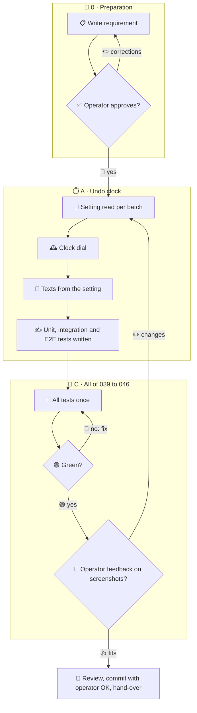

# 043 - Undo Window on a Clock

## User Story

As the operator, I want to set on a clock dial from 0 to 60 s how long a
grant, deny or release waits before it takes effect, so that the undo
window fits my pace.

## Decisions (operator-confirmed 2026-11-25; do not re-litigate)

1. **Range**: whole seconds from 0 to 60; 0 takes effect at once without an
   undo toast; default 3 s, today's value. Rejected: 1 to 30 s and fixed
   choices (operator pick: 0 to 60).
2. **Dial**: an analog clock face in Settings with 60 ticks and one hand;
   dragging the hand, clicking a tick, the arrow keys (±1 s) and Page Up and
   Down (±5 s) set it; a readout shows "N s"; ARIA `slider`.
3. **Server**: the value is stored with the hub settings; `batches.py` reads
   it per new batch instead of the constant `UNDO = 3.0`; a running batch
   keeps its due time.
4. **One source**: every text that says "3 s" today (deny note, release
   title, inbox deny note) shows the set value.

## Approach

## Acceptance Criteria

### Setting

- [ ] With 10 s saved, a new batch's `due` lies 10 s (±0.5) after its
      creation.
- [ ] With 0 saved, a new batch applies at once and no undo toast appears.
- [ ] The server refuses −1, 61 and 2.5 with 400.

### Dial

- [ ] The dial has `role="slider"`, `aria-valuemin="0"`,
      `aria-valuemax="60"` and `aria-valuenow` equal to the readout.
- [ ] The right arrow raises the value by 1, Page Up by 5, capped at 60.

### Texts

- [ ] With 10 s set, the deny sheet note and the release button title say
      "10 s".

### Tests

- [ ] Unit: settings validation for 0, 60, −1, 61 and 2.5.
- [ ] Integration: batch due time for 0 and 10 through the HTTP API.
- [ ] E2E: the dial and text checks above; screenshot of the dial.
