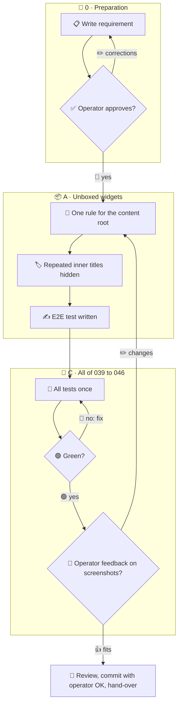

# 044 - Widgets without Inner Boxes

## User Story

As the operator, I want a widget's content to fill the widget instead of
sitting in a second box, so that the Home widgets look calm and use their
space.

## Decisions (operator-confirmed 2026-11-25; do not re-litigate)

1. **General rule**: when a widget's content root is itself a box (a card
   with its own border, background or padding), it loses border,
   background, radius and outer padding and fills the widget body; named
   examples Radio log, Radio device, Radio speak and Tasks Gantt. Rejected:
   rules per widget, which every new widget would need again; 033's
   speak-only rule folds into the general one. Amended 2026-11-26 after the
   e2e run: the walk also enters the one box of a wrapper that holds only
   it and `.legend` rows, so a Gantt or RASCI box beside its legend is
   flattened at any size; the legend stays under it, and the box with the rows
   after it fill the body; a text field inside the flattened box (the
   Radio speak input) keeps its frame.
2. **Titles**: an inner title that repeats the widget's title bar ("HISTORY"
   under "Radio log", "DEVICE" under "Radio device") is hidden in widget
   mode; section labels that add information stay.
3. **Full view unchanged**: outside widget mode the boxes stay as they are.

## Approach

## Acceptance Criteria

### Widgets

- [ ] For every widget kind on Home, the first box element inside
      `.home-tile` below the title bar has a computed `border-width` of 0
      and a transparent background.
- [ ] Its bottom edge lies within 2 px of the widget body's content
      bottom.
- [ ] Radio log and Radio device show no visible inner title repeating the
      widget title.
- [ ] Outside widget mode the same panels keep a 1px border.

### Tests

- [ ] Unit: n/a: CSS.
- [ ] Integration: n/a: no server change.
- [ ] E2E: the checks above for all widget kinds at 1920 and 390;
      screenshots of Radio log, Radio device, Radio speak and Gantt.
