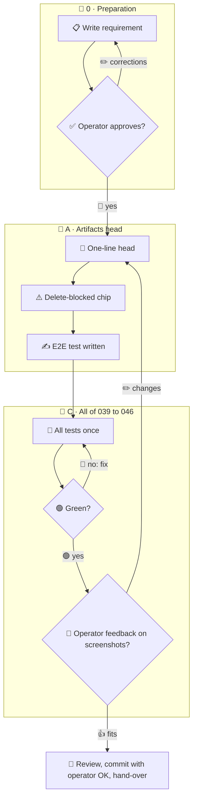

# 045 - Artifacts Head on One Line

## User Story

As the operator, I want the Artifacts head on one tidy line, so that the
controls and the status do not break apart.

## Decisions (operator-confirmed 2026-11-25; do not re-litigate)

1. **One line**: from 1024 px width, view switch, picker, toolbar and count
   sit on one line; no word breaks.
2. **Count**: "97 repositories · as of 14:02" truncates with an ellipsis
   when space runs short; the full text sits in `title`.
3. **Delete blocked**: leaves the count text and becomes a warning chip
   beside the delete button; chip and disabled delete button (042's
   wrapper) carry the reason as tooltip.
4. **Narrow**: below 1024 px at most two lines, still no word broken.

## Approach

## Acceptance Criteria

### Head

- [ ] At 1920 and 1366 the Artifacts head is one line: its height equals a
      single control row (±2 px).
- [ ] The count element has `text-overflow: ellipsis` and a `title` with
      the full text.
- [ ] Without a GitHub token a warning chip beside the delete button names
      the reason and the count text holds no "Delete blocked".
- [ ] At 390 the head takes at most two lines.

### Tests

- [ ] Unit: n/a: page JS and CSS.
- [ ] Integration: n/a: no server change.
- [ ] E2E: the four checks above; screenshots at 1920, 1366 and 390.
