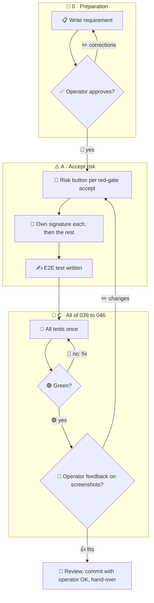

# 046 - Accept the Risk of a Red Gate

## User Story

As the operator, I want a button on a commit with a red gate that accepts
its risk explicitly, so that it is released with my other decisions instead
of blocking them.

## Decisions (operator-confirmed 2026-11-25; do not re-litigate)

1. **Button, not warning**: each accepted commit without a green gate shows
   "Accept risk: gate not green" in the release card (040); the release-block
   warning goes. Rejected: today's hard blocker ("release it alone").
2. **Until clicked**: the Release button stays usable for everything else; a
   risky commit whose risk is not accepted is left out of the release and
   stays in the stack; the release card names it.
3. **Signature** (operator pick): each risk-accepted red-gate commit gets
   its own passkey signature, one after the other, then the rest one
   signature, as the inbox bulk grant does; the server rule
   (`approving.py`: a red-gate review is approved only on its own) stays, so
   every red-gate approval keeps an individual signature as proof.
   Rejected: one signature with a `risk: accepted` flag per item, which
   would weaken that rule.
4. **Take back**: an accepted risk can be withdrawn until the release.

## Approach

## Acceptance Criteria

### Risk

- [ ] No `.match-release-block` exists; a red-gate accept shows a
      `.match-accept-risk` button.
- [ ] Without the click the release submits every decision except the risky
      commit, which stays in the stack.
- [ ] With the click the release sends the risky commit in its own submit
      before one submit with the rest.
- [ ] Withdrawing the accepted risk before the release leaves the commit out
      again.

### Tests

- [ ] Unit: n/a: page JS.
- [ ] Integration: n/a: the server rule is unchanged and keeps its tests.
- [ ] E2E: the four checks above with the submits captured on `/api/inbox`.
