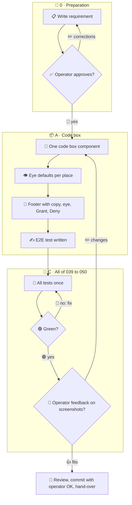

# 047 - One Code Box

## User Story

As the operator, I want every piece of code in the hub to sit in the same
box with an eye button and its actions at the bottom edge, so that Stream,
Waits on Operator, Match and Tasks feel like one tool.

## Decisions (operator-confirmed 2026-11-25; do not re-litigate)

1. **One component**: every command box and diff block in Stream, Waits on
   Operator (`#tasks/operator`), Match cards and Tasks is one code box; an
   item's command and its diff files form one box.
2. **Eye toggles in place** (operator pick 2): the eye grows the box to its
   full height and shrinks it back to its preview. Rejected: a modal viewer
   with zoom for every box; a second viewer button beside the inline toggle.
3. **Defaults per place** (operator): Stream and Waits on Operator show a
   12-line preview; Match cards show the box open and scroll inside the card
   body; Tasks show it closed, and the eye opens it in a modal above.
4. **Footer** (operator pick): copy, eye, then Grant ✓ and Deny ✗▾ sit in one
   bar at the box's bottom edge; snooze and pin stay to the right of the
   item's actions row. Match keeps Accept and Reject under the deck, its
   footer holds copy and eye. Rejected: buttons attached below the box;
   actions left where they are.
5. **Review entries**: the eye of a review entry in the Stream loads its diff
   into the box on the first click instead of opening the View diff modal.

## Approach

## Acceptance Criteria

### Box

- [ ] Every `.command` and every diff block in `#stream`,
      `#tasks/operator`, `#tasks/match` and `#tasks/list` lies inside one
      `.code-box` per item, whose last child is its `.code-foot`.
- [ ] `.code-foot` holds a copy button and a `.code-eye` button carrying
      `aria-expanded`; in Stream and Waits on Operator it also holds the
      item's Grant and Deny.

### Eye

- [ ] Stream and Waits on Operator: a box taller than 12 lines starts
      clipped (`aria-expanded="false"`); the eye shows its full height, a
      second click clips it again.
- [ ] Match: the box starts open; the card body scrolls, the page does not.
- [ ] Tasks: the box starts closed; the eye opens a sheet with the full code,
      Esc closes it.
- [ ] Stream review entry: the eye loads its diff into the box; no sheet
      opens.

### Tests

- [ ] Unit: n/a: page JS.
- [ ] Integration: `test_hub_operator_tasks` and `test_hub_grant_mode`
      follow the footer.
- [ ] E2E: the Box and Eye checks at 1920 and 390 in Chromium; screenshots.
